# ISO27001


**metamodel version:** 1.12.0

**version:** 2022/Amd 1:2024


A LinkML model of the records an organization keeps to run an information security management system (ISMS) to ISO/IEC 27001:2022 with Amendment 1:2024: its context and scope, policies, roles and objectives, risks and their treatment, its controls and Statement of Applicability, the support and operation it needs, its audits and management reviews, and its nonconformities, corrective actions and improvements. The 93 reference controls of Annex A appear by their numbers alone.


## Class Diagram

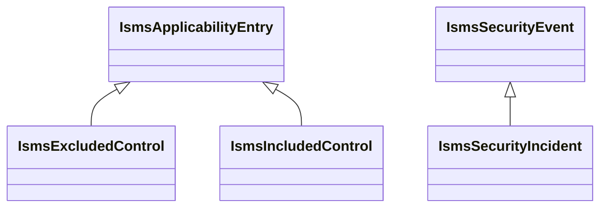

## ERD Diagram

```mermaid
erDiagram
IsmsAsset {
    string asset_category  
    string asset_classification  
    string asset_criticality  
    string asset_custodian  
    string asset_location  
    string asset_owner  
    string description  
    uriorcurie isms_id  
    string title  
}
IsmsAudit {
    stringList audit_auditees  
    string audit_conclusion  
    stringList audit_criteria  
    string audit_lead  
    stringList audit_objectives  
    date audit_period_end  
    date audit_period_start  
    date audit_report_date  
    stringList audit_report_distribution  
    string audit_scope  
    IsmsManagementSystemStandardList audit_standards  
    stringList audit_team  
    IsmsAuditType audit_type  
    string description  
    date document_approval_date  
    string document_approver  
    string document_author  
    string document_change_control  
    string document_classification  
    stringList document_distribution  
    date document_effective_date  
    boolean document_external_origin  
    string document_external_source  
    date document_last_review_date  
    date document_next_review_date  
    string document_owner  
    string document_reference  
    isms_duration document_retention  
    string document_status  
    string document_storage  
    string document_version  
    uriorcurie isms_id  
    string title  
}
IsmsAuditFinding {
    string finding_auditee_response  
    date finding_closure_date  
    string finding_closure_status  
    string finding_evidence  
    string finding_recommendation  
    isms_requirement_reference finding_requirement  
    string finding_risk  
    string finding_root_cause  
    IsmsAuditFindingType finding_type  
    string description  
    uriorcurie isms_id  
    string title  
}
IsmsAuditProgramme {
    string programme_auditor_qualifications  
    string programme_frequency_rationale  
    string programme_period  
    string programme_resources  
    string programme_status  
    string description  
    date document_approval_date  
    string document_approver  
    string document_author  
    string document_change_control  
    string document_classification  
    stringList document_distribution  
    date document_effective_date  
    boolean document_external_origin  
    string document_external_source  
    date document_last_review_date  
    date document_next_review_date  
    string document_owner  
    string document_reference  
    isms_duration document_retention  
    string document_status  
    string document_storage  
    string document_version  
    uriorcurie isms_id  
    string title  
}
IsmsAwarenessProgramme {
    string awareness_audience  
    string awareness_completion_tracking  
    string awareness_effectiveness  
    string awareness_frequency  
    stringList awareness_methods  
    stringList awareness_topics  
    string description  
    date document_approval_date  
    string document_approver  
    string document_author  
    string document_change_control  
    string document_classification  
    stringList document_distribution  
    date document_effective_date  
    boolean document_external_origin  
    string document_external_source  
    date document_last_review_date  
    date document_next_review_date  
    string document_owner  
    string document_reference  
    isms_duration document_retention  
    string document_status  
    string document_storage  
    string document_version  
    uriorcurie isms_id  
    string title  
}
IsmsCommunication {
    string communication_audience  
    string communication_frequency  
    string communication_method  
    string communication_purpose  
    boolean communication_records_required  
    string communication_subject  
}
IsmsCommunicationPlan {
    string description  
    date document_approval_date  
    string document_approver  
    string document_author  
    string document_change_control  
    string document_classification  
    stringList document_distribution  
    date document_effective_date  
    boolean document_external_origin  
    string document_external_source  
    date document_last_review_date  
    date document_next_review_date  
    string document_owner  
    string document_reference  
    isms_duration document_retention  
    string document_status  
    string document_storage  
    string document_version  
    uriorcurie isms_id  
    string title  
}
IsmsCompetenceRecord {
    stringList competence_actions  
    date competence_assessment_date  
    stringList competence_education  
    stringList competence_experience  
    stringList competence_gaps  
    string competence_person  
    stringList competence_required  
    stringList competence_training  
    string description  
    date document_approval_date  
    string document_approver  
    string document_author  
    string document_change_control  
    string document_classification  
    stringList document_distribution  
    date document_effective_date  
    boolean document_external_origin  
    string document_external_source  
    date document_last_review_date  
    date document_next_review_date  
    string document_owner  
    string document_reference  
    isms_duration document_retention  
    string document_status  
    string document_storage  
    string document_version  
    uriorcurie isms_id  
    string title  
}
IsmsControl {
    IsmsAnnexAControlList control_annex_a_controls  
    stringList control_asset_types  
    string control_effectiveness  
    stringList control_evidence  
    string control_guidance  
    date control_implementation_date  
    date control_last_tested  
    string control_owner  
    string control_text  
    IsmsControlTheme control_theme  
    stringList control_threats  
    IsmsImplementationStatus implementation_state  
    string description  
    uriorcurie isms_id  
    string title  
}
IsmsCorrectiveAction {
    date action_completion_date  
    boolean action_effective  
    string action_effectiveness_criteria  
    date action_effectiveness_review_date  
    string action_isms_changes  
    string action_resources  
    string action_root_cause  
    string action_status  
    date action_target_date  
    string description  
    uriorcurie isms_id  
    string title  
}
IsmsDocumentedInformation {
    IsmsDocumentKind document_kind  
    string description  
    date document_approval_date  
    string document_approver  
    string document_author  
    string document_change_control  
    string document_classification  
    stringList document_distribution  
    date document_effective_date  
    boolean document_external_origin  
    string document_external_source  
    date document_last_review_date  
    date document_next_review_date  
    string document_owner  
    string document_reference  
    isms_duration document_retention  
    string document_status  
    string document_storage  
    string document_version  
    uriorcurie isms_id  
    string title  
}
IsmsImprovementOpportunity {
    string improvement_benefit  
    date improvement_completion_date  
    string improvement_identified_by  
    date improvement_identified_on  
    string improvement_outcome  
    string improvement_plan  
    string improvement_priority  
    string improvement_source  
    string improvement_status  
    date improvement_target_date  
    string description  
    uriorcurie isms_id  
    string title  
}
IsmsIncludedControl {
    IsmsImplementationStatus implementation_state  
    string included_evidence  
    date included_target_date  
    IsmsAnnexAControl entry_annex_a_control  
    string entry_justification  
    string entry_type  
}
IsmsInterestedParty {
    stringList party_addressed_requirements  
    string party_category  
    stringList party_climate_change_requirements  
    string party_communication_needs  
    string party_contact  
    string party_relationship  
    stringList party_requirements  
    string description  
    uriorcurie isms_id  
    string title  
}
IsmsManagementReview {
    stringList review_actions  
    stringList review_attendees  
    string review_audit_results  
    string review_context_changes  
    stringList review_decisions  
    date review_held_on  
    stringList review_improvement_opportunities  
    string review_interested_party_changes  
    string review_interested_party_feedback  
    date review_next_date  
    string review_performance_trends  
    string review_previous_actions  
    string review_risk_assessment_results  
    string review_risk_treatment_status  
    string review_risks_and_opportunities  
    string description  
    date document_approval_date  
    string document_approver  
    string document_author  
    string document_change_control  
    string document_classification  
    stringList document_distribution  
    date document_effective_date  
    boolean document_external_origin  
    string document_external_source  
    date document_last_review_date  
    date document_next_review_date  
    string document_owner  
    string document_reference  
    isms_duration document_retention  
    string document_status  
    string document_storage  
    string document_version  
    uriorcurie isms_id  
    string title  
}
IsmsManagementSystem {
    string isms_certification_body  
    date isms_certification_date  
    string isms_certification_status  
    stringList isms_external_issues  
    stringList isms_external_services  
    string isms_governing_body  
    stringList isms_interfaces  
    stringList isms_internal_issues  
    stringList isms_leadership_evidence  
    stringList isms_planned_changes  
    string isms_processes  
    date isms_recertification_date  
    stringList isms_risk_and_opportunity_actions  
    string isms_scope  
    stringList isms_scope_boundaries  
    stringList isms_scope_exclusions  
    string isms_top_management  
    string description  
    uriorcurie isms_id  
    string title  
}
IsmsMonitoringItem {
    string monitoring_alert_threshold  
    string monitoring_analysis_frequency  
    string monitoring_analyst  
    string monitoring_current_value  
    string monitoring_description  
    string monitoring_frequency  
    string monitoring_method  
    string monitoring_metric  
    string monitoring_target  
    string monitoring_trend  
}
IsmsMonitoringProgramme {
    string description  
    date document_approval_date  
    string document_approver  
    string document_author  
    string document_change_control  
    string document_classification  
    stringList document_distribution  
    date document_effective_date  
    boolean document_external_origin  
    string document_external_source  
    date document_last_review_date  
    date document_next_review_date  
    string document_owner  
    string document_reference  
    isms_duration document_retention  
    string document_status  
    string document_storage  
    string document_version  
    uriorcurie isms_id  
    string title  
}
IsmsNonconformity {
    date nonconformity_closure_date  
    string nonconformity_closure_evidence  
    string nonconformity_consequences  
    string nonconformity_detected_by  
    date nonconformity_detected_on  
    stringList nonconformity_immediate_actions  
    string nonconformity_requirement  
    string nonconformity_root_cause  
    string nonconformity_similar_check  
    string nonconformity_source  
    string nonconformity_status  
    string description  
    uriorcurie isms_id  
    string title  
}
IsmsObjective {
    string objective_achievement  
    string objective_action_plan  
    string objective_current_value  
    string objective_measurement_frequency  
    string objective_measurement_method  
    string objective_metric  
    string objective_resources  
    string objective_statement  
    string objective_target  
    date objective_target_date  
    string description  
    uriorcurie isms_id  
    string title  
}
IsmsOperationalProcedure {
    string procedure_change_control  
    stringList procedure_control_measures  
    string procedure_criteria  
    string procedure_scope  
    string description  
    date document_approval_date  
    string document_approver  
    string document_author  
    string document_change_control  
    string document_classification  
    stringList document_distribution  
    date document_effective_date  
    boolean document_external_origin  
    string document_external_source  
    date document_last_review_date  
    date document_next_review_date  
    string document_owner  
    string document_reference  
    isms_duration document_retention  
    string document_status  
    string document_storage  
    string document_version  
    uriorcurie isms_id  
    string title  
}
IsmsOrganization {
    boolean organization_climate_change_relevant  
    integer organization_employee_count  
    stringList organization_jurisdictions  
    string organization_kind  
    string organization_legal_name  
    stringList organization_locations  
    string organization_parent  
    string organization_sector  
    string organization_size  
    stringList organization_subsidiaries  
    stringList organization_trading_names  
    string description  
    uriorcurie isms_id  
    string title  
}
IsmsPolicy {
    boolean policy_acknowledgement_required  
    string policy_applicability  
    stringList policy_commitments  
    date policy_communication_date  
    IsmsManagementSystemStandardList policy_management_systems  
    string policy_objectives_framework  
    string policy_statement  
    string description  
    date document_approval_date  
    string document_approver  
    string document_author  
    string document_change_control  
    string document_classification  
    stringList document_distribution  
    date document_effective_date  
    boolean document_external_origin  
    string document_external_source  
    date document_last_review_date  
    date document_next_review_date  
    string document_owner  
    string document_reference  
    isms_duration document_retention  
    string document_status  
    string document_storage  
    string document_version  
    uriorcurie isms_id  
    string title  
}
IsmsResource {
    string resource_allocated_to  
    date resource_allocation_date  
    string resource_availability  
    string resource_category  
    string resource_cost  
    string resource_quantity  
    string description  
    uriorcurie isms_id  
    string title  
}
IsmsRisk {
    IsmsSecurityPropertyList affected_security_properties  
    IsmsImpact risk_impact  
    IsmsRiskLevel risk_inherent_level  
    IsmsLikelihood risk_likelihood  
    string risk_owner  
    IsmsRiskLevel risk_residual_level  
    string risk_source  
    string risk_threat  
    IsmsRiskTreatmentOption risk_treatment_option  
    string risk_treatment_priority  
    string risk_vulnerability  
    string description  
    uriorcurie isms_id  
    string title  
}
IsmsRiskAssessment {
    string assessment_assessor  
    date assessment_date  
    string assessment_method_used  
    date assessment_next_date  
    stringList assessment_recommendations  
    string assessment_scope  
    string assessment_summary  
    string description  
    date document_approval_date  
    string document_approver  
    string document_author  
    string document_change_control  
    string document_classification  
    stringList document_distribution  
    date document_effective_date  
    boolean document_external_origin  
    string document_external_source  
    date document_last_review_date  
    date document_next_review_date  
    string document_owner  
    string document_reference  
    isms_duration document_retention  
    string document_status  
    string document_storage  
    string document_version  
    uriorcurie isms_id  
    string title  
}
IsmsRiskAssessmentProcess {
    string risk_acceptance_criteria  
    string risk_assessment_criteria  
    string risk_assessment_frequency  
    string risk_assessment_method  
    stringList risk_assessment_triggers  
    string risk_impact_scale  
    string risk_likelihood_scale  
    string risk_matrix  
    string description  
    date document_approval_date  
    string document_approver  
    string document_author  
    string document_change_control  
    string document_classification  
    stringList document_distribution  
    date document_effective_date  
    boolean document_external_origin  
    string document_external_source  
    date document_last_review_date  
    date document_next_review_date  
    string document_owner  
    string document_reference  
    isms_duration document_retention  
    string document_status  
    string document_storage  
    string document_version  
    uriorcurie isms_id  
    string title  
}
IsmsRiskTreatmentPlan {
    IsmsImplementationStatus implementation_state  
    stringList plan_actions  
    date plan_completion_date  
    string plan_residual_risk_acceptance  
    string plan_resources  
    stringList plan_responsible_parties  
    string plan_risk_owner_approval  
    string plan_scope  
    string plan_timeline  
    string description  
    date document_approval_date  
    string document_approver  
    string document_author  
    string document_change_control  
    string document_classification  
    stringList document_distribution  
    date document_effective_date  
    boolean document_external_origin  
    string document_external_source  
    date document_last_review_date  
    date document_next_review_date  
    string document_owner  
    string document_reference  
    isms_duration document_retention  
    string document_status  
    string document_storage  
    string document_version  
    uriorcurie isms_id  
    string title  
}
IsmsRiskTreatmentProcess {
    string treatment_annex_a_comparison  
    string treatment_approval_workflow  
    string treatment_control_selection  
    string treatment_options_guidance  
    string treatment_soa_template  
    string description  
    date document_approval_date  
    string document_approver  
    string document_author  
    string document_change_control  
    string document_classification  
    stringList document_distribution  
    date document_effective_date  
    boolean document_external_origin  
    string document_external_source  
    date document_last_review_date  
    date document_next_review_date  
    string document_owner  
    string document_reference  
    isms_duration document_retention  
    string document_status  
    string document_storage  
    string document_version  
    uriorcurie isms_id  
    string title  
}
IsmsRole {
    string role_accountability  
    stringList role_authorities  
    string role_category  
    string role_delegation  
    stringList role_holders  
    stringList role_responsibilities  
    string description  
    uriorcurie isms_id  
    string title  
}
IsmsSecurityEvent {
    string event_assessment  
    datetime event_occurred_at  
    string event_reporter  
    string event_type  
    string description  
    uriorcurie isms_id  
    string title  
}
IsmsSecurityIncident {
    IsmsSecurityPropertyList affected_security_properties  
    IsmsIncidentCategory incident_category  
    datetime incident_closed_at  
    stringList incident_containment_actions  
    string incident_detection_method  
    stringList incident_eradication_actions  
    stringList incident_evidence  
    stringList incident_lessons_learned  
    boolean incident_notification_required  
    stringList incident_notifications  
    stringList incident_recovery_actions  
    stringList incident_response_actions  
    string incident_review  
    string incident_root_cause  
    IsmsRiskLevel incident_severity  
    string description  
    string event_assessment  
    datetime event_occurred_at  
    string event_reporter  
    string event_type  
    uriorcurie isms_id  
    string title  
}
IsmsStatementOfApplicability {
    string description  
    date document_approval_date  
    string document_approver  
    string document_author  
    string document_change_control  
    string document_classification  
    stringList document_distribution  
    date document_effective_date  
    boolean document_external_origin  
    string document_external_source  
    date document_last_review_date  
    date document_next_review_date  
    string document_owner  
    string document_reference  
    isms_duration document_retention  
    string document_status  
    string document_storage  
    string document_version  
    uriorcurie isms_id  
    string title  
}
IsmsTopicSpecificPolicy {
    string topic_policy_audience  
    string topic_policy_topic  
    string description  
    date document_approval_date  
    string document_approver  
    string document_author  
    string document_change_control  
    string document_classification  
    stringList document_distribution  
    date document_effective_date  
    boolean document_external_origin  
    string document_external_source  
    date document_last_review_date  
    date document_next_review_date  
    string document_owner  
    string document_reference  
    isms_duration document_retention  
    string document_status  
    string document_storage  
    string document_version  
    uriorcurie isms_id  
    string title  
}

IsmsAsset ||--}o IsmsControl : "relevant_controls"
IsmsAudit ||--|o IsmsDocumentedInformation : "audit_plan"
IsmsAudit ||--}o IsmsAuditFinding : "audit_findings"
IsmsAuditFinding ||--|o IsmsControl : "finding_control"
IsmsAuditFinding ||--|o IsmsCorrectiveAction : "finding_corrective_action"
IsmsAuditProgramme ||--}o IsmsAudit : "programme_audits"
IsmsCommunication ||--|o IsmsRole : "responsible_role"
IsmsCommunicationPlan ||--}o IsmsCommunication : "communication_items"
IsmsCompetenceRecord ||--|o IsmsRole : "competence_role"
IsmsControl ||--}o IsmsControl : "relevant_controls"
IsmsCorrectiveAction ||--|o IsmsRole : "responsible_role"
IsmsCorrectiveAction ||--}o IsmsNonconformity : "action_nonconformities"
IsmsImprovementOpportunity ||--|o IsmsRole : "responsible_role"
IsmsIncludedControl ||--|o IsmsControl : "included_control"
IsmsIncludedControl ||--|o IsmsRole : "responsible_role"
IsmsManagementSystem ||--|o IsmsAwarenessProgramme : "isms_awareness_programme"
IsmsManagementSystem ||--|o IsmsCommunicationPlan : "isms_communication_plan"
IsmsManagementSystem ||--|o IsmsMonitoringProgramme : "isms_monitoring_programme"
IsmsManagementSystem ||--|o IsmsOrganization : "isms_organization"
IsmsManagementSystem ||--|o IsmsPolicy : "isms_policy"
IsmsManagementSystem ||--|o IsmsRiskAssessmentProcess : "isms_risk_assessment_process"
IsmsManagementSystem ||--|o IsmsRiskTreatmentProcess : "isms_risk_treatment_process"
IsmsManagementSystem ||--|o IsmsStatementOfApplicability : "isms_statement_of_applicability"
IsmsManagementSystem ||--}o IsmsAsset : "isms_assets"
IsmsManagementSystem ||--}o IsmsAudit : "isms_audits"
IsmsManagementSystem ||--}o IsmsAuditProgramme : "isms_audit_programmes"
IsmsManagementSystem ||--}o IsmsCompetenceRecord : "isms_competence_records"
IsmsManagementSystem ||--}o IsmsControl : "isms_controls"
IsmsManagementSystem ||--}o IsmsCorrectiveAction : "isms_corrective_actions"
IsmsManagementSystem ||--}o IsmsDocumentedInformation : "isms_documented_information"
IsmsManagementSystem ||--}o IsmsImprovementOpportunity : "isms_improvements"
IsmsManagementSystem ||--}o IsmsInterestedParty : "isms_interested_parties"
IsmsManagementSystem ||--}o IsmsManagementReview : "isms_management_reviews"
IsmsManagementSystem ||--}o IsmsNonconformity : "isms_nonconformities"
IsmsManagementSystem ||--}o IsmsObjective : "isms_objectives"
IsmsManagementSystem ||--}o IsmsOperationalProcedure : "isms_operational_procedures"
IsmsManagementSystem ||--}o IsmsResource : "isms_resources"
IsmsManagementSystem ||--}o IsmsRisk : "isms_risks"
IsmsManagementSystem ||--}o IsmsRiskAssessment : "isms_risk_assessments"
IsmsManagementSystem ||--}o IsmsRiskTreatmentPlan : "isms_risk_treatment_plans"
IsmsManagementSystem ||--}o IsmsRole : "isms_roles"
IsmsManagementSystem ||--}o IsmsSecurityEvent : "isms_security_events"
IsmsManagementSystem ||--}o IsmsTopicSpecificPolicy : "isms_topic_specific_policies"
IsmsMonitoringItem ||--|o IsmsRole : "responsible_role"
IsmsMonitoringProgramme ||--}o IsmsMonitoringItem : "monitoring_items"
IsmsObjective ||--|o IsmsRole : "responsible_role"
IsmsObjective ||--}o IsmsControl : "relevant_controls"
IsmsObjective ||--}o IsmsRisk : "objective_risks"
IsmsOperationalProcedure ||--}o IsmsControl : "relevant_controls"
IsmsOperationalProcedure ||--}o IsmsRole : "procedure_roles"
IsmsRisk ||--}o IsmsAsset : "affected_assets"
IsmsRisk ||--}o IsmsControl : "risk_existing_controls"
IsmsRiskAssessment ||--}o IsmsRisk : "assessment_risks"
IsmsRiskTreatmentPlan ||--}o IsmsControl : "plan_controls"
IsmsRiskTreatmentPlan ||--}o IsmsRisk : "plan_risks"
IsmsRole ||--|o IsmsRole : "role_reports_to"
IsmsSecurityEvent ||--}o IsmsAsset : "affected_assets"
IsmsSecurityIncident ||--}o IsmsAsset : "affected_assets"
IsmsStatementOfApplicability ||--}o IsmsApplicabilityEntry : "soa_entries"
IsmsTopicSpecificPolicy ||--|o IsmsPolicy : "topic_policy_parent"
IsmsTopicSpecificPolicy ||--}o IsmsControl : "relevant_controls"

```

## Base Classes


Foundational classes in the hierarchy (root classes and direct children of Thing):

| Class | Description |
| --- | --- |
| [IsmsApplicabilityEntry](#IsmsApplicabilityEntry) | One entry of the Statement of Applicability, which either includes a control or excludes an Annex A control, and says why. |
| [IsmsSecurityEvent](#IsmsSecurityEvent) | An information security event someone reported, and the assessment of whether it is an incident. An event assessed as an incident is recorded as an IsmsSecurityIncident. |

## Standalone Classes


These classes are completely isolated with no relationships and are not used as base classes:

| Class | Description |
| --- | --- |
| [IsmsExcludedControl](#IsmsExcludedControl) | An entry that leaves out an Annex A control the organization does not need, and says why. |

## Abstract Classes


### IsmsApplicabilityEntry

One entry of the Statement of Applicability, which either includes a control or excludes an Annex A control, and says why.

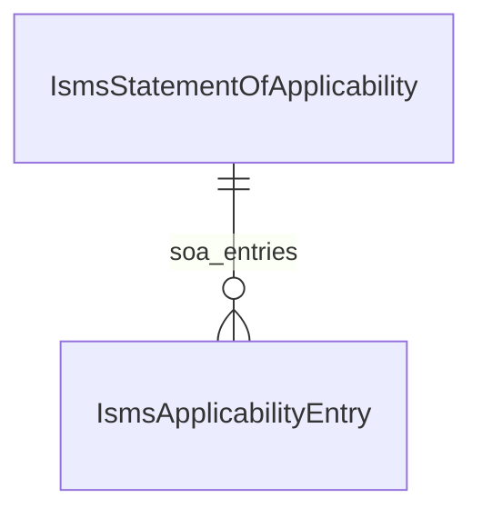

#### Attributes

| Name | Cardinality: | Type | Description |
| --- | --- | --- | --- |
| **[entry_annex_a_control](#EntryAnnexAControl)** | <sub>0..1</sub> | [IsmsAnnexAControl](#IsmsAnnexAControl) | The Annex A control a Statement of Applicability entry concerns. |
| **[entry_justification](#EntryJustification)** | <sub>1..1</sub> | string | Why the control is included or excluded. |
| **[entry_type](#EntryType)** | <sub>0..1</sub> | string | The kind of entry: IsmsIncludedControl or IsmsExcludedControl. |

#### Children

 * [IsmsExcludedControl](#IsmsExcludedControl) - An entry that leaves out an Annex A control the organization does not need, and says why.
 * [IsmsIncludedControl](#IsmsIncludedControl) - An entry that includes a control the organization needs, from Annex A or from elsewhere, and says whether it is in place.

#### Referenced by:

 *  **[IsmsStatementOfApplicability](#IsmsStatementOfApplicability)** : ismsStatementOfApplicability__soa_entries  <sub>0..\*</sub> 


## Classes


### IsmsAsset

An item in the inventory of information and other associated assets: what it is, who owns and looks after it, where it is, how it is classified and how much it matters.

```mermaid
erDiagram
IsmsAsset {

}
IsmsControl {

}
IsmsManagementSystem {

}
IsmsRisk {

}
IsmsSecurityEvent {

}

IsmsAsset ||--}o IsmsControl : "relevant_controls"
IsmsControl ||--}o IsmsControl : "relevant_controls"
IsmsManagementSystem ||--|o IsmsAwarenessProgramme : "isms_awareness_programme"
IsmsManagementSystem ||--|o IsmsCommunicationPlan : "isms_communication_plan"
IsmsManagementSystem ||--|o IsmsMonitoringProgramme : "isms_monitoring_programme"
IsmsManagementSystem ||--|o IsmsOrganization : "isms_organization"
IsmsManagementSystem ||--|o IsmsPolicy : "isms_policy"
IsmsManagementSystem ||--|o IsmsRiskAssessmentProcess : "isms_risk_assessment_process"
IsmsManagementSystem ||--|o IsmsRiskTreatmentProcess : "isms_risk_treatment_process"
IsmsManagementSystem ||--|o IsmsStatementOfApplicability : "isms_statement_of_applicability"
IsmsManagementSystem ||--}o IsmsAsset : "isms_assets"
IsmsManagementSystem ||--}o IsmsAudit : "isms_audits"
IsmsManagementSystem ||--}o IsmsAuditProgramme : "isms_audit_programmes"
IsmsManagementSystem ||--}o IsmsCompetenceRecord : "isms_competence_records"
IsmsManagementSystem ||--}o IsmsControl : "isms_controls"
IsmsManagementSystem ||--}o IsmsCorrectiveAction : "isms_corrective_actions"
IsmsManagementSystem ||--}o IsmsDocumentedInformation : "isms_documented_information"
IsmsManagementSystem ||--}o IsmsImprovementOpportunity : "isms_improvements"
IsmsManagementSystem ||--}o IsmsInterestedParty : "isms_interested_parties"
IsmsManagementSystem ||--}o IsmsManagementReview : "isms_management_reviews"
IsmsManagementSystem ||--}o IsmsNonconformity : "isms_nonconformities"
IsmsManagementSystem ||--}o IsmsObjective : "isms_objectives"
IsmsManagementSystem ||--}o IsmsOperationalProcedure : "isms_operational_procedures"
IsmsManagementSystem ||--}o IsmsResource : "isms_resources"
IsmsManagementSystem ||--}o IsmsRisk : "isms_risks"
IsmsManagementSystem ||--}o IsmsRiskAssessment : "isms_risk_assessments"
IsmsManagementSystem ||--}o IsmsRiskTreatmentPlan : "isms_risk_treatment_plans"
IsmsManagementSystem ||--}o IsmsRole : "isms_roles"
IsmsManagementSystem ||--}o IsmsSecurityEvent : "isms_security_events"
IsmsManagementSystem ||--}o IsmsTopicSpecificPolicy : "isms_topic_specific_policies"
IsmsRisk ||--}o IsmsAsset : "affected_assets"
IsmsRisk ||--}o IsmsControl : "risk_existing_controls"
IsmsSecurityEvent ||--}o IsmsAsset : "affected_assets"

```

#### Attributes

| Name | Cardinality: | Type | Description |
| --- | --- | --- | --- |
| **[description](#Description)** | <sub>0..1</sub> | string | What the record says or describes, in the organization's own words. |
| **[isms_id](#IsmsId)** | <sub>1..1</sub> | uriorcurie | The record's identifier, unique among the ISMS's records, such as a URI or a CURIE. Other records refer to the record by it. |
| **[title](#Title)** | <sub>1..1</sub> | string | The name the organization gives the record. |
| **[asset_category](#AssetCategory)** | <sub>0..1</sub> | string | What kind of asset it is, such as information, software, hardware or a service. |
| **[asset_classification](#AssetClassification)** | <sub>0..1</sub> | string | The information classification the asset carries. |
| **[asset_criticality](#AssetCriticality)** | <sub>0..1</sub> | string | How much the asset matters, in the organization's own terms. |
| **[asset_custodian](#AssetCustodian)** | <sub>0..1</sub> | string | Who looks after the asset from day to day. |
| **[asset_location](#AssetLocation)** | <sub>0..1</sub> | string | Where the asset is, physically or logically. |
| **[asset_owner](#AssetOwner)** | <sub>0..1</sub> | string | Who owns the asset. |
| **[relevant_controls](#RelevantControls)** | <sub>0..\*</sub> | [IsmsControl](#IsmsControl) | The organization's controls that the record concerns. |

#### Uses

 *  mixin: [IsmsRecordMixin](#IsmsRecordMixin) - What every record of the ISMS has, so that other records can refer to it: an identifier, a title and a description.

#### Referenced by:

 *  **[IsmsRisk](#IsmsRisk)** : affected_assets  <sub>0..\*</sub> 
 *  **[IsmsSecurityEvent](#IsmsSecurityEvent)** : affected_assets  <sub>0..\*</sub> 
 *  **[IsmsManagementSystem](#IsmsManagementSystem)** : ismsManagementSystem__isms_assets  <sub>0..\*</sub> 


### IsmsAudit

An audit of the ISMS: an internal audit, or an audit by a customer or a certification body, with its scope, criteria, team, findings and conclusion.

An audit of several management systems at once lists each standard in audit_standards.

```mermaid
erDiagram
IsmsAudit {

}
IsmsAuditFinding {

}
IsmsAuditProgramme {

}
IsmsDocumentedInformation {

}
IsmsManagementSystem {

}

IsmsAudit ||--|o IsmsDocumentedInformation : "audit_plan"
IsmsAudit ||--}o IsmsAuditFinding : "audit_findings"
IsmsAuditFinding ||--|o IsmsControl : "finding_control"
IsmsAuditFinding ||--|o IsmsCorrectiveAction : "finding_corrective_action"
IsmsAuditProgramme ||--}o IsmsAudit : "programme_audits"
IsmsManagementSystem ||--|o IsmsAwarenessProgramme : "isms_awareness_programme"
IsmsManagementSystem ||--|o IsmsCommunicationPlan : "isms_communication_plan"
IsmsManagementSystem ||--|o IsmsMonitoringProgramme : "isms_monitoring_programme"
IsmsManagementSystem ||--|o IsmsOrganization : "isms_organization"
IsmsManagementSystem ||--|o IsmsPolicy : "isms_policy"
IsmsManagementSystem ||--|o IsmsRiskAssessmentProcess : "isms_risk_assessment_process"
IsmsManagementSystem ||--|o IsmsRiskTreatmentProcess : "isms_risk_treatment_process"
IsmsManagementSystem ||--|o IsmsStatementOfApplicability : "isms_statement_of_applicability"
IsmsManagementSystem ||--}o IsmsAsset : "isms_assets"
IsmsManagementSystem ||--}o IsmsAudit : "isms_audits"
IsmsManagementSystem ||--}o IsmsAuditProgramme : "isms_audit_programmes"
IsmsManagementSystem ||--}o IsmsCompetenceRecord : "isms_competence_records"
IsmsManagementSystem ||--}o IsmsControl : "isms_controls"
IsmsManagementSystem ||--}o IsmsCorrectiveAction : "isms_corrective_actions"
IsmsManagementSystem ||--}o IsmsDocumentedInformation : "isms_documented_information"
IsmsManagementSystem ||--}o IsmsImprovementOpportunity : "isms_improvements"
IsmsManagementSystem ||--}o IsmsInterestedParty : "isms_interested_parties"
IsmsManagementSystem ||--}o IsmsManagementReview : "isms_management_reviews"
IsmsManagementSystem ||--}o IsmsNonconformity : "isms_nonconformities"
IsmsManagementSystem ||--}o IsmsObjective : "isms_objectives"
IsmsManagementSystem ||--}o IsmsOperationalProcedure : "isms_operational_procedures"
IsmsManagementSystem ||--}o IsmsResource : "isms_resources"
IsmsManagementSystem ||--}o IsmsRisk : "isms_risks"
IsmsManagementSystem ||--}o IsmsRiskAssessment : "isms_risk_assessments"
IsmsManagementSystem ||--}o IsmsRiskTreatmentPlan : "isms_risk_treatment_plans"
IsmsManagementSystem ||--}o IsmsRole : "isms_roles"
IsmsManagementSystem ||--}o IsmsSecurityEvent : "isms_security_events"
IsmsManagementSystem ||--}o IsmsTopicSpecificPolicy : "isms_topic_specific_policies"

```

#### Attributes

| Name | Cardinality: | Type | Description |
| --- | --- | --- | --- |
| **[description](#Description)** | <sub>0..1</sub> | string | What the record says or describes, in the organization's own words. |
| **[document_approval_date](#DocumentApprovalDate)** | <sub>0..1</sub> | date | When the document was approved. |
| **[document_approver](#DocumentApprover)** | <sub>0..1</sub> | string | Who approved the document. |
| **[document_author](#DocumentAuthor)** | <sub>0..1</sub> | string | Who wrote the document. |
| **[document_change_control](#DocumentChangeControl)** | <sub>0..1</sub> | string | How changes to the document are controlled, such as version control. |
| **[document_classification](#DocumentClassification)** | <sub>0..1</sub> | string | The information classification the document carries. |
| **[document_distribution](#DocumentDistribution)** | <sub>0..\*</sub> | string | How the document is distributed, accessed, retrieved and used. |
| **[document_effective_date](#DocumentEffectiveDate)** | <sub>0..1</sub> | date | When the document takes effect. |
| **[document_external_origin](#DocumentExternalOrigin)** | <sub>0..1</sub> | boolean | Whether the document comes from outside the organization and is kept because the ISMS needs it. |
| **[document_external_source](#DocumentExternalSource)** | <sub>0..1</sub> | string | Who the document came from, when it comes from outside. |
| **[document_last_review_date](#DocumentLastReviewDate)** | <sub>0..1</sub> | date | When the document was last reviewed. |
| **[document_next_review_date](#DocumentNextReviewDate)** | <sub>0..1</sub> | date | When the document is next due for review. |
| **[document_owner](#DocumentOwner)** | <sub>0..1</sub> | string | Who answers for the document's content and upkeep. |
| **[document_reference](#DocumentReference)** | <sub>0..1</sub> | string | The reference the organization's document control gives it. |
| **[document_retention](#DocumentRetention)** | <sub>0..1</sub> | isms_duration | How long the document is kept, as an ISO 8601 duration. |
| **[document_status](#DocumentStatus)** | <sub>0..1</sub> | string | Where the document stands in its life, in the organization's own terms, such as draft, approved or withdrawn. |
| **[document_storage](#DocumentStorage)** | <sub>0..1</sub> | string | How the document is stored and preserved, so that it stays legible. |
| **[document_version](#DocumentVersion)** | <sub>0..1</sub> | string | The version of the document. |
| **[isms_id](#IsmsId)** | <sub>1..1</sub> | uriorcurie | The record's identifier, unique among the ISMS's records, such as a URI or a CURIE. Other records refer to the record by it. |
| **[title](#Title)** | <sub>1..1</sub> | string | The name the organization gives the record. |
| **[audit_auditees](#AuditAuditees)** | <sub>0..\*</sub> | string | Who represented the parts of the organization audited. |
| **[audit_conclusion](#AuditConclusion)** | <sub>0..1</sub> | string | The audit's overall conclusion. |
| **[audit_criteria](#AuditCriteria)** | <sub>0..\*</sub> | string | What the audit compares the ISMS against. |
| **[audit_findings](#AuditFindings)** | <sub>0..\*</sub> | [IsmsAuditFinding](#IsmsAuditFinding) | What the audit found, good and bad. |
| **[audit_lead](#AuditLead)** | <sub>0..1</sub> | string | Who led the audit. |
| **[audit_objectives](#AuditObjectives)** | <sub>0..\*</sub> | string | What the audit sets out to establish. |
| **[audit_period_end](#AuditPeriodEnd)** | <sub>0..1</sub> | date | When the audit ended. |
| **[audit_period_start](#AuditPeriodStart)** | <sub>0..1</sub> | date | When the audit began. |
| **[audit_plan](#AuditPlan)** | <sub>0..1</sub> | [IsmsDocumentedInformation](#IsmsDocumentedInformation) | The documented information that holds the audit plan. |
| **[audit_report_date](#AuditReportDate)** | <sub>0..1</sub> | date | When the audit report was issued. |
| **[audit_report_distribution](#AuditReportDistribution)** | <sub>0..\*</sub> | string | Who received the audit report. |
| **[audit_scope](#AuditScope)** | <sub>0..1</sub> | string | What the audit covers. |
| **[audit_standards](#AuditStandards)** | <sub>0..\*</sub> | [IsmsManagementSystemStandard](#IsmsManagementSystemStandard) | The management system standards the audit covers. |
| **[audit_team](#AuditTeam)** | <sub>0..\*</sub> | string | Who else audited. |
| **[audit_type](#AuditType)** | <sub>1..1</sub> | [IsmsAuditType](#IsmsAuditType) | Who carries out the audit, relative to the organization. |

#### Uses

 *  mixin: [IsmsDocumentControlMixin](#IsmsDocumentControlMixin) - The control that documented information is kept under: who wrote, owns and approved it, when it takes effect and is reviewed, how it is classified, distributed, stored and changed, how long it is retained, and whether it came from outside the organization.
 *  mixin: [IsmsRecordMixin](#IsmsRecordMixin) - What every record of the ISMS has, so that other records can refer to it: an identifier, a title and a description.

#### Referenced by:

 *  **[IsmsAuditProgramme](#IsmsAuditProgramme)** : ismsAuditProgramme__programme_audits  <sub>0..\*</sub> 
 *  **[IsmsManagementSystem](#IsmsManagementSystem)** : ismsManagementSystem__isms_audits  <sub>0..\*</sub> 


### IsmsAuditFinding

One finding of an audit: a nonconformity, an observation or a strength, with the requirement or control it concerns, its evidence and how it is closed.

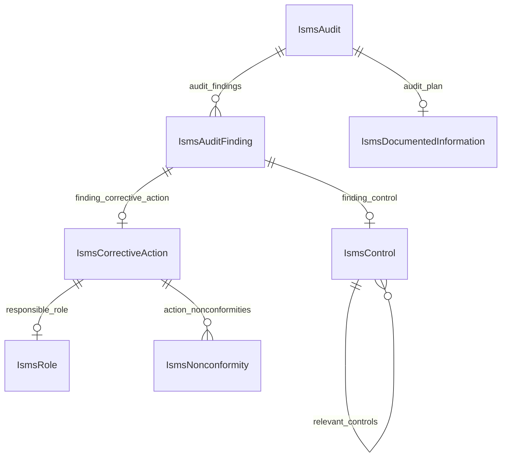

#### Attributes

| Name | Cardinality: | Type | Description |
| --- | --- | --- | --- |
| **[description](#Description)** | <sub>0..1</sub> | string | What the record says or describes, in the organization's own words. |
| **[isms_id](#IsmsId)** | <sub>1..1</sub> | uriorcurie | The record's identifier, unique among the ISMS's records, such as a URI or a CURIE. Other records refer to the record by it. |
| **[title](#Title)** | <sub>1..1</sub> | string | The name the organization gives the record. |
| **[finding_auditee_response](#FindingAuditeeResponse)** | <sub>0..1</sub> | string | How the auditee responded. |
| **[finding_closure_date](#FindingClosureDate)** | <sub>0..1</sub> | date | When the finding was closed. |
| **[finding_closure_status](#FindingClosureStatus)** | <sub>0..1</sub> | string | Whether the finding is closed, in the organization's own terms. |
| **[finding_control](#FindingControl)** | <sub>0..1</sub> | [IsmsControl](#IsmsControl) | The organization's control the finding concerns. |
| **[finding_corrective_action](#FindingCorrectiveAction)** | <sub>0..1</sub> | [IsmsCorrectiveAction](#IsmsCorrectiveAction) | The corrective action the finding led to. |
| **[finding_evidence](#FindingEvidence)** | <sub>0..1</sub> | string | The objective evidence for the finding. |
| **[finding_recommendation](#FindingRecommendation)** | <sub>0..1</sub> | string | What the auditor recommends. |
| **[finding_requirement](#FindingRequirement)** | <sub>0..1</sub> | isms_requirement_reference | The clause or Annex A control of ISO/IEC 27001:2022 the finding concerns, by number. |
| **[finding_risk](#FindingRisk)** | <sub>0..1</sub> | string | What the finding means for risk. |
| **[finding_root_cause](#FindingRootCause)** | <sub>0..1</sub> | string | What the analysis of the finding's cause found. |
| **[finding_type](#FindingType)** | <sub>1..1</sub> | [IsmsAuditFindingType](#IsmsAuditFindingType) | What kind of finding it is. |

#### Uses

 *  mixin: [IsmsRecordMixin](#IsmsRecordMixin) - What every record of the ISMS has, so that other records can refer to it: an identifier, a title and a description.

#### Referenced by:

 *  **[IsmsAudit](#IsmsAudit)** : ismsAudit__audit_findings  <sub>0..\*</sub> 


### IsmsAuditProgramme

An internal audit programme: the audits planned over a period, how often and why, and the resources and auditors they need.

```mermaid
erDiagram
IsmsAudit {

}
IsmsAuditProgramme {

}
IsmsManagementSystem {

}

IsmsAudit ||--|o IsmsDocumentedInformation : "audit_plan"
IsmsAudit ||--}o IsmsAuditFinding : "audit_findings"
IsmsAuditProgramme ||--}o IsmsAudit : "programme_audits"
IsmsManagementSystem ||--|o IsmsAwarenessProgramme : "isms_awareness_programme"
IsmsManagementSystem ||--|o IsmsCommunicationPlan : "isms_communication_plan"
IsmsManagementSystem ||--|o IsmsMonitoringProgramme : "isms_monitoring_programme"
IsmsManagementSystem ||--|o IsmsOrganization : "isms_organization"
IsmsManagementSystem ||--|o IsmsPolicy : "isms_policy"
IsmsManagementSystem ||--|o IsmsRiskAssessmentProcess : "isms_risk_assessment_process"
IsmsManagementSystem ||--|o IsmsRiskTreatmentProcess : "isms_risk_treatment_process"
IsmsManagementSystem ||--|o IsmsStatementOfApplicability : "isms_statement_of_applicability"
IsmsManagementSystem ||--}o IsmsAsset : "isms_assets"
IsmsManagementSystem ||--}o IsmsAudit : "isms_audits"
IsmsManagementSystem ||--}o IsmsAuditProgramme : "isms_audit_programmes"
IsmsManagementSystem ||--}o IsmsCompetenceRecord : "isms_competence_records"
IsmsManagementSystem ||--}o IsmsControl : "isms_controls"
IsmsManagementSystem ||--}o IsmsCorrectiveAction : "isms_corrective_actions"
IsmsManagementSystem ||--}o IsmsDocumentedInformation : "isms_documented_information"
IsmsManagementSystem ||--}o IsmsImprovementOpportunity : "isms_improvements"
IsmsManagementSystem ||--}o IsmsInterestedParty : "isms_interested_parties"
IsmsManagementSystem ||--}o IsmsManagementReview : "isms_management_reviews"
IsmsManagementSystem ||--}o IsmsNonconformity : "isms_nonconformities"
IsmsManagementSystem ||--}o IsmsObjective : "isms_objectives"
IsmsManagementSystem ||--}o IsmsOperationalProcedure : "isms_operational_procedures"
IsmsManagementSystem ||--}o IsmsResource : "isms_resources"
IsmsManagementSystem ||--}o IsmsRisk : "isms_risks"
IsmsManagementSystem ||--}o IsmsRiskAssessment : "isms_risk_assessments"
IsmsManagementSystem ||--}o IsmsRiskTreatmentPlan : "isms_risk_treatment_plans"
IsmsManagementSystem ||--}o IsmsRole : "isms_roles"
IsmsManagementSystem ||--}o IsmsSecurityEvent : "isms_security_events"
IsmsManagementSystem ||--}o IsmsTopicSpecificPolicy : "isms_topic_specific_policies"

```

#### Attributes

| Name | Cardinality: | Type | Description |
| --- | --- | --- | --- |
| **[description](#Description)** | <sub>0..1</sub> | string | What the record says or describes, in the organization's own words. |
| **[document_approval_date](#DocumentApprovalDate)** | <sub>0..1</sub> | date | When the document was approved. |
| **[document_approver](#DocumentApprover)** | <sub>0..1</sub> | string | Who approved the document. |
| **[document_author](#DocumentAuthor)** | <sub>0..1</sub> | string | Who wrote the document. |
| **[document_change_control](#DocumentChangeControl)** | <sub>0..1</sub> | string | How changes to the document are controlled, such as version control. |
| **[document_classification](#DocumentClassification)** | <sub>0..1</sub> | string | The information classification the document carries. |
| **[document_distribution](#DocumentDistribution)** | <sub>0..\*</sub> | string | How the document is distributed, accessed, retrieved and used. |
| **[document_effective_date](#DocumentEffectiveDate)** | <sub>0..1</sub> | date | When the document takes effect. |
| **[document_external_origin](#DocumentExternalOrigin)** | <sub>0..1</sub> | boolean | Whether the document comes from outside the organization and is kept because the ISMS needs it. |
| **[document_external_source](#DocumentExternalSource)** | <sub>0..1</sub> | string | Who the document came from, when it comes from outside. |
| **[document_last_review_date](#DocumentLastReviewDate)** | <sub>0..1</sub> | date | When the document was last reviewed. |
| **[document_next_review_date](#DocumentNextReviewDate)** | <sub>0..1</sub> | date | When the document is next due for review. |
| **[document_owner](#DocumentOwner)** | <sub>0..1</sub> | string | Who answers for the document's content and upkeep. |
| **[document_reference](#DocumentReference)** | <sub>0..1</sub> | string | The reference the organization's document control gives it. |
| **[document_retention](#DocumentRetention)** | <sub>0..1</sub> | isms_duration | How long the document is kept, as an ISO 8601 duration. |
| **[document_status](#DocumentStatus)** | <sub>0..1</sub> | string | Where the document stands in its life, in the organization's own terms, such as draft, approved or withdrawn. |
| **[document_storage](#DocumentStorage)** | <sub>0..1</sub> | string | How the document is stored and preserved, so that it stays legible. |
| **[document_version](#DocumentVersion)** | <sub>0..1</sub> | string | The version of the document. |
| **[isms_id](#IsmsId)** | <sub>1..1</sub> | uriorcurie | The record's identifier, unique among the ISMS's records, such as a URI or a CURIE. Other records refer to the record by it. |
| **[title](#Title)** | <sub>1..1</sub> | string | The name the organization gives the record. |
| **[programme_auditor_qualifications](#ProgrammeAuditorQualifications)** | <sub>0..1</sub> | string | The qualifications the auditors need. |
| **[programme_audits](#ProgrammeAudits)** | <sub>0..\*</sub> | [IsmsAudit](#IsmsAudit) | The audits the programme plans. |
| **[programme_frequency_rationale](#ProgrammeFrequencyRationale)** | <sub>0..1</sub> | string | Why the audits happen as often as they do. |
| **[programme_period](#ProgrammePeriod)** | <sub>0..1</sub> | string | The period the programme covers. |
| **[programme_resources](#ProgrammeResources)** | <sub>0..1</sub> | string | The resources the programme needs. |
| **[programme_status](#ProgrammeStatus)** | <sub>0..1</sub> | string | Where the programme stands, in the organization's own terms. |

#### Uses

 *  mixin: [IsmsDocumentControlMixin](#IsmsDocumentControlMixin) - The control that documented information is kept under: who wrote, owns and approved it, when it takes effect and is reviewed, how it is classified, distributed, stored and changed, how long it is retained, and whether it came from outside the organization.
 *  mixin: [IsmsRecordMixin](#IsmsRecordMixin) - What every record of the ISMS has, so that other records can refer to it: an identifier, a title and a description.

#### Referenced by:

 *  **[IsmsManagementSystem](#IsmsManagementSystem)** : ismsManagementSystem__isms_audit_programmes  <sub>0..\*</sub> 


### IsmsAwarenessProgramme

The programme that makes people working for the organization aware of the policy, their part in the ISMS and what failing it would mean.

```mermaid
erDiagram
IsmsAwarenessProgramme {

}
IsmsManagementSystem {

}

IsmsManagementSystem ||--|o IsmsAwarenessProgramme : "isms_awareness_programme"
IsmsManagementSystem ||--|o IsmsCommunicationPlan : "isms_communication_plan"
IsmsManagementSystem ||--|o IsmsMonitoringProgramme : "isms_monitoring_programme"
IsmsManagementSystem ||--|o IsmsOrganization : "isms_organization"
IsmsManagementSystem ||--|o IsmsPolicy : "isms_policy"
IsmsManagementSystem ||--|o IsmsRiskAssessmentProcess : "isms_risk_assessment_process"
IsmsManagementSystem ||--|o IsmsRiskTreatmentProcess : "isms_risk_treatment_process"
IsmsManagementSystem ||--|o IsmsStatementOfApplicability : "isms_statement_of_applicability"
IsmsManagementSystem ||--}o IsmsAsset : "isms_assets"
IsmsManagementSystem ||--}o IsmsAudit : "isms_audits"
IsmsManagementSystem ||--}o IsmsAuditProgramme : "isms_audit_programmes"
IsmsManagementSystem ||--}o IsmsCompetenceRecord : "isms_competence_records"
IsmsManagementSystem ||--}o IsmsControl : "isms_controls"
IsmsManagementSystem ||--}o IsmsCorrectiveAction : "isms_corrective_actions"
IsmsManagementSystem ||--}o IsmsDocumentedInformation : "isms_documented_information"
IsmsManagementSystem ||--}o IsmsImprovementOpportunity : "isms_improvements"
IsmsManagementSystem ||--}o IsmsInterestedParty : "isms_interested_parties"
IsmsManagementSystem ||--}o IsmsManagementReview : "isms_management_reviews"
IsmsManagementSystem ||--}o IsmsNonconformity : "isms_nonconformities"
IsmsManagementSystem ||--}o IsmsObjective : "isms_objectives"
IsmsManagementSystem ||--}o IsmsOperationalProcedure : "isms_operational_procedures"
IsmsManagementSystem ||--}o IsmsResource : "isms_resources"
IsmsManagementSystem ||--}o IsmsRisk : "isms_risks"
IsmsManagementSystem ||--}o IsmsRiskAssessment : "isms_risk_assessments"
IsmsManagementSystem ||--}o IsmsRiskTreatmentPlan : "isms_risk_treatment_plans"
IsmsManagementSystem ||--}o IsmsRole : "isms_roles"
IsmsManagementSystem ||--}o IsmsSecurityEvent : "isms_security_events"
IsmsManagementSystem ||--}o IsmsTopicSpecificPolicy : "isms_topic_specific_policies"

```

#### Attributes

| Name | Cardinality: | Type | Description |
| --- | --- | --- | --- |
| **[description](#Description)** | <sub>0..1</sub> | string | What the record says or describes, in the organization's own words. |
| **[document_approval_date](#DocumentApprovalDate)** | <sub>0..1</sub> | date | When the document was approved. |
| **[document_approver](#DocumentApprover)** | <sub>0..1</sub> | string | Who approved the document. |
| **[document_author](#DocumentAuthor)** | <sub>0..1</sub> | string | Who wrote the document. |
| **[document_change_control](#DocumentChangeControl)** | <sub>0..1</sub> | string | How changes to the document are controlled, such as version control. |
| **[document_classification](#DocumentClassification)** | <sub>0..1</sub> | string | The information classification the document carries. |
| **[document_distribution](#DocumentDistribution)** | <sub>0..\*</sub> | string | How the document is distributed, accessed, retrieved and used. |
| **[document_effective_date](#DocumentEffectiveDate)** | <sub>0..1</sub> | date | When the document takes effect. |
| **[document_external_origin](#DocumentExternalOrigin)** | <sub>0..1</sub> | boolean | Whether the document comes from outside the organization and is kept because the ISMS needs it. |
| **[document_external_source](#DocumentExternalSource)** | <sub>0..1</sub> | string | Who the document came from, when it comes from outside. |
| **[document_last_review_date](#DocumentLastReviewDate)** | <sub>0..1</sub> | date | When the document was last reviewed. |
| **[document_next_review_date](#DocumentNextReviewDate)** | <sub>0..1</sub> | date | When the document is next due for review. |
| **[document_owner](#DocumentOwner)** | <sub>0..1</sub> | string | Who answers for the document's content and upkeep. |
| **[document_reference](#DocumentReference)** | <sub>0..1</sub> | string | The reference the organization's document control gives it. |
| **[document_retention](#DocumentRetention)** | <sub>0..1</sub> | isms_duration | How long the document is kept, as an ISO 8601 duration. |
| **[document_status](#DocumentStatus)** | <sub>0..1</sub> | string | Where the document stands in its life, in the organization's own terms, such as draft, approved or withdrawn. |
| **[document_storage](#DocumentStorage)** | <sub>0..1</sub> | string | How the document is stored and preserved, so that it stays legible. |
| **[document_version](#DocumentVersion)** | <sub>0..1</sub> | string | The version of the document. |
| **[isms_id](#IsmsId)** | <sub>1..1</sub> | uriorcurie | The record's identifier, unique among the ISMS's records, such as a URI or a CURIE. Other records refer to the record by it. |
| **[title](#Title)** | <sub>1..1</sub> | string | The name the organization gives the record. |
| **[awareness_audience](#AwarenessAudience)** | <sub>0..1</sub> | string | Whom the programme is for. |
| **[awareness_completion_tracking](#AwarenessCompletionTracking)** | <sub>0..1</sub> | string | How completion is tracked. |
| **[awareness_effectiveness](#AwarenessEffectiveness)** | <sub>0..1</sub> | string | How the programme's effect is measured. |
| **[awareness_frequency](#AwarenessFrequency)** | <sub>0..1</sub> | string | How often the programme runs. |
| **[awareness_methods](#AwarenessMethods)** | <sub>0..\*</sub> | string | How the programme is delivered. |
| **[awareness_topics](#AwarenessTopics)** | <sub>0..\*</sub> | string | The topics the programme covers. |

#### Uses

 *  mixin: [IsmsDocumentControlMixin](#IsmsDocumentControlMixin) - The control that documented information is kept under: who wrote, owns and approved it, when it takes effect and is reviewed, how it is classified, distributed, stored and changed, how long it is retained, and whether it came from outside the organization.
 *  mixin: [IsmsRecordMixin](#IsmsRecordMixin) - What every record of the ISMS has, so that other records can refer to it: an identifier, a title and a description.

#### Referenced by:

 *  **[IsmsManagementSystem](#IsmsManagementSystem)** : ismsManagementSystem__isms_awareness_programme  <sub>0..1</sub> 


### IsmsCommunication

One communication the plan provides for: what about, why, to whom, how often, how, and who communicates.

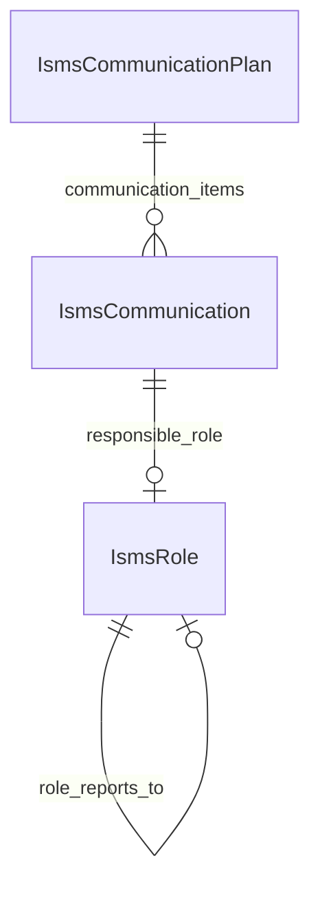

#### Attributes

| Name | Cardinality: | Type | Description |
| --- | --- | --- | --- |
| **[communication_audience](#CommunicationAudience)** | <sub>0..1</sub> | string | To whom it is communicated. |
| **[communication_frequency](#CommunicationFrequency)** | <sub>0..1</sub> | string | How often it is communicated. |
| **[communication_method](#CommunicationMethod)** | <sub>0..1</sub> | string | How it is communicated. |
| **[communication_purpose](#CommunicationPurpose)** | <sub>0..1</sub> | string | Why it is communicated. |
| **[communication_records_required](#CommunicationRecordsRequired)** | <sub>0..1</sub> | boolean | Whether a record of the communication is kept. |
| **[communication_subject](#CommunicationSubject)** | <sub>1..1</sub> | string | What the communication is about. |
| **[responsible_role](#ResponsibleRole)** | <sub>0..1</sub> | [IsmsRole](#IsmsRole) | The role that answers for the record's activity or outcome. |

#### Referenced by:

 *  **[IsmsCommunicationPlan](#IsmsCommunicationPlan)** : ismsCommunicationPlan__communication_items  <sub>0..\*</sub> 


### IsmsCommunicationPlan

The plan for communication about the ISMS, inside the organization and outside it.

```mermaid
erDiagram
IsmsCommunication {

}
IsmsCommunicationPlan {

}
IsmsManagementSystem {

}

IsmsCommunication ||--|o IsmsRole : "responsible_role"
IsmsCommunicationPlan ||--}o IsmsCommunication : "communication_items"
IsmsManagementSystem ||--|o IsmsAwarenessProgramme : "isms_awareness_programme"
IsmsManagementSystem ||--|o IsmsCommunicationPlan : "isms_communication_plan"
IsmsManagementSystem ||--|o IsmsMonitoringProgramme : "isms_monitoring_programme"
IsmsManagementSystem ||--|o IsmsOrganization : "isms_organization"
IsmsManagementSystem ||--|o IsmsPolicy : "isms_policy"
IsmsManagementSystem ||--|o IsmsRiskAssessmentProcess : "isms_risk_assessment_process"
IsmsManagementSystem ||--|o IsmsRiskTreatmentProcess : "isms_risk_treatment_process"
IsmsManagementSystem ||--|o IsmsStatementOfApplicability : "isms_statement_of_applicability"
IsmsManagementSystem ||--}o IsmsAsset : "isms_assets"
IsmsManagementSystem ||--}o IsmsAudit : "isms_audits"
IsmsManagementSystem ||--}o IsmsAuditProgramme : "isms_audit_programmes"
IsmsManagementSystem ||--}o IsmsCompetenceRecord : "isms_competence_records"
IsmsManagementSystem ||--}o IsmsControl : "isms_controls"
IsmsManagementSystem ||--}o IsmsCorrectiveAction : "isms_corrective_actions"
IsmsManagementSystem ||--}o IsmsDocumentedInformation : "isms_documented_information"
IsmsManagementSystem ||--}o IsmsImprovementOpportunity : "isms_improvements"
IsmsManagementSystem ||--}o IsmsInterestedParty : "isms_interested_parties"
IsmsManagementSystem ||--}o IsmsManagementReview : "isms_management_reviews"
IsmsManagementSystem ||--}o IsmsNonconformity : "isms_nonconformities"
IsmsManagementSystem ||--}o IsmsObjective : "isms_objectives"
IsmsManagementSystem ||--}o IsmsOperationalProcedure : "isms_operational_procedures"
IsmsManagementSystem ||--}o IsmsResource : "isms_resources"
IsmsManagementSystem ||--}o IsmsRisk : "isms_risks"
IsmsManagementSystem ||--}o IsmsRiskAssessment : "isms_risk_assessments"
IsmsManagementSystem ||--}o IsmsRiskTreatmentPlan : "isms_risk_treatment_plans"
IsmsManagementSystem ||--}o IsmsRole : "isms_roles"
IsmsManagementSystem ||--}o IsmsSecurityEvent : "isms_security_events"
IsmsManagementSystem ||--}o IsmsTopicSpecificPolicy : "isms_topic_specific_policies"

```

#### Attributes

| Name | Cardinality: | Type | Description |
| --- | --- | --- | --- |
| **[description](#Description)** | <sub>0..1</sub> | string | What the record says or describes, in the organization's own words. |
| **[document_approval_date](#DocumentApprovalDate)** | <sub>0..1</sub> | date | When the document was approved. |
| **[document_approver](#DocumentApprover)** | <sub>0..1</sub> | string | Who approved the document. |
| **[document_author](#DocumentAuthor)** | <sub>0..1</sub> | string | Who wrote the document. |
| **[document_change_control](#DocumentChangeControl)** | <sub>0..1</sub> | string | How changes to the document are controlled, such as version control. |
| **[document_classification](#DocumentClassification)** | <sub>0..1</sub> | string | The information classification the document carries. |
| **[document_distribution](#DocumentDistribution)** | <sub>0..\*</sub> | string | How the document is distributed, accessed, retrieved and used. |
| **[document_effective_date](#DocumentEffectiveDate)** | <sub>0..1</sub> | date | When the document takes effect. |
| **[document_external_origin](#DocumentExternalOrigin)** | <sub>0..1</sub> | boolean | Whether the document comes from outside the organization and is kept because the ISMS needs it. |
| **[document_external_source](#DocumentExternalSource)** | <sub>0..1</sub> | string | Who the document came from, when it comes from outside. |
| **[document_last_review_date](#DocumentLastReviewDate)** | <sub>0..1</sub> | date | When the document was last reviewed. |
| **[document_next_review_date](#DocumentNextReviewDate)** | <sub>0..1</sub> | date | When the document is next due for review. |
| **[document_owner](#DocumentOwner)** | <sub>0..1</sub> | string | Who answers for the document's content and upkeep. |
| **[document_reference](#DocumentReference)** | <sub>0..1</sub> | string | The reference the organization's document control gives it. |
| **[document_retention](#DocumentRetention)** | <sub>0..1</sub> | isms_duration | How long the document is kept, as an ISO 8601 duration. |
| **[document_status](#DocumentStatus)** | <sub>0..1</sub> | string | Where the document stands in its life, in the organization's own terms, such as draft, approved or withdrawn. |
| **[document_storage](#DocumentStorage)** | <sub>0..1</sub> | string | How the document is stored and preserved, so that it stays legible. |
| **[document_version](#DocumentVersion)** | <sub>0..1</sub> | string | The version of the document. |
| **[isms_id](#IsmsId)** | <sub>1..1</sub> | uriorcurie | The record's identifier, unique among the ISMS's records, such as a URI or a CURIE. Other records refer to the record by it. |
| **[title](#Title)** | <sub>1..1</sub> | string | The name the organization gives the record. |
| **[communication_items](#CommunicationItems)** | <sub>0..\*</sub> | [IsmsCommunication](#IsmsCommunication) | The communications the plan provides for. |

#### Uses

 *  mixin: [IsmsDocumentControlMixin](#IsmsDocumentControlMixin) - The control that documented information is kept under: who wrote, owns and approved it, when it takes effect and is reviewed, how it is classified, distributed, stored and changed, how long it is retained, and whether it came from outside the organization.
 *  mixin: [IsmsRecordMixin](#IsmsRecordMixin) - What every record of the ISMS has, so that other records can refer to it: an identifier, a title and a description.

#### Referenced by:

 *  **[IsmsManagementSystem](#IsmsManagementSystem)** : ismsManagementSystem__isms_communication_plan  <sub>0..1</sub> 


### IsmsCompetenceRecord

The evidence of one person's competence for work that affects information security, and what is done to close any gap.

```mermaid
erDiagram
IsmsCompetenceRecord {

}
IsmsManagementSystem {

}
IsmsRole {

}

IsmsCompetenceRecord ||--|o IsmsRole : "competence_role"
IsmsManagementSystem ||--|o IsmsAwarenessProgramme : "isms_awareness_programme"
IsmsManagementSystem ||--|o IsmsCommunicationPlan : "isms_communication_plan"
IsmsManagementSystem ||--|o IsmsMonitoringProgramme : "isms_monitoring_programme"
IsmsManagementSystem ||--|o IsmsOrganization : "isms_organization"
IsmsManagementSystem ||--|o IsmsPolicy : "isms_policy"
IsmsManagementSystem ||--|o IsmsRiskAssessmentProcess : "isms_risk_assessment_process"
IsmsManagementSystem ||--|o IsmsRiskTreatmentProcess : "isms_risk_treatment_process"
IsmsManagementSystem ||--|o IsmsStatementOfApplicability : "isms_statement_of_applicability"
IsmsManagementSystem ||--}o IsmsAsset : "isms_assets"
IsmsManagementSystem ||--}o IsmsAudit : "isms_audits"
IsmsManagementSystem ||--}o IsmsAuditProgramme : "isms_audit_programmes"
IsmsManagementSystem ||--}o IsmsCompetenceRecord : "isms_competence_records"
IsmsManagementSystem ||--}o IsmsControl : "isms_controls"
IsmsManagementSystem ||--}o IsmsCorrectiveAction : "isms_corrective_actions"
IsmsManagementSystem ||--}o IsmsDocumentedInformation : "isms_documented_information"
IsmsManagementSystem ||--}o IsmsImprovementOpportunity : "isms_improvements"
IsmsManagementSystem ||--}o IsmsInterestedParty : "isms_interested_parties"
IsmsManagementSystem ||--}o IsmsManagementReview : "isms_management_reviews"
IsmsManagementSystem ||--}o IsmsNonconformity : "isms_nonconformities"
IsmsManagementSystem ||--}o IsmsObjective : "isms_objectives"
IsmsManagementSystem ||--}o IsmsOperationalProcedure : "isms_operational_procedures"
IsmsManagementSystem ||--}o IsmsResource : "isms_resources"
IsmsManagementSystem ||--}o IsmsRisk : "isms_risks"
IsmsManagementSystem ||--}o IsmsRiskAssessment : "isms_risk_assessments"
IsmsManagementSystem ||--}o IsmsRiskTreatmentPlan : "isms_risk_treatment_plans"
IsmsManagementSystem ||--}o IsmsRole : "isms_roles"
IsmsManagementSystem ||--}o IsmsSecurityEvent : "isms_security_events"
IsmsManagementSystem ||--}o IsmsTopicSpecificPolicy : "isms_topic_specific_policies"
IsmsRole ||--|o IsmsRole : "role_reports_to"

```

#### Attributes

| Name | Cardinality: | Type | Description |
| --- | --- | --- | --- |
| **[description](#Description)** | <sub>0..1</sub> | string | What the record says or describes, in the organization's own words. |
| **[document_approval_date](#DocumentApprovalDate)** | <sub>0..1</sub> | date | When the document was approved. |
| **[document_approver](#DocumentApprover)** | <sub>0..1</sub> | string | Who approved the document. |
| **[document_author](#DocumentAuthor)** | <sub>0..1</sub> | string | Who wrote the document. |
| **[document_change_control](#DocumentChangeControl)** | <sub>0..1</sub> | string | How changes to the document are controlled, such as version control. |
| **[document_classification](#DocumentClassification)** | <sub>0..1</sub> | string | The information classification the document carries. |
| **[document_distribution](#DocumentDistribution)** | <sub>0..\*</sub> | string | How the document is distributed, accessed, retrieved and used. |
| **[document_effective_date](#DocumentEffectiveDate)** | <sub>0..1</sub> | date | When the document takes effect. |
| **[document_external_origin](#DocumentExternalOrigin)** | <sub>0..1</sub> | boolean | Whether the document comes from outside the organization and is kept because the ISMS needs it. |
| **[document_external_source](#DocumentExternalSource)** | <sub>0..1</sub> | string | Who the document came from, when it comes from outside. |
| **[document_last_review_date](#DocumentLastReviewDate)** | <sub>0..1</sub> | date | When the document was last reviewed. |
| **[document_next_review_date](#DocumentNextReviewDate)** | <sub>0..1</sub> | date | When the document is next due for review. |
| **[document_owner](#DocumentOwner)** | <sub>0..1</sub> | string | Who answers for the document's content and upkeep. |
| **[document_reference](#DocumentReference)** | <sub>0..1</sub> | string | The reference the organization's document control gives it. |
| **[document_retention](#DocumentRetention)** | <sub>0..1</sub> | isms_duration | How long the document is kept, as an ISO 8601 duration. |
| **[document_status](#DocumentStatus)** | <sub>0..1</sub> | string | Where the document stands in its life, in the organization's own terms, such as draft, approved or withdrawn. |
| **[document_storage](#DocumentStorage)** | <sub>0..1</sub> | string | How the document is stored and preserved, so that it stays legible. |
| **[document_version](#DocumentVersion)** | <sub>0..1</sub> | string | The version of the document. |
| **[isms_id](#IsmsId)** | <sub>1..1</sub> | uriorcurie | The record's identifier, unique among the ISMS's records, such as a URI or a CURIE. Other records refer to the record by it. |
| **[title](#Title)** | <sub>1..1</sub> | string | The name the organization gives the record. |
| **[competence_actions](#CompetenceActions)** | <sub>0..\*</sub> | string | What is done to close the gaps. |
| **[competence_assessment_date](#CompetenceAssessmentDate)** | <sub>0..1</sub> | date | When the person's competence was last assessed. |
| **[competence_education](#CompetenceEducation)** | <sub>0..\*</sub> | string | The person's relevant education. |
| **[competence_experience](#CompetenceExperience)** | <sub>0..\*</sub> | string | The person's relevant experience. |
| **[competence_gaps](#CompetenceGaps)** | <sub>0..\*</sub> | string | The gaps the assessment found. |
| **[competence_person](#CompetencePerson)** | <sub>0..1</sub> | string | The person the record is about. |
| **[competence_required](#CompetenceRequired)** | <sub>0..\*</sub> | string | The competences the role needs. |
| **[competence_role](#CompetenceRole)** | <sub>0..1</sub> | [IsmsRole](#IsmsRole) | The role the person holds. |
| **[competence_training](#CompetenceTraining)** | <sub>0..\*</sub> | string | The training the person has completed. |

#### Uses

 *  mixin: [IsmsDocumentControlMixin](#IsmsDocumentControlMixin) - The control that documented information is kept under: who wrote, owns and approved it, when it takes effect and is reviewed, how it is classified, distributed, stored and changed, how long it is retained, and whether it came from outside the organization.
 *  mixin: [IsmsRecordMixin](#IsmsRecordMixin) - What every record of the ISMS has, so that other records can refer to it: an identifier, a title and a description.

#### Referenced by:

 *  **[IsmsManagementSystem](#IsmsManagementSystem)** : ismsManagementSystem__isms_competence_records  <sub>0..\*</sub> 


### IsmsControl

A control the organization has determined it needs to treat its risks: what it does in the organization's words, which Annex A controls it answers to, who owns it, how far it is in place and how well it works.

The text and guidance are the organization's own words, never the text of ISO/IEC 27001 or ISO/IEC 27002. A control from another source names no Annex A control.

```mermaid
erDiagram
IsmsAsset {

}
IsmsAuditFinding {

}
IsmsControl {

}
IsmsIncludedControl {

}
IsmsManagementSystem {

}
IsmsObjective {

}
IsmsOperationalProcedure {

}
IsmsRisk {

}
IsmsRiskTreatmentPlan {

}
IsmsTopicSpecificPolicy {

}

IsmsAsset ||--}o IsmsControl : "relevant_controls"
IsmsAuditFinding ||--|o IsmsControl : "finding_control"
IsmsAuditFinding ||--|o IsmsCorrectiveAction : "finding_corrective_action"
IsmsControl ||--}o IsmsControl : "relevant_controls"
IsmsIncludedControl ||--|o IsmsControl : "included_control"
IsmsIncludedControl ||--|o IsmsRole : "responsible_role"
IsmsManagementSystem ||--|o IsmsAwarenessProgramme : "isms_awareness_programme"
IsmsManagementSystem ||--|o IsmsCommunicationPlan : "isms_communication_plan"
IsmsManagementSystem ||--|o IsmsMonitoringProgramme : "isms_monitoring_programme"
IsmsManagementSystem ||--|o IsmsOrganization : "isms_organization"
IsmsManagementSystem ||--|o IsmsPolicy : "isms_policy"
IsmsManagementSystem ||--|o IsmsRiskAssessmentProcess : "isms_risk_assessment_process"
IsmsManagementSystem ||--|o IsmsRiskTreatmentProcess : "isms_risk_treatment_process"
IsmsManagementSystem ||--|o IsmsStatementOfApplicability : "isms_statement_of_applicability"
IsmsManagementSystem ||--}o IsmsAsset : "isms_assets"
IsmsManagementSystem ||--}o IsmsAudit : "isms_audits"
IsmsManagementSystem ||--}o IsmsAuditProgramme : "isms_audit_programmes"
IsmsManagementSystem ||--}o IsmsCompetenceRecord : "isms_competence_records"
IsmsManagementSystem ||--}o IsmsControl : "isms_controls"
IsmsManagementSystem ||--}o IsmsCorrectiveAction : "isms_corrective_actions"
IsmsManagementSystem ||--}o IsmsDocumentedInformation : "isms_documented_information"
IsmsManagementSystem ||--}o IsmsImprovementOpportunity : "isms_improvements"
IsmsManagementSystem ||--}o IsmsInterestedParty : "isms_interested_parties"
IsmsManagementSystem ||--}o IsmsManagementReview : "isms_management_reviews"
IsmsManagementSystem ||--}o IsmsNonconformity : "isms_nonconformities"
IsmsManagementSystem ||--}o IsmsObjective : "isms_objectives"
IsmsManagementSystem ||--}o IsmsOperationalProcedure : "isms_operational_procedures"
IsmsManagementSystem ||--}o IsmsResource : "isms_resources"
IsmsManagementSystem ||--}o IsmsRisk : "isms_risks"
IsmsManagementSystem ||--}o IsmsRiskAssessment : "isms_risk_assessments"
IsmsManagementSystem ||--}o IsmsRiskTreatmentPlan : "isms_risk_treatment_plans"
IsmsManagementSystem ||--}o IsmsRole : "isms_roles"
IsmsManagementSystem ||--}o IsmsSecurityEvent : "isms_security_events"
IsmsManagementSystem ||--}o IsmsTopicSpecificPolicy : "isms_topic_specific_policies"
IsmsObjective ||--|o IsmsRole : "responsible_role"
IsmsObjective ||--}o IsmsControl : "relevant_controls"
IsmsObjective ||--}o IsmsRisk : "objective_risks"
IsmsOperationalProcedure ||--}o IsmsControl : "relevant_controls"
IsmsOperationalProcedure ||--}o IsmsRole : "procedure_roles"
IsmsRisk ||--}o IsmsAsset : "affected_assets"
IsmsRisk ||--}o IsmsControl : "risk_existing_controls"
IsmsRiskTreatmentPlan ||--}o IsmsControl : "plan_controls"
IsmsRiskTreatmentPlan ||--}o IsmsRisk : "plan_risks"
IsmsTopicSpecificPolicy ||--|o IsmsPolicy : "topic_policy_parent"
IsmsTopicSpecificPolicy ||--}o IsmsControl : "relevant_controls"

```

#### Attributes

| Name | Cardinality: | Type | Description |
| --- | --- | --- | --- |
| **[description](#Description)** | <sub>0..1</sub> | string | What the record says or describes, in the organization's own words. |
| **[isms_id](#IsmsId)** | <sub>1..1</sub> | uriorcurie | The record's identifier, unique among the ISMS's records, such as a URI or a CURIE. Other records refer to the record by it. |
| **[title](#Title)** | <sub>1..1</sub> | string | The name the organization gives the record. |
| **[control_annex_a_controls](#ControlAnnexAControls)** | <sub>0..\*</sub> | [IsmsAnnexAControl](#IsmsAnnexAControl) | The Annex A controls the control answers to. |
| **[control_asset_types](#ControlAssetTypes)** | <sub>0..\*</sub> | string | The kinds of asset the control applies to. |
| **[control_effectiveness](#ControlEffectiveness)** | <sub>0..1</sub> | string | How well the control works, in the organization's own terms. |
| **[control_evidence](#ControlEvidence)** | <sub>0..\*</sub> | string | Where the evidence that the control is in place is kept. |
| **[control_guidance](#ControlGuidance)** | <sub>0..1</sub> | string | The organization's notes on putting the control in place. |
| **[control_implementation_date](#ControlImplementationDate)** | <sub>0..1</sub> | date | When the control was put in place. |
| **[control_last_tested](#ControlLastTested)** | <sub>0..1</sub> | date | When the control was last tested. |
| **[control_owner](#ControlOwner)** | <sub>0..1</sub> | string | The person who owns the control. |
| **[control_text](#ControlText)** | <sub>0..1</sub> | string | What the control does, in the organization's own words. |
| **[control_theme](#ControlTheme)** | <sub>0..1</sub> | [IsmsControlTheme](#IsmsControlTheme) | Which of Annex A's four themes the control belongs to. |
| **[control_threats](#ControlThreats)** | <sub>0..\*</sub> | string | The threats the control acts against. |
| **[implementation_state](#ImplementationState)** | <sub>0..1</sub> | [IsmsImplementationStatus](#IsmsImplementationStatus) | How far the control or the plan has been put into effect. |
| **[relevant_controls](#RelevantControls)** | <sub>0..\*</sub> | [IsmsControl](#IsmsControl) | The organization's controls that the record concerns. |

#### Uses

 *  mixin: [IsmsRecordMixin](#IsmsRecordMixin) - What every record of the ISMS has, so that other records can refer to it: an identifier, a title and a description.

#### Referenced by:

 *  **[IsmsAuditFinding](#IsmsAuditFinding)** : ismsAuditFinding__finding_control  <sub>0..1</sub> 
 *  **[IsmsIncludedControl](#IsmsIncludedControl)** : ismsIncludedControl__included_control  <sub>0..1</sub> 
 *  **[IsmsManagementSystem](#IsmsManagementSystem)** : ismsManagementSystem__isms_controls  <sub>0..\*</sub> 
 *  **[IsmsRiskTreatmentPlan](#IsmsRiskTreatmentPlan)** : ismsRiskTreatmentPlan__plan_controls  <sub>0..\*</sub> 
 *  **[IsmsRisk](#IsmsRisk)** : ismsRisk__risk_existing_controls  <sub>0..\*</sub> 
 *  **[IsmsAsset](#IsmsAsset)** : relevant_controls  <sub>0..\*</sub> 
 *  **[IsmsControl](#IsmsControl)** : relevant_controls  <sub>0..\*</sub> 
 *  **[IsmsObjective](#IsmsObjective)** : relevant_controls  <sub>0..\*</sub> 
 *  **[IsmsOperationalProcedure](#IsmsOperationalProcedure)** : relevant_controls  <sub>0..\*</sub> 
 *  **[IsmsTopicSpecificPolicy](#IsmsTopicSpecificPolicy)** : relevant_controls  <sub>0..\*</sub> 


### IsmsCorrectiveAction

An action that removes the cause of one or more nonconformities so that they do not recur, and the check that it worked.

```mermaid
erDiagram
IsmsAuditFinding {

}
IsmsCorrectiveAction {

}
IsmsManagementSystem {

}
IsmsNonconformity {

}
IsmsRole {

}

IsmsAuditFinding ||--|o IsmsControl : "finding_control"
IsmsAuditFinding ||--|o IsmsCorrectiveAction : "finding_corrective_action"
IsmsCorrectiveAction ||--|o IsmsRole : "responsible_role"
IsmsCorrectiveAction ||--}o IsmsNonconformity : "action_nonconformities"
IsmsManagementSystem ||--|o IsmsAwarenessProgramme : "isms_awareness_programme"
IsmsManagementSystem ||--|o IsmsCommunicationPlan : "isms_communication_plan"
IsmsManagementSystem ||--|o IsmsMonitoringProgramme : "isms_monitoring_programme"
IsmsManagementSystem ||--|o IsmsOrganization : "isms_organization"
IsmsManagementSystem ||--|o IsmsPolicy : "isms_policy"
IsmsManagementSystem ||--|o IsmsRiskAssessmentProcess : "isms_risk_assessment_process"
IsmsManagementSystem ||--|o IsmsRiskTreatmentProcess : "isms_risk_treatment_process"
IsmsManagementSystem ||--|o IsmsStatementOfApplicability : "isms_statement_of_applicability"
IsmsManagementSystem ||--}o IsmsAsset : "isms_assets"
IsmsManagementSystem ||--}o IsmsAudit : "isms_audits"
IsmsManagementSystem ||--}o IsmsAuditProgramme : "isms_audit_programmes"
IsmsManagementSystem ||--}o IsmsCompetenceRecord : "isms_competence_records"
IsmsManagementSystem ||--}o IsmsControl : "isms_controls"
IsmsManagementSystem ||--}o IsmsCorrectiveAction : "isms_corrective_actions"
IsmsManagementSystem ||--}o IsmsDocumentedInformation : "isms_documented_information"
IsmsManagementSystem ||--}o IsmsImprovementOpportunity : "isms_improvements"
IsmsManagementSystem ||--}o IsmsInterestedParty : "isms_interested_parties"
IsmsManagementSystem ||--}o IsmsManagementReview : "isms_management_reviews"
IsmsManagementSystem ||--}o IsmsNonconformity : "isms_nonconformities"
IsmsManagementSystem ||--}o IsmsObjective : "isms_objectives"
IsmsManagementSystem ||--}o IsmsOperationalProcedure : "isms_operational_procedures"
IsmsManagementSystem ||--}o IsmsResource : "isms_resources"
IsmsManagementSystem ||--}o IsmsRisk : "isms_risks"
IsmsManagementSystem ||--}o IsmsRiskAssessment : "isms_risk_assessments"
IsmsManagementSystem ||--}o IsmsRiskTreatmentPlan : "isms_risk_treatment_plans"
IsmsManagementSystem ||--}o IsmsRole : "isms_roles"
IsmsManagementSystem ||--}o IsmsSecurityEvent : "isms_security_events"
IsmsManagementSystem ||--}o IsmsTopicSpecificPolicy : "isms_topic_specific_policies"
IsmsRole ||--|o IsmsRole : "role_reports_to"

```

#### Attributes

| Name | Cardinality: | Type | Description |
| --- | --- | --- | --- |
| **[description](#Description)** | <sub>0..1</sub> | string | What the record says or describes, in the organization's own words. |
| **[isms_id](#IsmsId)** | <sub>1..1</sub> | uriorcurie | The record's identifier, unique among the ISMS's records, such as a URI or a CURIE. Other records refer to the record by it. |
| **[title](#Title)** | <sub>1..1</sub> | string | The name the organization gives the record. |
| **[action_completion_date](#ActionCompletionDate)** | <sub>0..1</sub> | date | When the action was complete. |
| **[action_effective](#ActionEffective)** | <sub>0..1</sub> | boolean | Whether the review found the action effective. |
| **[action_effectiveness_criteria](#ActionEffectivenessCriteria)** | <sub>0..1</sub> | string | How the action's effect will be judged. |
| **[action_effectiveness_review_date](#ActionEffectivenessReviewDate)** | <sub>0..1</sub> | date | When the action's effect was reviewed. |
| **[action_isms_changes](#ActionIsmsChanges)** | <sub>0..1</sub> | string | The changes to the ISMS the action needs. |
| **[action_nonconformities](#ActionNonconformities)** | <sub>0..\*</sub> | [IsmsNonconformity](#IsmsNonconformity) | The nonconformities the action addresses. |
| **[action_resources](#ActionResources)** | <sub>0..1</sub> | string | The resources the action needs. |
| **[action_root_cause](#ActionRootCause)** | <sub>0..1</sub> | string | The cause the action removes. |
| **[action_status](#ActionStatus)** | <sub>0..1</sub> | string | Where the action stands, in the organization's own terms. |
| **[action_target_date](#ActionTargetDate)** | <sub>0..1</sub> | date | When the action is to be complete. |
| **[responsible_role](#ResponsibleRole)** | <sub>0..1</sub> | [IsmsRole](#IsmsRole) | The role that answers for the record's activity or outcome. |

#### Uses

 *  mixin: [IsmsRecordMixin](#IsmsRecordMixin) - What every record of the ISMS has, so that other records can refer to it: an identifier, a title and a description.

#### Referenced by:

 *  **[IsmsAuditFinding](#IsmsAuditFinding)** : ismsAuditFinding__finding_corrective_action  <sub>0..1</sub> 
 *  **[IsmsManagementSystem](#IsmsManagementSystem)** : ismsManagementSystem__isms_corrective_actions  <sub>0..\*</sub> 


### IsmsDocumentedInformation

A piece of documented information the ISMS keeps under control that no more specific record describes, such as a procedure, a standard, a plan or a report.

```mermaid
erDiagram
IsmsAudit {

}
IsmsDocumentedInformation {

}
IsmsManagementSystem {

}

IsmsAudit ||--|o IsmsDocumentedInformation : "audit_plan"
IsmsAudit ||--}o IsmsAuditFinding : "audit_findings"
IsmsManagementSystem ||--|o IsmsAwarenessProgramme : "isms_awareness_programme"
IsmsManagementSystem ||--|o IsmsCommunicationPlan : "isms_communication_plan"
IsmsManagementSystem ||--|o IsmsMonitoringProgramme : "isms_monitoring_programme"
IsmsManagementSystem ||--|o IsmsOrganization : "isms_organization"
IsmsManagementSystem ||--|o IsmsPolicy : "isms_policy"
IsmsManagementSystem ||--|o IsmsRiskAssessmentProcess : "isms_risk_assessment_process"
IsmsManagementSystem ||--|o IsmsRiskTreatmentProcess : "isms_risk_treatment_process"
IsmsManagementSystem ||--|o IsmsStatementOfApplicability : "isms_statement_of_applicability"
IsmsManagementSystem ||--}o IsmsAsset : "isms_assets"
IsmsManagementSystem ||--}o IsmsAudit : "isms_audits"
IsmsManagementSystem ||--}o IsmsAuditProgramme : "isms_audit_programmes"
IsmsManagementSystem ||--}o IsmsCompetenceRecord : "isms_competence_records"
IsmsManagementSystem ||--}o IsmsControl : "isms_controls"
IsmsManagementSystem ||--}o IsmsCorrectiveAction : "isms_corrective_actions"
IsmsManagementSystem ||--}o IsmsDocumentedInformation : "isms_documented_information"
IsmsManagementSystem ||--}o IsmsImprovementOpportunity : "isms_improvements"
IsmsManagementSystem ||--}o IsmsInterestedParty : "isms_interested_parties"
IsmsManagementSystem ||--}o IsmsManagementReview : "isms_management_reviews"
IsmsManagementSystem ||--}o IsmsNonconformity : "isms_nonconformities"
IsmsManagementSystem ||--}o IsmsObjective : "isms_objectives"
IsmsManagementSystem ||--}o IsmsOperationalProcedure : "isms_operational_procedures"
IsmsManagementSystem ||--}o IsmsResource : "isms_resources"
IsmsManagementSystem ||--}o IsmsRisk : "isms_risks"
IsmsManagementSystem ||--}o IsmsRiskAssessment : "isms_risk_assessments"
IsmsManagementSystem ||--}o IsmsRiskTreatmentPlan : "isms_risk_treatment_plans"
IsmsManagementSystem ||--}o IsmsRole : "isms_roles"
IsmsManagementSystem ||--}o IsmsSecurityEvent : "isms_security_events"
IsmsManagementSystem ||--}o IsmsTopicSpecificPolicy : "isms_topic_specific_policies"

```

#### Attributes

| Name | Cardinality: | Type | Description |
| --- | --- | --- | --- |
| **[description](#Description)** | <sub>0..1</sub> | string | What the record says or describes, in the organization's own words. |
| **[document_approval_date](#DocumentApprovalDate)** | <sub>0..1</sub> | date | When the document was approved. |
| **[document_approver](#DocumentApprover)** | <sub>0..1</sub> | string | Who approved the document. |
| **[document_author](#DocumentAuthor)** | <sub>0..1</sub> | string | Who wrote the document. |
| **[document_change_control](#DocumentChangeControl)** | <sub>0..1</sub> | string | How changes to the document are controlled, such as version control. |
| **[document_classification](#DocumentClassification)** | <sub>0..1</sub> | string | The information classification the document carries. |
| **[document_distribution](#DocumentDistribution)** | <sub>0..\*</sub> | string | How the document is distributed, accessed, retrieved and used. |
| **[document_effective_date](#DocumentEffectiveDate)** | <sub>0..1</sub> | date | When the document takes effect. |
| **[document_external_origin](#DocumentExternalOrigin)** | <sub>0..1</sub> | boolean | Whether the document comes from outside the organization and is kept because the ISMS needs it. |
| **[document_external_source](#DocumentExternalSource)** | <sub>0..1</sub> | string | Who the document came from, when it comes from outside. |
| **[document_last_review_date](#DocumentLastReviewDate)** | <sub>0..1</sub> | date | When the document was last reviewed. |
| **[document_next_review_date](#DocumentNextReviewDate)** | <sub>0..1</sub> | date | When the document is next due for review. |
| **[document_owner](#DocumentOwner)** | <sub>0..1</sub> | string | Who answers for the document's content and upkeep. |
| **[document_reference](#DocumentReference)** | <sub>0..1</sub> | string | The reference the organization's document control gives it. |
| **[document_retention](#DocumentRetention)** | <sub>0..1</sub> | isms_duration | How long the document is kept, as an ISO 8601 duration. |
| **[document_status](#DocumentStatus)** | <sub>0..1</sub> | string | Where the document stands in its life, in the organization's own terms, such as draft, approved or withdrawn. |
| **[document_storage](#DocumentStorage)** | <sub>0..1</sub> | string | How the document is stored and preserved, so that it stays legible. |
| **[document_version](#DocumentVersion)** | <sub>0..1</sub> | string | The version of the document. |
| **[isms_id](#IsmsId)** | <sub>1..1</sub> | uriorcurie | The record's identifier, unique among the ISMS's records, such as a URI or a CURIE. Other records refer to the record by it. |
| **[title](#Title)** | <sub>1..1</sub> | string | The name the organization gives the record. |
| **[document_kind](#DocumentKind)** | <sub>1..1</sub> | [IsmsDocumentKind](#IsmsDocumentKind) | What kind of documented information it is. |

#### Uses

 *  mixin: [IsmsDocumentControlMixin](#IsmsDocumentControlMixin) - The control that documented information is kept under: who wrote, owns and approved it, when it takes effect and is reviewed, how it is classified, distributed, stored and changed, how long it is retained, and whether it came from outside the organization.
 *  mixin: [IsmsRecordMixin](#IsmsRecordMixin) - What every record of the ISMS has, so that other records can refer to it: an identifier, a title and a description.

#### Referenced by:

 *  **[IsmsAudit](#IsmsAudit)** : ismsAudit__audit_plan  <sub>0..1</sub> 
 *  **[IsmsManagementSystem](#IsmsManagementSystem)** : ismsManagementSystem__isms_documented_information  <sub>0..\*</sub> 


### IsmsExcludedControl

An entry that leaves out an Annex A control the organization does not need, and says why.


#### Local class diagram

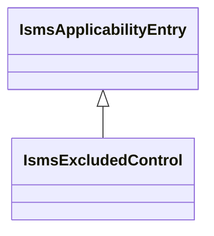

#### Attributes

| Name | Cardinality: | Type | Description |
| --- | --- | --- | --- |
| **[entry_justification](#EntryJustification)** | <sub>1..1</sub> | string | Why the control is included or excluded. |
| **[entry_type](#EntryType)** | <sub>0..1</sub> | string | The kind of entry: IsmsIncludedControl or IsmsExcludedControl. |
| **[entry_annex_a_control](#EntryAnnexAControl)** | <sub>1..1</sub> | [IsmsAnnexAControl](#IsmsAnnexAControl) | The Annex A control a Statement of Applicability entry concerns. |

#### Parents

 * [IsmsApplicabilityEntry](#IsmsApplicabilityEntry) - One entry of the Statement of Applicability, which either includes a control or excludes an Annex A control, and says why.


### IsmsImprovementOpportunity

An opportunity to improve the ISMS's suitability, adequacy or effectiveness, and what came of it.

```mermaid
erDiagram
IsmsImprovementOpportunity {

}
IsmsManagementSystem {

}
IsmsRole {

}

IsmsImprovementOpportunity ||--|o IsmsRole : "responsible_role"
IsmsManagementSystem ||--|o IsmsAwarenessProgramme : "isms_awareness_programme"
IsmsManagementSystem ||--|o IsmsCommunicationPlan : "isms_communication_plan"
IsmsManagementSystem ||--|o IsmsMonitoringProgramme : "isms_monitoring_programme"
IsmsManagementSystem ||--|o IsmsOrganization : "isms_organization"
IsmsManagementSystem ||--|o IsmsPolicy : "isms_policy"
IsmsManagementSystem ||--|o IsmsRiskAssessmentProcess : "isms_risk_assessment_process"
IsmsManagementSystem ||--|o IsmsRiskTreatmentProcess : "isms_risk_treatment_process"
IsmsManagementSystem ||--|o IsmsStatementOfApplicability : "isms_statement_of_applicability"
IsmsManagementSystem ||--}o IsmsAsset : "isms_assets"
IsmsManagementSystem ||--}o IsmsAudit : "isms_audits"
IsmsManagementSystem ||--}o IsmsAuditProgramme : "isms_audit_programmes"
IsmsManagementSystem ||--}o IsmsCompetenceRecord : "isms_competence_records"
IsmsManagementSystem ||--}o IsmsControl : "isms_controls"
IsmsManagementSystem ||--}o IsmsCorrectiveAction : "isms_corrective_actions"
IsmsManagementSystem ||--}o IsmsDocumentedInformation : "isms_documented_information"
IsmsManagementSystem ||--}o IsmsImprovementOpportunity : "isms_improvements"
IsmsManagementSystem ||--}o IsmsInterestedParty : "isms_interested_parties"
IsmsManagementSystem ||--}o IsmsManagementReview : "isms_management_reviews"
IsmsManagementSystem ||--}o IsmsNonconformity : "isms_nonconformities"
IsmsManagementSystem ||--}o IsmsObjective : "isms_objectives"
IsmsManagementSystem ||--}o IsmsOperationalProcedure : "isms_operational_procedures"
IsmsManagementSystem ||--}o IsmsResource : "isms_resources"
IsmsManagementSystem ||--}o IsmsRisk : "isms_risks"
IsmsManagementSystem ||--}o IsmsRiskAssessment : "isms_risk_assessments"
IsmsManagementSystem ||--}o IsmsRiskTreatmentPlan : "isms_risk_treatment_plans"
IsmsManagementSystem ||--}o IsmsRole : "isms_roles"
IsmsManagementSystem ||--}o IsmsSecurityEvent : "isms_security_events"
IsmsManagementSystem ||--}o IsmsTopicSpecificPolicy : "isms_topic_specific_policies"
IsmsRole ||--|o IsmsRole : "role_reports_to"

```

#### Attributes

| Name | Cardinality: | Type | Description |
| --- | --- | --- | --- |
| **[description](#Description)** | <sub>0..1</sub> | string | What the record says or describes, in the organization's own words. |
| **[isms_id](#IsmsId)** | <sub>1..1</sub> | uriorcurie | The record's identifier, unique among the ISMS's records, such as a URI or a CURIE. Other records refer to the record by it. |
| **[title](#Title)** | <sub>1..1</sub> | string | The name the organization gives the record. |
| **[improvement_benefit](#ImprovementBenefit)** | <sub>0..1</sub> | string | What the improvement is expected to bring. |
| **[improvement_completion_date](#ImprovementCompletionDate)** | <sub>0..1</sub> | date | When it was made. |
| **[improvement_identified_by](#ImprovementIdentifiedBy)** | <sub>0..1</sub> | string | Who identified it. |
| **[improvement_identified_on](#ImprovementIdentifiedOn)** | <sub>0..1</sub> | date | When the opportunity was identified. |
| **[improvement_outcome](#ImprovementOutcome)** | <sub>0..1</sub> | string | What the improvement brought. |
| **[improvement_plan](#ImprovementPlan)** | <sub>0..1</sub> | string | How the improvement is to be made. |
| **[improvement_priority](#ImprovementPriority)** | <sub>0..1</sub> | string | How soon it is to be acted on, in the organization's own terms. |
| **[improvement_source](#ImprovementSource)** | <sub>0..1</sub> | string | Where the opportunity came from, such as a review, an audit or daily work. |
| **[improvement_status](#ImprovementStatus)** | <sub>0..1</sub> | string | Where it stands, in the organization's own terms. |
| **[improvement_target_date](#ImprovementTargetDate)** | <sub>0..1</sub> | date | When the improvement is to be made. |
| **[responsible_role](#ResponsibleRole)** | <sub>0..1</sub> | [IsmsRole](#IsmsRole) | The role that answers for the record's activity or outcome. |

#### Uses

 *  mixin: [IsmsRecordMixin](#IsmsRecordMixin) - What every record of the ISMS has, so that other records can refer to it: an identifier, a title and a description.

#### Referenced by:

 *  **[IsmsManagementSystem](#IsmsManagementSystem)** : ismsManagementSystem__isms_improvements  <sub>0..\*</sub> 


### IsmsIncludedControl

An entry that includes a control the organization needs, from Annex A or from elsewhere, and says whether it is in place.

An included control names an Annex A control, one of the organization's controls, or both.

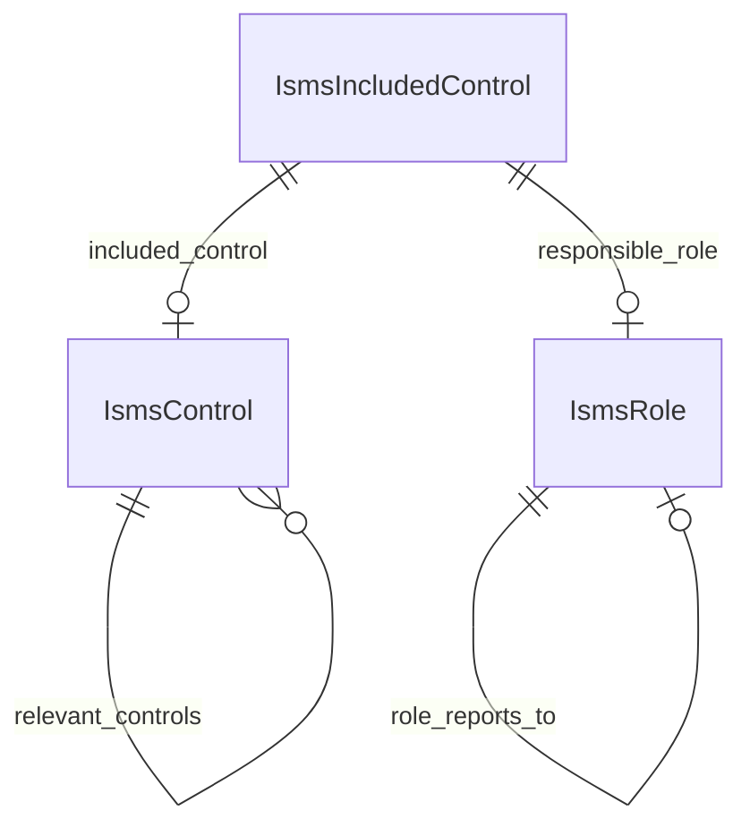

#### Attributes

| Name | Cardinality: | Type | Description |
| --- | --- | --- | --- |
| **[entry_annex_a_control](#EntryAnnexAControl)** | <sub>0..1</sub> | [IsmsAnnexAControl](#IsmsAnnexAControl) | The Annex A control a Statement of Applicability entry concerns. |
| **[entry_justification](#EntryJustification)** | <sub>1..1</sub> | string | Why the control is included or excluded. |
| **[entry_type](#EntryType)** | <sub>0..1</sub> | string | The kind of entry: IsmsIncludedControl or IsmsExcludedControl. |
| **[implementation_state](#ImplementationState)** | <sub>1..1</sub> | [IsmsImplementationStatus](#IsmsImplementationStatus) | How far the control or the plan has been put into effect. |
| **[included_control](#IncludedControl)** | <sub>0..1</sub> | [IsmsControl](#IsmsControl) | The organization's control the entry includes. |
| **[included_evidence](#IncludedEvidence)** | <sub>0..1</sub> | string | What shows that the control is in place. |
| **[included_target_date](#IncludedTargetDate)** | <sub>0..1</sub> | date | When the control is to be in place, if it is not yet. |
| **[responsible_role](#ResponsibleRole)** | <sub>0..1</sub> | [IsmsRole](#IsmsRole) | The role that answers for the record's activity or outcome. |

#### Parents

 * [IsmsApplicabilityEntry](#IsmsApplicabilityEntry) - One entry of the Statement of Applicability, which either includes a control or excludes an Annex A control, and says why.


### IsmsInterestedParty

A person or organization whose needs and expectations bear on the ISMS, inside the organization or outside it, such as staff, customers, regulators or suppliers.


#### Attributes

| Name | Cardinality: | Type | Description |
| --- | --- | --- | --- |
| **[description](#Description)** | <sub>0..1</sub> | string | What the record says or describes, in the organization's own words. |
| **[isms_id](#IsmsId)** | <sub>1..1</sub> | uriorcurie | The record's identifier, unique among the ISMS's records, such as a URI or a CURIE. Other records refer to the record by it. |
| **[title](#Title)** | <sub>1..1</sub> | string | The name the organization gives the record. |
| **[party_addressed_requirements](#PartyAddressedRequirements)** | <sub>0..\*</sub> | string | Which of those requirements the ISMS addresses. |
| **[party_category](#PartyCategory)** | <sub>0..1</sub> | string | What kind of interested party it is, in the organization's own terms. |
| **[party_climate_change_requirements](#PartyClimateChangeRequirements)** | <sub>0..\*</sub> | string | The party's requirements that concern climate change. |
| **[party_communication_needs](#PartyCommunicationNeeds)** | <sub>0..1</sub> | string | What the party needs to be told, and how. |
| **[party_contact](#PartyContact)** | <sub>0..1</sub> | string | How to reach the party. |
| **[party_relationship](#PartyRelationship)** | <sub>0..1</sub> | string | How the party relates to the organization. |
| **[party_requirements](#PartyRequirements)** | <sub>0..\*</sub> | string | The party's requirements that bear on information security. |

#### Uses

 *  mixin: [IsmsRecordMixin](#IsmsRecordMixin) - What every record of the ISMS has, so that other records can refer to it: an identifier, a title and a description.

#### Referenced by:

 *  **[IsmsManagementSystem](#IsmsManagementSystem)** : ismsManagementSystem__isms_interested_parties  <sub>0..\*</sub> 


### IsmsManagementReview

A review of the ISMS by top management: what it considered, what it decided and what it asked to be done.


#### Attributes

| Name | Cardinality: | Type | Description |
| --- | --- | --- | --- |
| **[description](#Description)** | <sub>0..1</sub> | string | What the record says or describes, in the organization's own words. |
| **[document_approval_date](#DocumentApprovalDate)** | <sub>0..1</sub> | date | When the document was approved. |
| **[document_approver](#DocumentApprover)** | <sub>0..1</sub> | string | Who approved the document. |
| **[document_author](#DocumentAuthor)** | <sub>0..1</sub> | string | Who wrote the document. |
| **[document_change_control](#DocumentChangeControl)** | <sub>0..1</sub> | string | How changes to the document are controlled, such as version control. |
| **[document_classification](#DocumentClassification)** | <sub>0..1</sub> | string | The information classification the document carries. |
| **[document_distribution](#DocumentDistribution)** | <sub>0..\*</sub> | string | How the document is distributed, accessed, retrieved and used. |
| **[document_effective_date](#DocumentEffectiveDate)** | <sub>0..1</sub> | date | When the document takes effect. |
| **[document_external_origin](#DocumentExternalOrigin)** | <sub>0..1</sub> | boolean | Whether the document comes from outside the organization and is kept because the ISMS needs it. |
| **[document_external_source](#DocumentExternalSource)** | <sub>0..1</sub> | string | Who the document came from, when it comes from outside. |
| **[document_last_review_date](#DocumentLastReviewDate)** | <sub>0..1</sub> | date | When the document was last reviewed. |
| **[document_next_review_date](#DocumentNextReviewDate)** | <sub>0..1</sub> | date | When the document is next due for review. |
| **[document_owner](#DocumentOwner)** | <sub>0..1</sub> | string | Who answers for the document's content and upkeep. |
| **[document_reference](#DocumentReference)** | <sub>0..1</sub> | string | The reference the organization's document control gives it. |
| **[document_retention](#DocumentRetention)** | <sub>0..1</sub> | isms_duration | How long the document is kept, as an ISO 8601 duration. |
| **[document_status](#DocumentStatus)** | <sub>0..1</sub> | string | Where the document stands in its life, in the organization's own terms, such as draft, approved or withdrawn. |
| **[document_storage](#DocumentStorage)** | <sub>0..1</sub> | string | How the document is stored and preserved, so that it stays legible. |
| **[document_version](#DocumentVersion)** | <sub>0..1</sub> | string | The version of the document. |
| **[isms_id](#IsmsId)** | <sub>1..1</sub> | uriorcurie | The record's identifier, unique among the ISMS's records, such as a URI or a CURIE. Other records refer to the record by it. |
| **[title](#Title)** | <sub>1..1</sub> | string | The name the organization gives the record. |
| **[review_actions](#ReviewActions)** | <sub>0..\*</sub> | string | What the review asked to be done. |
| **[review_attendees](#ReviewAttendees)** | <sub>0..\*</sub> | string | Who attended the review. |
| **[review_audit_results](#ReviewAuditResults)** | <sub>0..1</sub> | string | What the audits found. |
| **[review_context_changes](#ReviewContextChanges)** | <sub>0..1</sub> | string | How the issues that bear on the ISMS have changed. |
| **[review_decisions](#ReviewDecisions)** | <sub>0..\*</sub> | string | What the review decided. |
| **[review_held_on](#ReviewHeldOn)** | <sub>1..1</sub> | date | When the review was held. |
| **[review_improvement_opportunities](#ReviewImprovementOpportunities)** | <sub>0..\*</sub> | string | The opportunities for improvement raised. |
| **[review_interested_party_changes](#ReviewInterestedPartyChanges)** | <sub>0..1</sub> | string | How interested parties' needs and expectations have changed. |
| **[review_interested_party_feedback](#ReviewInterestedPartyFeedback)** | <sub>0..1</sub> | string | What interested parties said. |
| **[review_next_date](#ReviewNextDate)** | <sub>0..1</sub> | date | When the next review is planned. |
| **[review_performance_trends](#ReviewPerformanceTrends)** | <sub>0..1</sub> | string | The trends in information security performance. |
| **[review_previous_actions](#ReviewPreviousActions)** | <sub>0..1</sub> | string | Where the actions from earlier reviews stand. |
| **[review_risk_assessment_results](#ReviewRiskAssessmentResults)** | <sub>0..1</sub> | string | What the risk assessments found. |
| **[review_risk_treatment_status](#ReviewRiskTreatmentStatus)** | <sub>0..1</sub> | string | Where risk treatment stands. |
| **[review_risks_and_opportunities](#ReviewRisksAndOpportunities)** | <sub>0..1</sub> | string | How risks and opportunities have changed. |

#### Uses

 *  mixin: [IsmsDocumentControlMixin](#IsmsDocumentControlMixin) - The control that documented information is kept under: who wrote, owns and approved it, when it takes effect and is reviewed, how it is classified, distributed, stored and changed, how long it is retained, and whether it came from outside the organization.
 *  mixin: [IsmsRecordMixin](#IsmsRecordMixin) - What every record of the ISMS has, so that other records can refer to it: an identifier, a title and a description.

#### Referenced by:

 *  **[IsmsManagementSystem](#IsmsManagementSystem)** : ismsManagementSystem__isms_management_reviews  <sub>0..\*</sub> 


### IsmsManagementSystem

One organization's information security management system: its scope and context, and every record it keeps, each kind in a list of its own.

```mermaid
erDiagram
IsmsAsset {

}
IsmsAudit {

}
IsmsAuditProgramme {

}
IsmsAwarenessProgramme {

}
IsmsCommunicationPlan {

}
IsmsCompetenceRecord {

}
IsmsControl {

}
IsmsCorrectiveAction {

}
IsmsDocumentedInformation {

}
IsmsImprovementOpportunity {

}
IsmsInterestedParty {

}
IsmsManagementReview {

}
IsmsManagementSystem {

}
IsmsMonitoringProgramme {

}
IsmsNonconformity {

}
IsmsObjective {

}
IsmsOperationalProcedure {

}
IsmsOrganization {

}
IsmsPolicy {

}
IsmsResource {

}
IsmsRisk {

}
IsmsRiskAssessment {

}
IsmsRiskAssessmentProcess {

}
IsmsRiskTreatmentPlan {

}
IsmsRiskTreatmentProcess {

}
IsmsRole {

}
IsmsSecurityEvent {

}
IsmsStatementOfApplicability {

}
IsmsTopicSpecificPolicy {

}

IsmsAsset ||--}o IsmsControl : "relevant_controls"
IsmsAudit ||--|o IsmsDocumentedInformation : "audit_plan"
IsmsAudit ||--}o IsmsAuditFinding : "audit_findings"
IsmsAuditProgramme ||--}o IsmsAudit : "programme_audits"
IsmsCommunicationPlan ||--}o IsmsCommunication : "communication_items"
IsmsCompetenceRecord ||--|o IsmsRole : "competence_role"
IsmsControl ||--}o IsmsControl : "relevant_controls"
IsmsCorrectiveAction ||--|o IsmsRole : "responsible_role"
IsmsCorrectiveAction ||--}o IsmsNonconformity : "action_nonconformities"
IsmsImprovementOpportunity ||--|o IsmsRole : "responsible_role"
IsmsManagementSystem ||--|o IsmsAwarenessProgramme : "isms_awareness_programme"
IsmsManagementSystem ||--|o IsmsCommunicationPlan : "isms_communication_plan"
IsmsManagementSystem ||--|o IsmsMonitoringProgramme : "isms_monitoring_programme"
IsmsManagementSystem ||--|o IsmsOrganization : "isms_organization"
IsmsManagementSystem ||--|o IsmsPolicy : "isms_policy"
IsmsManagementSystem ||--|o IsmsRiskAssessmentProcess : "isms_risk_assessment_process"
IsmsManagementSystem ||--|o IsmsRiskTreatmentProcess : "isms_risk_treatment_process"
IsmsManagementSystem ||--|o IsmsStatementOfApplicability : "isms_statement_of_applicability"
IsmsManagementSystem ||--}o IsmsAsset : "isms_assets"
IsmsManagementSystem ||--}o IsmsAudit : "isms_audits"
IsmsManagementSystem ||--}o IsmsAuditProgramme : "isms_audit_programmes"
IsmsManagementSystem ||--}o IsmsCompetenceRecord : "isms_competence_records"
IsmsManagementSystem ||--}o IsmsControl : "isms_controls"
IsmsManagementSystem ||--}o IsmsCorrectiveAction : "isms_corrective_actions"
IsmsManagementSystem ||--}o IsmsDocumentedInformation : "isms_documented_information"
IsmsManagementSystem ||--}o IsmsImprovementOpportunity : "isms_improvements"
IsmsManagementSystem ||--}o IsmsInterestedParty : "isms_interested_parties"
IsmsManagementSystem ||--}o IsmsManagementReview : "isms_management_reviews"
IsmsManagementSystem ||--}o IsmsNonconformity : "isms_nonconformities"
IsmsManagementSystem ||--}o IsmsObjective : "isms_objectives"
IsmsManagementSystem ||--}o IsmsOperationalProcedure : "isms_operational_procedures"
IsmsManagementSystem ||--}o IsmsResource : "isms_resources"
IsmsManagementSystem ||--}o IsmsRisk : "isms_risks"
IsmsManagementSystem ||--}o IsmsRiskAssessment : "isms_risk_assessments"
IsmsManagementSystem ||--}o IsmsRiskTreatmentPlan : "isms_risk_treatment_plans"
IsmsManagementSystem ||--}o IsmsRole : "isms_roles"
IsmsManagementSystem ||--}o IsmsSecurityEvent : "isms_security_events"
IsmsManagementSystem ||--}o IsmsTopicSpecificPolicy : "isms_topic_specific_policies"
IsmsMonitoringProgramme ||--}o IsmsMonitoringItem : "monitoring_items"
IsmsObjective ||--|o IsmsRole : "responsible_role"
IsmsObjective ||--}o IsmsControl : "relevant_controls"
IsmsObjective ||--}o IsmsRisk : "objective_risks"
IsmsOperationalProcedure ||--}o IsmsControl : "relevant_controls"
IsmsOperationalProcedure ||--}o IsmsRole : "procedure_roles"
IsmsRisk ||--}o IsmsAsset : "affected_assets"
IsmsRisk ||--}o IsmsControl : "risk_existing_controls"
IsmsRiskAssessment ||--}o IsmsRisk : "assessment_risks"
IsmsRiskTreatmentPlan ||--}o IsmsControl : "plan_controls"
IsmsRiskTreatmentPlan ||--}o IsmsRisk : "plan_risks"
IsmsRole ||--|o IsmsRole : "role_reports_to"
IsmsSecurityEvent ||--}o IsmsAsset : "affected_assets"
IsmsStatementOfApplicability ||--}o IsmsApplicabilityEntry : "soa_entries"
IsmsTopicSpecificPolicy ||--|o IsmsPolicy : "topic_policy_parent"
IsmsTopicSpecificPolicy ||--}o IsmsControl : "relevant_controls"

```

#### Attributes

| Name | Cardinality: | Type | Description |
| --- | --- | --- | --- |
| **[description](#Description)** | <sub>0..1</sub> | string | What the record says or describes, in the organization's own words. |
| **[isms_id](#IsmsId)** | <sub>1..1</sub> | uriorcurie | The record's identifier, unique among the ISMS's records, such as a URI or a CURIE. Other records refer to the record by it. |
| **[title](#Title)** | <sub>1..1</sub> | string | The name the organization gives the record. |
| **[isms_assets](#IsmsAssets)** | <sub>0..\*</sub> | [IsmsAsset](#IsmsAsset) | The inventory of information and other associated assets. |
| **[isms_audit_programmes](#IsmsAuditProgrammes)** | <sub>0..\*</sub> | [IsmsAuditProgramme](#IsmsAuditProgramme) | The audit programmes. |
| **[isms_audits](#IsmsAudits)** | <sub>0..\*</sub> | [IsmsAudit](#IsmsAudit) | The audits of the ISMS, internal and external. |
| **[isms_awareness_programme](#IsmsAwarenessProgramme)** | <sub>0..1</sub> | [IsmsAwarenessProgramme](#IsmsAwarenessProgramme) | The awareness programme. |
| **[isms_certification_body](#IsmsCertificationBody)** | <sub>0..1</sub> | string | The body that certifies the ISMS. |
| **[isms_certification_date](#IsmsCertificationDate)** | <sub>0..1</sub> | date | When the ISMS was certified. |
| **[isms_certification_status](#IsmsCertificationStatus)** | <sub>0..1</sub> | string | Where the ISMS stands with certification, in the organization's own terms. |
| **[isms_communication_plan](#IsmsCommunicationPlan)** | <sub>0..1</sub> | [IsmsCommunicationPlan](#IsmsCommunicationPlan) | The plan for communication about the ISMS. |
| **[isms_competence_records](#IsmsCompetenceRecords)** | <sub>0..\*</sub> | [IsmsCompetenceRecord](#IsmsCompetenceRecord) | The records of competence. |
| **[isms_controls](#IsmsControls)** | <sub>0..\*</sub> | [IsmsControl](#IsmsControl) | The controls the organization has determined it needs. |
| **[isms_corrective_actions](#IsmsCorrectiveActions)** | <sub>0..\*</sub> | [IsmsCorrectiveAction](#IsmsCorrectiveAction) | The corrective actions taken. |
| **[isms_documented_information](#IsmsDocumentedInformation)** | <sub>0..\*</sub> | [IsmsDocumentedInformation](#IsmsDocumentedInformation) | The documented information the ISMS keeps that no more specific list holds, such as procedures, plans and reports. |
| **[isms_external_issues](#IsmsExternalIssues)** | <sub>0..\*</sub> | string | The external issues that bear on the ISMS. |
| **[isms_external_services](#IsmsExternalServices)** | <sub>0..\*</sub> | string | The processes, products or services from outside the organization that the ISMS relies on and controls. |
| **[isms_governing_body](#IsmsGoverningBody)** | <sub>0..1</sub> | string | The body top management answers to, such as a board, where there is one. |
| **[isms_improvements](#IsmsImprovements)** | <sub>0..\*</sub> | [IsmsImprovementOpportunity](#IsmsImprovementOpportunity) | The opportunities for improvement identified. |
| **[isms_interested_parties](#IsmsInterestedParties)** | <sub>0..\*</sub> | [IsmsInterestedParty](#IsmsInterestedParty) | The interested parties the ISMS takes into account. |
| **[isms_interfaces](#IsmsInterfaces)** | <sub>0..\*</sub> | string | The interfaces and dependencies between what the organization does and what other organizations do, which the scope takes into account. |
| **[isms_internal_issues](#IsmsInternalIssues)** | <sub>0..\*</sub> | string | The internal issues that bear on the ISMS. |
| **[isms_leadership_evidence](#IsmsLeadershipEvidence)** | <sub>0..\*</sub> | string | What shows that top management leads and commits to the ISMS. |
| **[isms_management_reviews](#IsmsManagementReviews)** | <sub>0..\*</sub> | [IsmsManagementReview](#IsmsManagementReview) | The management reviews. |
| **[isms_monitoring_programme](#IsmsMonitoringProgramme)** | <sub>0..1</sub> | [IsmsMonitoringProgramme](#IsmsMonitoringProgramme) | The programme of monitoring and measurement. |
| **[isms_nonconformities](#IsmsNonconformities)** | <sub>0..\*</sub> | [IsmsNonconformity](#IsmsNonconformity) | The nonconformities found. |
| **[isms_objectives](#IsmsObjectives)** | <sub>0..\*</sub> | [IsmsObjective](#IsmsObjective) | The information security objectives. |
| **[isms_operational_procedures](#IsmsOperationalProcedures)** | <sub>0..\*</sub> | [IsmsOperationalProcedure](#IsmsOperationalProcedure) | The procedures for operational planning and control. |
| **[isms_organization](#IsmsOrganization)** | <sub>0..1</sub> | [IsmsOrganization](#IsmsOrganization) | The organization that runs the ISMS. |
| **[isms_planned_changes](#IsmsPlannedChanges)** | <sub>0..\*</sub> | string | The changes to the ISMS that are planned. |
| **[isms_policy](#IsmsPolicy)** | <sub>0..1</sub> | [IsmsPolicy](#IsmsPolicy) | The information security policy. |
| **[isms_processes](#IsmsProcesses)** | <sub>0..1</sub> | string | The processes the ISMS needs and how they interact. |
| **[isms_recertification_date](#IsmsRecertificationDate)** | <sub>0..1</sub> | date | When the ISMS is next due for recertification. |
| **[isms_resources](#IsmsResources)** | <sub>0..\*</sub> | [IsmsResource](#IsmsResource) | The resources provided for the ISMS. |
| **[isms_risk_and_opportunity_actions](#IsmsRiskAndOpportunityActions)** | <sub>0..\*</sub> | string | The actions planned to address the ISMS's risks and opportunities, and how they fit into its processes. |
| **[isms_risk_assessment_process](#IsmsRiskAssessmentProcess)** | <sub>0..1</sub> | [IsmsRiskAssessmentProcess](#IsmsRiskAssessmentProcess) | The information security risk assessment process. |
| **[isms_risk_assessments](#IsmsRiskAssessments)** | <sub>0..\*</sub> | [IsmsRiskAssessment](#IsmsRiskAssessment) | The risk assessments carried out. |
| **[isms_risk_treatment_plans](#IsmsRiskTreatmentPlans)** | <sub>0..\*</sub> | [IsmsRiskTreatmentPlan](#IsmsRiskTreatmentPlan) | The risk treatment plans. |
| **[isms_risk_treatment_process](#IsmsRiskTreatmentProcess)** | <sub>0..1</sub> | [IsmsRiskTreatmentProcess](#IsmsRiskTreatmentProcess) | The information security risk treatment process. |
| **[isms_risks](#IsmsRisks)** | <sub>0..\*</sub> | [IsmsRisk](#IsmsRisk) | The risks identified, the risk register. |
| **[isms_roles](#IsmsRoles)** | <sub>0..\*</sub> | [IsmsRole](#IsmsRole) | The roles that carry the ISMS's responsibilities and authorities. |
| **[isms_scope](#IsmsScope)** | <sub>0..1</sub> | string | The scope of the ISMS, as the organization states it. |
| **[isms_scope_boundaries](#IsmsScopeBoundaries)** | <sub>0..\*</sub> | string | Where the scope of the ISMS ends. |
| **[isms_scope_exclusions](#IsmsScopeExclusions)** | <sub>0..\*</sub> | string | What the scope leaves out, each with the reason. |
| **[isms_security_events](#IsmsSecurityEvents)** | <sub>0..\*</sub> | [IsmsSecurityEvent](#IsmsSecurityEvent) | The information security events reported, the incidents among them. |
| **[isms_statement_of_applicability](#IsmsStatementOfApplicability)** | <sub>0..1</sub> | [IsmsStatementOfApplicability](#IsmsStatementOfApplicability) | The Statement of Applicability. |
| **[isms_top_management](#IsmsTopManagement)** | <sub>0..1</sub> | string | The person or group that directs and controls the organization at the highest level. |
| **[isms_topic_specific_policies](#IsmsTopicSpecificPolicies)** | <sub>0..\*</sub> | [IsmsTopicSpecificPolicy](#IsmsTopicSpecificPolicy) | The topic-specific policies under the information security policy. |

#### Uses

 *  mixin: [IsmsRecordMixin](#IsmsRecordMixin) - What every record of the ISMS has, so that other records can refer to it: an identifier, a title and a description.


### IsmsMonitoringItem

One thing the monitoring programme measures: what, how, how often and by whom it is measured and analysed, and against what thresholds.

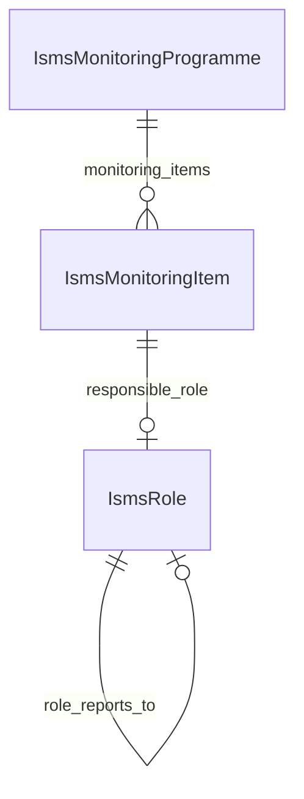

#### Attributes

| Name | Cardinality: | Type | Description |
| --- | --- | --- | --- |
| **[monitoring_alert_threshold](#MonitoringAlertThreshold)** | <sub>0..1</sub> | string | The value that calls for action. |
| **[monitoring_analysis_frequency](#MonitoringAnalysisFrequency)** | <sub>0..1</sub> | string | How often the results are analysed and evaluated. |
| **[monitoring_analyst](#MonitoringAnalyst)** | <sub>0..1</sub> | string | Who analyses and evaluates the results. |
| **[monitoring_current_value](#MonitoringCurrentValue)** | <sub>0..1</sub> | string | The value last measured. |
| **[monitoring_description](#MonitoringDescription)** | <sub>0..1</sub> | string | What the measurement shows. |
| **[monitoring_frequency](#MonitoringFrequency)** | <sub>0..1</sub> | string | How often it is measured. |
| **[monitoring_method](#MonitoringMethod)** | <sub>0..1</sub> | string | How it is measured. |
| **[monitoring_metric](#MonitoringMetric)** | <sub>1..1</sub> | string | The name of what is measured. |
| **[monitoring_target](#MonitoringTarget)** | <sub>0..1</sub> | string | The value aimed for. |
| **[monitoring_trend](#MonitoringTrend)** | <sub>0..1</sub> | string | Which way the value is moving. |
| **[responsible_role](#ResponsibleRole)** | <sub>0..1</sub> | [IsmsRole](#IsmsRole) | The role that answers for the record's activity or outcome. |

#### Referenced by:

 *  **[IsmsMonitoringProgramme](#IsmsMonitoringProgramme)** : ismsMonitoringProgramme__monitoring_items  <sub>0..\*</sub> 


### IsmsMonitoringProgramme

The programme of monitoring, measurement, analysis and evaluation of information security performance and of the ISMS's effectiveness.

```mermaid
erDiagram
IsmsManagementSystem {

}
IsmsMonitoringItem {

}
IsmsMonitoringProgramme {

}

IsmsManagementSystem ||--|o IsmsAwarenessProgramme : "isms_awareness_programme"
IsmsManagementSystem ||--|o IsmsCommunicationPlan : "isms_communication_plan"
IsmsManagementSystem ||--|o IsmsMonitoringProgramme : "isms_monitoring_programme"
IsmsManagementSystem ||--|o IsmsOrganization : "isms_organization"
IsmsManagementSystem ||--|o IsmsPolicy : "isms_policy"
IsmsManagementSystem ||--|o IsmsRiskAssessmentProcess : "isms_risk_assessment_process"
IsmsManagementSystem ||--|o IsmsRiskTreatmentProcess : "isms_risk_treatment_process"
IsmsManagementSystem ||--|o IsmsStatementOfApplicability : "isms_statement_of_applicability"
IsmsManagementSystem ||--}o IsmsAsset : "isms_assets"
IsmsManagementSystem ||--}o IsmsAudit : "isms_audits"
IsmsManagementSystem ||--}o IsmsAuditProgramme : "isms_audit_programmes"
IsmsManagementSystem ||--}o IsmsCompetenceRecord : "isms_competence_records"
IsmsManagementSystem ||--}o IsmsControl : "isms_controls"
IsmsManagementSystem ||--}o IsmsCorrectiveAction : "isms_corrective_actions"
IsmsManagementSystem ||--}o IsmsDocumentedInformation : "isms_documented_information"
IsmsManagementSystem ||--}o IsmsImprovementOpportunity : "isms_improvements"
IsmsManagementSystem ||--}o IsmsInterestedParty : "isms_interested_parties"
IsmsManagementSystem ||--}o IsmsManagementReview : "isms_management_reviews"
IsmsManagementSystem ||--}o IsmsNonconformity : "isms_nonconformities"
IsmsManagementSystem ||--}o IsmsObjective : "isms_objectives"
IsmsManagementSystem ||--}o IsmsOperationalProcedure : "isms_operational_procedures"
IsmsManagementSystem ||--}o IsmsResource : "isms_resources"
IsmsManagementSystem ||--}o IsmsRisk : "isms_risks"
IsmsManagementSystem ||--}o IsmsRiskAssessment : "isms_risk_assessments"
IsmsManagementSystem ||--}o IsmsRiskTreatmentPlan : "isms_risk_treatment_plans"
IsmsManagementSystem ||--}o IsmsRole : "isms_roles"
IsmsManagementSystem ||--}o IsmsSecurityEvent : "isms_security_events"
IsmsManagementSystem ||--}o IsmsTopicSpecificPolicy : "isms_topic_specific_policies"
IsmsMonitoringItem ||--|o IsmsRole : "responsible_role"
IsmsMonitoringProgramme ||--}o IsmsMonitoringItem : "monitoring_items"

```

#### Attributes

| Name | Cardinality: | Type | Description |
| --- | --- | --- | --- |
| **[description](#Description)** | <sub>0..1</sub> | string | What the record says or describes, in the organization's own words. |
| **[document_approval_date](#DocumentApprovalDate)** | <sub>0..1</sub> | date | When the document was approved. |
| **[document_approver](#DocumentApprover)** | <sub>0..1</sub> | string | Who approved the document. |
| **[document_author](#DocumentAuthor)** | <sub>0..1</sub> | string | Who wrote the document. |
| **[document_change_control](#DocumentChangeControl)** | <sub>0..1</sub> | string | How changes to the document are controlled, such as version control. |
| **[document_classification](#DocumentClassification)** | <sub>0..1</sub> | string | The information classification the document carries. |
| **[document_distribution](#DocumentDistribution)** | <sub>0..\*</sub> | string | How the document is distributed, accessed, retrieved and used. |
| **[document_effective_date](#DocumentEffectiveDate)** | <sub>0..1</sub> | date | When the document takes effect. |
| **[document_external_origin](#DocumentExternalOrigin)** | <sub>0..1</sub> | boolean | Whether the document comes from outside the organization and is kept because the ISMS needs it. |
| **[document_external_source](#DocumentExternalSource)** | <sub>0..1</sub> | string | Who the document came from, when it comes from outside. |
| **[document_last_review_date](#DocumentLastReviewDate)** | <sub>0..1</sub> | date | When the document was last reviewed. |
| **[document_next_review_date](#DocumentNextReviewDate)** | <sub>0..1</sub> | date | When the document is next due for review. |
| **[document_owner](#DocumentOwner)** | <sub>0..1</sub> | string | Who answers for the document's content and upkeep. |
| **[document_reference](#DocumentReference)** | <sub>0..1</sub> | string | The reference the organization's document control gives it. |
| **[document_retention](#DocumentRetention)** | <sub>0..1</sub> | isms_duration | How long the document is kept, as an ISO 8601 duration. |
| **[document_status](#DocumentStatus)** | <sub>0..1</sub> | string | Where the document stands in its life, in the organization's own terms, such as draft, approved or withdrawn. |
| **[document_storage](#DocumentStorage)** | <sub>0..1</sub> | string | How the document is stored and preserved, so that it stays legible. |
| **[document_version](#DocumentVersion)** | <sub>0..1</sub> | string | The version of the document. |
| **[isms_id](#IsmsId)** | <sub>1..1</sub> | uriorcurie | The record's identifier, unique among the ISMS's records, such as a URI or a CURIE. Other records refer to the record by it. |
| **[title](#Title)** | <sub>1..1</sub> | string | The name the organization gives the record. |
| **[monitoring_items](#MonitoringItems)** | <sub>0..\*</sub> | [IsmsMonitoringItem](#IsmsMonitoringItem) | What the programme monitors and measures. |

#### Uses

 *  mixin: [IsmsDocumentControlMixin](#IsmsDocumentControlMixin) - The control that documented information is kept under: who wrote, owns and approved it, when it takes effect and is reviewed, how it is classified, distributed, stored and changed, how long it is retained, and whether it came from outside the organization.
 *  mixin: [IsmsRecordMixin](#IsmsRecordMixin) - What every record of the ISMS has, so that other records can refer to it: an identifier, a title and a description.

#### Referenced by:

 *  **[IsmsManagementSystem](#IsmsManagementSystem)** : ismsManagementSystem__isms_monitoring_programme  <sub>0..1</sub> 


### IsmsNonconformity

A nonconformity: a requirement not met, how it was found and contained, its consequences and cause, and how it was closed.

```mermaid
erDiagram
IsmsCorrectiveAction {

}
IsmsManagementSystem {

}
IsmsNonconformity {

}

IsmsCorrectiveAction ||--|o IsmsRole : "responsible_role"
IsmsCorrectiveAction ||--}o IsmsNonconformity : "action_nonconformities"
IsmsManagementSystem ||--|o IsmsAwarenessProgramme : "isms_awareness_programme"
IsmsManagementSystem ||--|o IsmsCommunicationPlan : "isms_communication_plan"
IsmsManagementSystem ||--|o IsmsMonitoringProgramme : "isms_monitoring_programme"
IsmsManagementSystem ||--|o IsmsOrganization : "isms_organization"
IsmsManagementSystem ||--|o IsmsPolicy : "isms_policy"
IsmsManagementSystem ||--|o IsmsRiskAssessmentProcess : "isms_risk_assessment_process"
IsmsManagementSystem ||--|o IsmsRiskTreatmentProcess : "isms_risk_treatment_process"
IsmsManagementSystem ||--|o IsmsStatementOfApplicability : "isms_statement_of_applicability"
IsmsManagementSystem ||--}o IsmsAsset : "isms_assets"
IsmsManagementSystem ||--}o IsmsAudit : "isms_audits"
IsmsManagementSystem ||--}o IsmsAuditProgramme : "isms_audit_programmes"
IsmsManagementSystem ||--}o IsmsCompetenceRecord : "isms_competence_records"
IsmsManagementSystem ||--}o IsmsControl : "isms_controls"
IsmsManagementSystem ||--}o IsmsCorrectiveAction : "isms_corrective_actions"
IsmsManagementSystem ||--}o IsmsDocumentedInformation : "isms_documented_information"
IsmsManagementSystem ||--}o IsmsImprovementOpportunity : "isms_improvements"
IsmsManagementSystem ||--}o IsmsInterestedParty : "isms_interested_parties"
IsmsManagementSystem ||--}o IsmsManagementReview : "isms_management_reviews"
IsmsManagementSystem ||--}o IsmsNonconformity : "isms_nonconformities"
IsmsManagementSystem ||--}o IsmsObjective : "isms_objectives"
IsmsManagementSystem ||--}o IsmsOperationalProcedure : "isms_operational_procedures"
IsmsManagementSystem ||--}o IsmsResource : "isms_resources"
IsmsManagementSystem ||--}o IsmsRisk : "isms_risks"
IsmsManagementSystem ||--}o IsmsRiskAssessment : "isms_risk_assessments"
IsmsManagementSystem ||--}o IsmsRiskTreatmentPlan : "isms_risk_treatment_plans"
IsmsManagementSystem ||--}o IsmsRole : "isms_roles"
IsmsManagementSystem ||--}o IsmsSecurityEvent : "isms_security_events"
IsmsManagementSystem ||--}o IsmsTopicSpecificPolicy : "isms_topic_specific_policies"

```

#### Attributes

| Name | Cardinality: | Type | Description |
| --- | --- | --- | --- |
| **[description](#Description)** | <sub>0..1</sub> | string | What the record says or describes, in the organization's own words. |
| **[isms_id](#IsmsId)** | <sub>1..1</sub> | uriorcurie | The record's identifier, unique among the ISMS's records, such as a URI or a CURIE. Other records refer to the record by it. |
| **[title](#Title)** | <sub>1..1</sub> | string | The name the organization gives the record. |
| **[nonconformity_closure_date](#NonconformityClosureDate)** | <sub>0..1</sub> | date | When it was closed. |
| **[nonconformity_closure_evidence](#NonconformityClosureEvidence)** | <sub>0..1</sub> | string | What shows that it is closed. |
| **[nonconformity_consequences](#NonconformityConsequences)** | <sub>0..1</sub> | string | How its consequences were dealt with. |
| **[nonconformity_detected_by](#NonconformityDetectedBy)** | <sub>0..1</sub> | string | Who or what found it. |
| **[nonconformity_detected_on](#NonconformityDetectedOn)** | <sub>0..1</sub> | date | When the nonconformity was found. |
| **[nonconformity_immediate_actions](#NonconformityImmediateActions)** | <sub>0..\*</sub> | string | What was done at once to control and correct it. |
| **[nonconformity_requirement](#NonconformityRequirement)** | <sub>0..1</sub> | string | The requirement that was not met, of ISO/IEC 27001, of the organization or of an interested party. |
| **[nonconformity_root_cause](#NonconformityRootCause)** | <sub>0..1</sub> | string | What caused it. |
| **[nonconformity_similar_check](#NonconformitySimilarCheck)** | <sub>0..1</sub> | string | Whether similar nonconformities exist or could occur, and where. |
| **[nonconformity_source](#NonconformitySource)** | <sub>0..1</sub> | string | How the nonconformity came to light, such as an audit, a review or an incident. |
| **[nonconformity_status](#NonconformityStatus)** | <sub>0..1</sub> | string | Where the nonconformity stands, in the organization's own terms. |

#### Uses

 *  mixin: [IsmsRecordMixin](#IsmsRecordMixin) - What every record of the ISMS has, so that other records can refer to it: an identifier, a title and a description.

#### Referenced by:

 *  **[IsmsCorrectiveAction](#IsmsCorrectiveAction)** : ismsCorrectiveAction__action_nonconformities  <sub>0..\*</sub> 
 *  **[IsmsManagementSystem](#IsmsManagementSystem)** : ismsManagementSystem__isms_nonconformities  <sub>0..\*</sub> 


### IsmsObjective

An information security objective: a measurable result the organization aims for, with how it plans to reach it and how it measures progress.

```mermaid
erDiagram
IsmsControl {

}
IsmsManagementSystem {

}
IsmsObjective {

}
IsmsRisk {

}
IsmsRole {

}

IsmsControl ||--}o IsmsControl : "relevant_controls"
IsmsManagementSystem ||--|o IsmsAwarenessProgramme : "isms_awareness_programme"
IsmsManagementSystem ||--|o IsmsCommunicationPlan : "isms_communication_plan"
IsmsManagementSystem ||--|o IsmsMonitoringProgramme : "isms_monitoring_programme"
IsmsManagementSystem ||--|o IsmsOrganization : "isms_organization"
IsmsManagementSystem ||--|o IsmsPolicy : "isms_policy"
IsmsManagementSystem ||--|o IsmsRiskAssessmentProcess : "isms_risk_assessment_process"
IsmsManagementSystem ||--|o IsmsRiskTreatmentProcess : "isms_risk_treatment_process"
IsmsManagementSystem ||--|o IsmsStatementOfApplicability : "isms_statement_of_applicability"
IsmsManagementSystem ||--}o IsmsAsset : "isms_assets"
IsmsManagementSystem ||--}o IsmsAudit : "isms_audits"
IsmsManagementSystem ||--}o IsmsAuditProgramme : "isms_audit_programmes"
IsmsManagementSystem ||--}o IsmsCompetenceRecord : "isms_competence_records"
IsmsManagementSystem ||--}o IsmsControl : "isms_controls"
IsmsManagementSystem ||--}o IsmsCorrectiveAction : "isms_corrective_actions"
IsmsManagementSystem ||--}o IsmsDocumentedInformation : "isms_documented_information"
IsmsManagementSystem ||--}o IsmsImprovementOpportunity : "isms_improvements"
IsmsManagementSystem ||--}o IsmsInterestedParty : "isms_interested_parties"
IsmsManagementSystem ||--}o IsmsManagementReview : "isms_management_reviews"
IsmsManagementSystem ||--}o IsmsNonconformity : "isms_nonconformities"
IsmsManagementSystem ||--}o IsmsObjective : "isms_objectives"
IsmsManagementSystem ||--}o IsmsOperationalProcedure : "isms_operational_procedures"
IsmsManagementSystem ||--}o IsmsResource : "isms_resources"
IsmsManagementSystem ||--}o IsmsRisk : "isms_risks"
IsmsManagementSystem ||--}o IsmsRiskAssessment : "isms_risk_assessments"
IsmsManagementSystem ||--}o IsmsRiskTreatmentPlan : "isms_risk_treatment_plans"
IsmsManagementSystem ||--}o IsmsRole : "isms_roles"
IsmsManagementSystem ||--}o IsmsSecurityEvent : "isms_security_events"
IsmsManagementSystem ||--}o IsmsTopicSpecificPolicy : "isms_topic_specific_policies"
IsmsObjective ||--|o IsmsRole : "responsible_role"
IsmsObjective ||--}o IsmsControl : "relevant_controls"
IsmsObjective ||--}o IsmsRisk : "objective_risks"
IsmsRisk ||--}o IsmsAsset : "affected_assets"
IsmsRisk ||--}o IsmsControl : "risk_existing_controls"
IsmsRole ||--|o IsmsRole : "role_reports_to"

```

#### Attributes

| Name | Cardinality: | Type | Description |
| --- | --- | --- | --- |
| **[description](#Description)** | <sub>0..1</sub> | string | What the record says or describes, in the organization's own words. |
| **[isms_id](#IsmsId)** | <sub>1..1</sub> | uriorcurie | The record's identifier, unique among the ISMS's records, such as a URI or a CURIE. Other records refer to the record by it. |
| **[title](#Title)** | <sub>1..1</sub> | string | The name the organization gives the record. |
| **[objective_achievement](#ObjectiveAchievement)** | <sub>0..1</sub> | string | How far the objective has been reached, in the organization's own terms. |
| **[objective_action_plan](#ObjectiveActionPlan)** | <sub>0..1</sub> | string | What will be done to reach the objective. |
| **[objective_current_value](#ObjectiveCurrentValue)** | <sub>0..1</sub> | string | The value last measured. |
| **[objective_measurement_frequency](#ObjectiveMeasurementFrequency)** | <sub>0..1</sub> | string | How often the value is measured. |
| **[objective_measurement_method](#ObjectiveMeasurementMethod)** | <sub>0..1</sub> | string | How the value is measured. |
| **[objective_metric](#ObjectiveMetric)** | <sub>0..1</sub> | string | How the objective's value is defined. |
| **[objective_resources](#ObjectiveResources)** | <sub>0..1</sub> | string | The resources needed to reach the objective. |
| **[objective_risks](#ObjectiveRisks)** | <sub>0..\*</sub> | [IsmsRisk](#IsmsRisk) | The risks the objective concerns. |
| **[objective_statement](#ObjectiveStatement)** | <sub>0..1</sub> | string | The objective, as the organization states it. |
| **[objective_target](#ObjectiveTarget)** | <sub>0..1</sub> | string | The value the objective aims for. |
| **[objective_target_date](#ObjectiveTargetDate)** | <sub>0..1</sub> | date | When the objective is to be reached. |
| **[relevant_controls](#RelevantControls)** | <sub>0..\*</sub> | [IsmsControl](#IsmsControl) | The organization's controls that the record concerns. |
| **[responsible_role](#ResponsibleRole)** | <sub>0..1</sub> | [IsmsRole](#IsmsRole) | The role that answers for the record's activity or outcome. |

#### Uses

 *  mixin: [IsmsRecordMixin](#IsmsRecordMixin) - What every record of the ISMS has, so that other records can refer to it: an identifier, a title and a description.

#### Referenced by:

 *  **[IsmsManagementSystem](#IsmsManagementSystem)** : ismsManagementSystem__isms_objectives  <sub>0..\*</sub> 


### IsmsOperationalProcedure

A procedure by which the organization plans and controls the processes that meet its information security requirements.

```mermaid
erDiagram
IsmsControl {

}
IsmsManagementSystem {

}
IsmsOperationalProcedure {

}
IsmsRole {

}

IsmsControl ||--}o IsmsControl : "relevant_controls"
IsmsManagementSystem ||--|o IsmsAwarenessProgramme : "isms_awareness_programme"
IsmsManagementSystem ||--|o IsmsCommunicationPlan : "isms_communication_plan"
IsmsManagementSystem ||--|o IsmsMonitoringProgramme : "isms_monitoring_programme"
IsmsManagementSystem ||--|o IsmsOrganization : "isms_organization"
IsmsManagementSystem ||--|o IsmsPolicy : "isms_policy"
IsmsManagementSystem ||--|o IsmsRiskAssessmentProcess : "isms_risk_assessment_process"
IsmsManagementSystem ||--|o IsmsRiskTreatmentProcess : "isms_risk_treatment_process"
IsmsManagementSystem ||--|o IsmsStatementOfApplicability : "isms_statement_of_applicability"
IsmsManagementSystem ||--}o IsmsAsset : "isms_assets"
IsmsManagementSystem ||--}o IsmsAudit : "isms_audits"
IsmsManagementSystem ||--}o IsmsAuditProgramme : "isms_audit_programmes"
IsmsManagementSystem ||--}o IsmsCompetenceRecord : "isms_competence_records"
IsmsManagementSystem ||--}o IsmsControl : "isms_controls"
IsmsManagementSystem ||--}o IsmsCorrectiveAction : "isms_corrective_actions"
IsmsManagementSystem ||--}o IsmsDocumentedInformation : "isms_documented_information"
IsmsManagementSystem ||--}o IsmsImprovementOpportunity : "isms_improvements"
IsmsManagementSystem ||--}o IsmsInterestedParty : "isms_interested_parties"
IsmsManagementSystem ||--}o IsmsManagementReview : "isms_management_reviews"
IsmsManagementSystem ||--}o IsmsNonconformity : "isms_nonconformities"
IsmsManagementSystem ||--}o IsmsObjective : "isms_objectives"
IsmsManagementSystem ||--}o IsmsOperationalProcedure : "isms_operational_procedures"
IsmsManagementSystem ||--}o IsmsResource : "isms_resources"
IsmsManagementSystem ||--}o IsmsRisk : "isms_risks"
IsmsManagementSystem ||--}o IsmsRiskAssessment : "isms_risk_assessments"
IsmsManagementSystem ||--}o IsmsRiskTreatmentPlan : "isms_risk_treatment_plans"
IsmsManagementSystem ||--}o IsmsRole : "isms_roles"
IsmsManagementSystem ||--}o IsmsSecurityEvent : "isms_security_events"
IsmsManagementSystem ||--}o IsmsTopicSpecificPolicy : "isms_topic_specific_policies"
IsmsOperationalProcedure ||--}o IsmsControl : "relevant_controls"
IsmsOperationalProcedure ||--}o IsmsRole : "procedure_roles"
IsmsRole ||--|o IsmsRole : "role_reports_to"

```

#### Attributes

| Name | Cardinality: | Type | Description |
| --- | --- | --- | --- |
| **[description](#Description)** | <sub>0..1</sub> | string | What the record says or describes, in the organization's own words. |
| **[document_approval_date](#DocumentApprovalDate)** | <sub>0..1</sub> | date | When the document was approved. |
| **[document_approver](#DocumentApprover)** | <sub>0..1</sub> | string | Who approved the document. |
| **[document_author](#DocumentAuthor)** | <sub>0..1</sub> | string | Who wrote the document. |
| **[document_change_control](#DocumentChangeControl)** | <sub>0..1</sub> | string | How changes to the document are controlled, such as version control. |
| **[document_classification](#DocumentClassification)** | <sub>0..1</sub> | string | The information classification the document carries. |
| **[document_distribution](#DocumentDistribution)** | <sub>0..\*</sub> | string | How the document is distributed, accessed, retrieved and used. |
| **[document_effective_date](#DocumentEffectiveDate)** | <sub>0..1</sub> | date | When the document takes effect. |
| **[document_external_origin](#DocumentExternalOrigin)** | <sub>0..1</sub> | boolean | Whether the document comes from outside the organization and is kept because the ISMS needs it. |
| **[document_external_source](#DocumentExternalSource)** | <sub>0..1</sub> | string | Who the document came from, when it comes from outside. |
| **[document_last_review_date](#DocumentLastReviewDate)** | <sub>0..1</sub> | date | When the document was last reviewed. |
| **[document_next_review_date](#DocumentNextReviewDate)** | <sub>0..1</sub> | date | When the document is next due for review. |
| **[document_owner](#DocumentOwner)** | <sub>0..1</sub> | string | Who answers for the document's content and upkeep. |
| **[document_reference](#DocumentReference)** | <sub>0..1</sub> | string | The reference the organization's document control gives it. |
| **[document_retention](#DocumentRetention)** | <sub>0..1</sub> | isms_duration | How long the document is kept, as an ISO 8601 duration. |
| **[document_status](#DocumentStatus)** | <sub>0..1</sub> | string | Where the document stands in its life, in the organization's own terms, such as draft, approved or withdrawn. |
| **[document_storage](#DocumentStorage)** | <sub>0..1</sub> | string | How the document is stored and preserved, so that it stays legible. |
| **[document_version](#DocumentVersion)** | <sub>0..1</sub> | string | The version of the document. |
| **[isms_id](#IsmsId)** | <sub>1..1</sub> | uriorcurie | The record's identifier, unique among the ISMS's records, such as a URI or a CURIE. Other records refer to the record by it. |
| **[title](#Title)** | <sub>1..1</sub> | string | The name the organization gives the record. |
| **[procedure_change_control](#ProcedureChangeControl)** | <sub>0..1</sub> | string | How changes to the processes are controlled. |
| **[procedure_control_measures](#ProcedureControlMeasures)** | <sub>0..\*</sub> | string | The measures that control the processes. |
| **[procedure_criteria](#ProcedureCriteria)** | <sub>0..1</sub> | string | The criteria the processes are run to. |
| **[procedure_roles](#ProcedureRoles)** | <sub>0..\*</sub> | [IsmsRole](#IsmsRole) | The roles that carry out the procedure. |
| **[procedure_scope](#ProcedureScope)** | <sub>0..1</sub> | string | What the procedure covers. |
| **[relevant_controls](#RelevantControls)** | <sub>0..\*</sub> | [IsmsControl](#IsmsControl) | The organization's controls that the record concerns. |

#### Uses

 *  mixin: [IsmsDocumentControlMixin](#IsmsDocumentControlMixin) - The control that documented information is kept under: who wrote, owns and approved it, when it takes effect and is reviewed, how it is classified, distributed, stored and changed, how long it is retained, and whether it came from outside the organization.
 *  mixin: [IsmsRecordMixin](#IsmsRecordMixin) - What every record of the ISMS has, so that other records can refer to it: an identifier, a title and a description.

#### Referenced by:

 *  **[IsmsManagementSystem](#IsmsManagementSystem)** : ismsManagementSystem__isms_operational_procedures  <sub>0..\*</sub> 


### IsmsOrganization

The organization that runs the ISMS, with what it needs to know about itself to understand its context.

```mermaid
erDiagram
IsmsManagementSystem {

}
IsmsOrganization {

}

IsmsManagementSystem ||--|o IsmsAwarenessProgramme : "isms_awareness_programme"
IsmsManagementSystem ||--|o IsmsCommunicationPlan : "isms_communication_plan"
IsmsManagementSystem ||--|o IsmsMonitoringProgramme : "isms_monitoring_programme"
IsmsManagementSystem ||--|o IsmsOrganization : "isms_organization"
IsmsManagementSystem ||--|o IsmsPolicy : "isms_policy"
IsmsManagementSystem ||--|o IsmsRiskAssessmentProcess : "isms_risk_assessment_process"
IsmsManagementSystem ||--|o IsmsRiskTreatmentProcess : "isms_risk_treatment_process"
IsmsManagementSystem ||--|o IsmsStatementOfApplicability : "isms_statement_of_applicability"
IsmsManagementSystem ||--}o IsmsAsset : "isms_assets"
IsmsManagementSystem ||--}o IsmsAudit : "isms_audits"
IsmsManagementSystem ||--}o IsmsAuditProgramme : "isms_audit_programmes"
IsmsManagementSystem ||--}o IsmsCompetenceRecord : "isms_competence_records"
IsmsManagementSystem ||--}o IsmsControl : "isms_controls"
IsmsManagementSystem ||--}o IsmsCorrectiveAction : "isms_corrective_actions"
IsmsManagementSystem ||--}o IsmsDocumentedInformation : "isms_documented_information"
IsmsManagementSystem ||--}o IsmsImprovementOpportunity : "isms_improvements"
IsmsManagementSystem ||--}o IsmsInterestedParty : "isms_interested_parties"
IsmsManagementSystem ||--}o IsmsManagementReview : "isms_management_reviews"
IsmsManagementSystem ||--}o IsmsNonconformity : "isms_nonconformities"
IsmsManagementSystem ||--}o IsmsObjective : "isms_objectives"
IsmsManagementSystem ||--}o IsmsOperationalProcedure : "isms_operational_procedures"
IsmsManagementSystem ||--}o IsmsResource : "isms_resources"
IsmsManagementSystem ||--}o IsmsRisk : "isms_risks"
IsmsManagementSystem ||--}o IsmsRiskAssessment : "isms_risk_assessments"
IsmsManagementSystem ||--}o IsmsRiskTreatmentPlan : "isms_risk_treatment_plans"
IsmsManagementSystem ||--}o IsmsRole : "isms_roles"
IsmsManagementSystem ||--}o IsmsSecurityEvent : "isms_security_events"
IsmsManagementSystem ||--}o IsmsTopicSpecificPolicy : "isms_topic_specific_policies"

```

#### Attributes

| Name | Cardinality: | Type | Description |
| --- | --- | --- | --- |
| **[description](#Description)** | <sub>0..1</sub> | string | What the record says or describes, in the organization's own words. |
| **[isms_id](#IsmsId)** | <sub>1..1</sub> | uriorcurie | The record's identifier, unique among the ISMS's records, such as a URI or a CURIE. Other records refer to the record by it. |
| **[title](#Title)** | <sub>1..1</sub> | string | The name the organization gives the record. |
| **[organization_climate_change_relevant](#OrganizationClimateChangeRelevant)** | <sub>0..1</sub> | boolean | Whether the organization has determined that climate change is a relevant issue for its ISMS. |
| **[organization_employee_count](#OrganizationEmployeeCount)** | <sub>0..1</sub> | integer | About how many people the organization employs. |
| **[organization_jurisdictions](#OrganizationJurisdictions)** | <sub>0..\*</sub> | string | The jurisdictions whose laws and regulations apply to the organization. |
| **[organization_kind](#OrganizationKind)** | <sub>0..1</sub> | string | What kind of organization it is, such as a company, an agency or a charity. |
| **[organization_legal_name](#OrganizationLegalName)** | <sub>0..1</sub> | string | The organization's registered legal name. |
| **[organization_locations](#OrganizationLocations)** | <sub>0..\*</sub> | string | The countries or regions the organization works in. |
| **[organization_parent](#OrganizationParent)** | <sub>0..1</sub> | string | The organization's parent, if it has one. |
| **[organization_sector](#OrganizationSector)** | <sub>0..1</sub> | string | The organization's main industry sector. |
| **[organization_size](#OrganizationSize)** | <sub>0..1</sub> | string | How the organization classes its own size. |
| **[organization_subsidiaries](#OrganizationSubsidiaries)** | <sub>0..\*</sub> | string | The organization's subsidiaries, if it has any. |
| **[organization_trading_names](#OrganizationTradingNames)** | <sub>0..\*</sub> | string | Other names the organization trades under. |

#### Uses

 *  mixin: [IsmsRecordMixin](#IsmsRecordMixin) - What every record of the ISMS has, so that other records can refer to it: an identifier, a title and a description.

#### Referenced by:

 *  **[IsmsManagementSystem](#IsmsManagementSystem)** : ismsManagementSystem__isms_organization  <sub>0..1</sub> 


### IsmsPolicy

The information security policy that top management sets: the organization's commitment and the frame for its information security objectives.

```mermaid
erDiagram
IsmsManagementSystem {

}
IsmsPolicy {

}
IsmsTopicSpecificPolicy {

}

IsmsManagementSystem ||--|o IsmsAwarenessProgramme : "isms_awareness_programme"
IsmsManagementSystem ||--|o IsmsCommunicationPlan : "isms_communication_plan"
IsmsManagementSystem ||--|o IsmsMonitoringProgramme : "isms_monitoring_programme"
IsmsManagementSystem ||--|o IsmsOrganization : "isms_organization"
IsmsManagementSystem ||--|o IsmsPolicy : "isms_policy"
IsmsManagementSystem ||--|o IsmsRiskAssessmentProcess : "isms_risk_assessment_process"
IsmsManagementSystem ||--|o IsmsRiskTreatmentProcess : "isms_risk_treatment_process"
IsmsManagementSystem ||--|o IsmsStatementOfApplicability : "isms_statement_of_applicability"
IsmsManagementSystem ||--}o IsmsAsset : "isms_assets"
IsmsManagementSystem ||--}o IsmsAudit : "isms_audits"
IsmsManagementSystem ||--}o IsmsAuditProgramme : "isms_audit_programmes"
IsmsManagementSystem ||--}o IsmsCompetenceRecord : "isms_competence_records"
IsmsManagementSystem ||--}o IsmsControl : "isms_controls"
IsmsManagementSystem ||--}o IsmsCorrectiveAction : "isms_corrective_actions"
IsmsManagementSystem ||--}o IsmsDocumentedInformation : "isms_documented_information"
IsmsManagementSystem ||--}o IsmsImprovementOpportunity : "isms_improvements"
IsmsManagementSystem ||--}o IsmsInterestedParty : "isms_interested_parties"
IsmsManagementSystem ||--}o IsmsManagementReview : "isms_management_reviews"
IsmsManagementSystem ||--}o IsmsNonconformity : "isms_nonconformities"
IsmsManagementSystem ||--}o IsmsObjective : "isms_objectives"
IsmsManagementSystem ||--}o IsmsOperationalProcedure : "isms_operational_procedures"
IsmsManagementSystem ||--}o IsmsResource : "isms_resources"
IsmsManagementSystem ||--}o IsmsRisk : "isms_risks"
IsmsManagementSystem ||--}o IsmsRiskAssessment : "isms_risk_assessments"
IsmsManagementSystem ||--}o IsmsRiskTreatmentPlan : "isms_risk_treatment_plans"
IsmsManagementSystem ||--}o IsmsRole : "isms_roles"
IsmsManagementSystem ||--}o IsmsSecurityEvent : "isms_security_events"
IsmsManagementSystem ||--}o IsmsTopicSpecificPolicy : "isms_topic_specific_policies"
IsmsTopicSpecificPolicy ||--|o IsmsPolicy : "topic_policy_parent"
IsmsTopicSpecificPolicy ||--}o IsmsControl : "relevant_controls"

```

#### Attributes

| Name | Cardinality: | Type | Description |
| --- | --- | --- | --- |
| **[description](#Description)** | <sub>0..1</sub> | string | What the record says or describes, in the organization's own words. |
| **[document_approval_date](#DocumentApprovalDate)** | <sub>0..1</sub> | date | When the document was approved. |
| **[document_approver](#DocumentApprover)** | <sub>0..1</sub> | string | Who approved the document. |
| **[document_author](#DocumentAuthor)** | <sub>0..1</sub> | string | Who wrote the document. |
| **[document_change_control](#DocumentChangeControl)** | <sub>0..1</sub> | string | How changes to the document are controlled, such as version control. |
| **[document_classification](#DocumentClassification)** | <sub>0..1</sub> | string | The information classification the document carries. |
| **[document_distribution](#DocumentDistribution)** | <sub>0..\*</sub> | string | How the document is distributed, accessed, retrieved and used. |
| **[document_effective_date](#DocumentEffectiveDate)** | <sub>0..1</sub> | date | When the document takes effect. |
| **[document_external_origin](#DocumentExternalOrigin)** | <sub>0..1</sub> | boolean | Whether the document comes from outside the organization and is kept because the ISMS needs it. |
| **[document_external_source](#DocumentExternalSource)** | <sub>0..1</sub> | string | Who the document came from, when it comes from outside. |
| **[document_last_review_date](#DocumentLastReviewDate)** | <sub>0..1</sub> | date | When the document was last reviewed. |
| **[document_next_review_date](#DocumentNextReviewDate)** | <sub>0..1</sub> | date | When the document is next due for review. |
| **[document_owner](#DocumentOwner)** | <sub>0..1</sub> | string | Who answers for the document's content and upkeep. |
| **[document_reference](#DocumentReference)** | <sub>0..1</sub> | string | The reference the organization's document control gives it. |
| **[document_retention](#DocumentRetention)** | <sub>0..1</sub> | isms_duration | How long the document is kept, as an ISO 8601 duration. |
| **[document_status](#DocumentStatus)** | <sub>0..1</sub> | string | Where the document stands in its life, in the organization's own terms, such as draft, approved or withdrawn. |
| **[document_storage](#DocumentStorage)** | <sub>0..1</sub> | string | How the document is stored and preserved, so that it stays legible. |
| **[document_version](#DocumentVersion)** | <sub>0..1</sub> | string | The version of the document. |
| **[isms_id](#IsmsId)** | <sub>1..1</sub> | uriorcurie | The record's identifier, unique among the ISMS's records, such as a URI or a CURIE. Other records refer to the record by it. |
| **[title](#Title)** | <sub>1..1</sub> | string | The name the organization gives the record. |
| **[policy_acknowledgement_required](#PolicyAcknowledgementRequired)** | <sub>0..1</sub> | boolean | Whether staff must acknowledge the policy. |
| **[policy_applicability](#PolicyApplicability)** | <sub>0..1</sub> | string | To whom and to what the policy applies. |
| **[policy_commitments](#PolicyCommitments)** | <sub>0..\*</sub> | string | The commitments the policy makes. |
| **[policy_communication_date](#PolicyCommunicationDate)** | <sub>0..1</sub> | date | When the policy was communicated within the organization. |
| **[policy_management_systems](#PolicyManagementSystems)** | <sub>0..\*</sub> | [IsmsManagementSystemStandard](#IsmsManagementSystemStandard) | The other management system standards the ISMS is integrated with under the same policy. |
| **[policy_objectives_framework](#PolicyObjectivesFramework)** | <sub>0..1</sub> | string | How the policy frames the setting of information security objectives. |
| **[policy_statement](#PolicyStatement)** | <sub>0..1</sub> | string | The policy's own statement, in the organization's words. |

#### Uses

 *  mixin: [IsmsDocumentControlMixin](#IsmsDocumentControlMixin) - The control that documented information is kept under: who wrote, owns and approved it, when it takes effect and is reviewed, how it is classified, distributed, stored and changed, how long it is retained, and whether it came from outside the organization.
 *  mixin: [IsmsRecordMixin](#IsmsRecordMixin) - What every record of the ISMS has, so that other records can refer to it: an identifier, a title and a description.

#### Referenced by:

 *  **[IsmsManagementSystem](#IsmsManagementSystem)** : ismsManagementSystem__isms_policy  <sub>0..1</sub> 
 *  **[IsmsTopicSpecificPolicy](#IsmsTopicSpecificPolicy)** : ismsTopicSpecificPolicy__topic_policy_parent  <sub>0..1</sub> 


### IsmsResource

A resource provided for the ISMS, such as people, time, tools or budget.

```mermaid
erDiagram
IsmsManagementSystem {

}
IsmsResource {

}

IsmsManagementSystem ||--|o IsmsAwarenessProgramme : "isms_awareness_programme"
IsmsManagementSystem ||--|o IsmsCommunicationPlan : "isms_communication_plan"
IsmsManagementSystem ||--|o IsmsMonitoringProgramme : "isms_monitoring_programme"
IsmsManagementSystem ||--|o IsmsOrganization : "isms_organization"
IsmsManagementSystem ||--|o IsmsPolicy : "isms_policy"
IsmsManagementSystem ||--|o IsmsRiskAssessmentProcess : "isms_risk_assessment_process"
IsmsManagementSystem ||--|o IsmsRiskTreatmentProcess : "isms_risk_treatment_process"
IsmsManagementSystem ||--|o IsmsStatementOfApplicability : "isms_statement_of_applicability"
IsmsManagementSystem ||--}o IsmsAsset : "isms_assets"
IsmsManagementSystem ||--}o IsmsAudit : "isms_audits"
IsmsManagementSystem ||--}o IsmsAuditProgramme : "isms_audit_programmes"
IsmsManagementSystem ||--}o IsmsCompetenceRecord : "isms_competence_records"
IsmsManagementSystem ||--}o IsmsControl : "isms_controls"
IsmsManagementSystem ||--}o IsmsCorrectiveAction : "isms_corrective_actions"
IsmsManagementSystem ||--}o IsmsDocumentedInformation : "isms_documented_information"
IsmsManagementSystem ||--}o IsmsImprovementOpportunity : "isms_improvements"
IsmsManagementSystem ||--}o IsmsInterestedParty : "isms_interested_parties"
IsmsManagementSystem ||--}o IsmsManagementReview : "isms_management_reviews"
IsmsManagementSystem ||--}o IsmsNonconformity : "isms_nonconformities"
IsmsManagementSystem ||--}o IsmsObjective : "isms_objectives"
IsmsManagementSystem ||--}o IsmsOperationalProcedure : "isms_operational_procedures"
IsmsManagementSystem ||--}o IsmsResource : "isms_resources"
IsmsManagementSystem ||--}o IsmsRisk : "isms_risks"
IsmsManagementSystem ||--}o IsmsRiskAssessment : "isms_risk_assessments"
IsmsManagementSystem ||--}o IsmsRiskTreatmentPlan : "isms_risk_treatment_plans"
IsmsManagementSystem ||--}o IsmsRole : "isms_roles"
IsmsManagementSystem ||--}o IsmsSecurityEvent : "isms_security_events"
IsmsManagementSystem ||--}o IsmsTopicSpecificPolicy : "isms_topic_specific_policies"

```

#### Attributes

| Name | Cardinality: | Type | Description |
| --- | --- | --- | --- |
| **[description](#Description)** | <sub>0..1</sub> | string | What the record says or describes, in the organization's own words. |
| **[isms_id](#IsmsId)** | <sub>1..1</sub> | uriorcurie | The record's identifier, unique among the ISMS's records, such as a URI or a CURIE. Other records refer to the record by it. |
| **[title](#Title)** | <sub>1..1</sub> | string | The name the organization gives the record. |
| **[resource_allocated_to](#ResourceAllocatedTo)** | <sub>0..1</sub> | string | What the resource is allocated to. |
| **[resource_allocation_date](#ResourceAllocationDate)** | <sub>0..1</sub> | date | When the resource was allocated. |
| **[resource_availability](#ResourceAvailability)** | <sub>0..1</sub> | string | Whether the resource is available now, in the organization's own terms. |
| **[resource_category](#ResourceCategory)** | <sub>0..1</sub> | string | What kind of resource it is. |
| **[resource_cost](#ResourceCost)** | <sub>0..1</sub> | string | What the resource costs. |
| **[resource_quantity](#ResourceQuantity)** | <sub>0..1</sub> | string | How much of the resource is provided. |

#### Uses

 *  mixin: [IsmsRecordMixin](#IsmsRecordMixin) - What every record of the ISMS has, so that other records can refer to it: an identifier, a title and a description.

#### Referenced by:

 *  **[IsmsManagementSystem](#IsmsManagementSystem)** : ismsManagementSystem__isms_resources  <sub>0..\*</sub> 


### IsmsRisk

An information security risk in the risk register: where it comes from, what it threatens, who owns it, how it is rated before and after controls, and how it is treated.

```mermaid
erDiagram
IsmsAsset {

}
IsmsControl {

}
IsmsManagementSystem {

}
IsmsObjective {

}
IsmsRisk {

}
IsmsRiskAssessment {

}
IsmsRiskTreatmentPlan {

}

IsmsAsset ||--}o IsmsControl : "relevant_controls"
IsmsControl ||--}o IsmsControl : "relevant_controls"
IsmsManagementSystem ||--|o IsmsAwarenessProgramme : "isms_awareness_programme"
IsmsManagementSystem ||--|o IsmsCommunicationPlan : "isms_communication_plan"
IsmsManagementSystem ||--|o IsmsMonitoringProgramme : "isms_monitoring_programme"
IsmsManagementSystem ||--|o IsmsOrganization : "isms_organization"
IsmsManagementSystem ||--|o IsmsPolicy : "isms_policy"
IsmsManagementSystem ||--|o IsmsRiskAssessmentProcess : "isms_risk_assessment_process"
IsmsManagementSystem ||--|o IsmsRiskTreatmentProcess : "isms_risk_treatment_process"
IsmsManagementSystem ||--|o IsmsStatementOfApplicability : "isms_statement_of_applicability"
IsmsManagementSystem ||--}o IsmsAsset : "isms_assets"
IsmsManagementSystem ||--}o IsmsAudit : "isms_audits"
IsmsManagementSystem ||--}o IsmsAuditProgramme : "isms_audit_programmes"
IsmsManagementSystem ||--}o IsmsCompetenceRecord : "isms_competence_records"
IsmsManagementSystem ||--}o IsmsControl : "isms_controls"
IsmsManagementSystem ||--}o IsmsCorrectiveAction : "isms_corrective_actions"
IsmsManagementSystem ||--}o IsmsDocumentedInformation : "isms_documented_information"
IsmsManagementSystem ||--}o IsmsImprovementOpportunity : "isms_improvements"
IsmsManagementSystem ||--}o IsmsInterestedParty : "isms_interested_parties"
IsmsManagementSystem ||--}o IsmsManagementReview : "isms_management_reviews"
IsmsManagementSystem ||--}o IsmsNonconformity : "isms_nonconformities"
IsmsManagementSystem ||--}o IsmsObjective : "isms_objectives"
IsmsManagementSystem ||--}o IsmsOperationalProcedure : "isms_operational_procedures"
IsmsManagementSystem ||--}o IsmsResource : "isms_resources"
IsmsManagementSystem ||--}o IsmsRisk : "isms_risks"
IsmsManagementSystem ||--}o IsmsRiskAssessment : "isms_risk_assessments"
IsmsManagementSystem ||--}o IsmsRiskTreatmentPlan : "isms_risk_treatment_plans"
IsmsManagementSystem ||--}o IsmsRole : "isms_roles"
IsmsManagementSystem ||--}o IsmsSecurityEvent : "isms_security_events"
IsmsManagementSystem ||--}o IsmsTopicSpecificPolicy : "isms_topic_specific_policies"
IsmsObjective ||--|o IsmsRole : "responsible_role"
IsmsObjective ||--}o IsmsControl : "relevant_controls"
IsmsObjective ||--}o IsmsRisk : "objective_risks"
IsmsRisk ||--}o IsmsAsset : "affected_assets"
IsmsRisk ||--}o IsmsControl : "risk_existing_controls"
IsmsRiskAssessment ||--}o IsmsRisk : "assessment_risks"
IsmsRiskTreatmentPlan ||--}o IsmsControl : "plan_controls"
IsmsRiskTreatmentPlan ||--}o IsmsRisk : "plan_risks"

```

#### Attributes

| Name | Cardinality: | Type | Description |
| --- | --- | --- | --- |
| **[description](#Description)** | <sub>0..1</sub> | string | What the record says or describes, in the organization's own words. |
| **[isms_id](#IsmsId)** | <sub>1..1</sub> | uriorcurie | The record's identifier, unique among the ISMS's records, such as a URI or a CURIE. Other records refer to the record by it. |
| **[title](#Title)** | <sub>1..1</sub> | string | The name the organization gives the record. |
| **[affected_assets](#AffectedAssets)** | <sub>0..\*</sub> | [IsmsAsset](#IsmsAsset) | The assets the risk, event or incident affects. |
| **[affected_security_properties](#AffectedSecurityProperties)** | <sub>0..\*</sub> | [IsmsSecurityProperty](#IsmsSecurityProperty) | Which of confidentiality, integrity and availability the risk or incident threatens. |
| **[risk_existing_controls](#RiskExistingControls)** | <sub>0..\*</sub> | [IsmsControl](#IsmsControl) | The organization's controls already acting on the risk. |
| **[risk_impact](#RiskImpact)** | <sub>0..1</sub> | [IsmsImpact](#IsmsImpact) | How severe the consequences would be. |
| **[risk_inherent_level](#RiskInherentLevel)** | <sub>0..1</sub> | [IsmsRiskLevel](#IsmsRiskLevel) | The risk's level before controls. |
| **[risk_likelihood](#RiskLikelihood)** | <sub>0..1</sub> | [IsmsLikelihood](#IsmsLikelihood) | How likely the risk is. |
| **[risk_owner](#RiskOwner)** | <sub>0..1</sub> | string | The person who is accountable for the risk and has the authority to manage it. |
| **[risk_residual_level](#RiskResidualLevel)** | <sub>0..1</sub> | [IsmsRiskLevel](#IsmsRiskLevel) | The risk's level after controls. |
| **[risk_source](#RiskSource)** | <sub>0..1</sub> | string | Where the risk comes from. |
| **[risk_threat](#RiskThreat)** | <sub>0..1</sub> | string | The threat that could cause harm. |
| **[risk_treatment_option](#RiskTreatmentOption)** | <sub>0..1</sub> | [IsmsRiskTreatmentOption](#IsmsRiskTreatmentOption) | The treatment chosen for the risk. |
| **[risk_treatment_priority](#RiskTreatmentPriority)** | <sub>0..1</sub> | string | How soon the risk is to be treated, in the organization's own terms. |
| **[risk_vulnerability](#RiskVulnerability)** | <sub>0..1</sub> | string | The weakness the threat could exploit. |

#### Uses

 *  mixin: [IsmsRecordMixin](#IsmsRecordMixin) - What every record of the ISMS has, so that other records can refer to it: an identifier, a title and a description.

#### Referenced by:

 *  **[IsmsManagementSystem](#IsmsManagementSystem)** : ismsManagementSystem__isms_risks  <sub>0..\*</sub> 
 *  **[IsmsObjective](#IsmsObjective)** : ismsObjective__objective_risks  <sub>0..\*</sub> 
 *  **[IsmsRiskAssessment](#IsmsRiskAssessment)** : ismsRiskAssessment__assessment_risks  <sub>0..\*</sub> 
 *  **[IsmsRiskTreatmentPlan](#IsmsRiskTreatmentPlan)** : ismsRiskTreatmentPlan__plan_risks  <sub>0..\*</sub> 


### IsmsRiskAssessment

One risk assessment carried out under the risk assessment process, and what it found.

```mermaid
erDiagram
IsmsManagementSystem {

}
IsmsRisk {

}
IsmsRiskAssessment {

}

IsmsManagementSystem ||--|o IsmsAwarenessProgramme : "isms_awareness_programme"
IsmsManagementSystem ||--|o IsmsCommunicationPlan : "isms_communication_plan"
IsmsManagementSystem ||--|o IsmsMonitoringProgramme : "isms_monitoring_programme"
IsmsManagementSystem ||--|o IsmsOrganization : "isms_organization"
IsmsManagementSystem ||--|o IsmsPolicy : "isms_policy"
IsmsManagementSystem ||--|o IsmsRiskAssessmentProcess : "isms_risk_assessment_process"
IsmsManagementSystem ||--|o IsmsRiskTreatmentProcess : "isms_risk_treatment_process"
IsmsManagementSystem ||--|o IsmsStatementOfApplicability : "isms_statement_of_applicability"
IsmsManagementSystem ||--}o IsmsAsset : "isms_assets"
IsmsManagementSystem ||--}o IsmsAudit : "isms_audits"
IsmsManagementSystem ||--}o IsmsAuditProgramme : "isms_audit_programmes"
IsmsManagementSystem ||--}o IsmsCompetenceRecord : "isms_competence_records"
IsmsManagementSystem ||--}o IsmsControl : "isms_controls"
IsmsManagementSystem ||--}o IsmsCorrectiveAction : "isms_corrective_actions"
IsmsManagementSystem ||--}o IsmsDocumentedInformation : "isms_documented_information"
IsmsManagementSystem ||--}o IsmsImprovementOpportunity : "isms_improvements"
IsmsManagementSystem ||--}o IsmsInterestedParty : "isms_interested_parties"
IsmsManagementSystem ||--}o IsmsManagementReview : "isms_management_reviews"
IsmsManagementSystem ||--}o IsmsNonconformity : "isms_nonconformities"
IsmsManagementSystem ||--}o IsmsObjective : "isms_objectives"
IsmsManagementSystem ||--}o IsmsOperationalProcedure : "isms_operational_procedures"
IsmsManagementSystem ||--}o IsmsResource : "isms_resources"
IsmsManagementSystem ||--}o IsmsRisk : "isms_risks"
IsmsManagementSystem ||--}o IsmsRiskAssessment : "isms_risk_assessments"
IsmsManagementSystem ||--}o IsmsRiskTreatmentPlan : "isms_risk_treatment_plans"
IsmsManagementSystem ||--}o IsmsRole : "isms_roles"
IsmsManagementSystem ||--}o IsmsSecurityEvent : "isms_security_events"
IsmsManagementSystem ||--}o IsmsTopicSpecificPolicy : "isms_topic_specific_policies"
IsmsRisk ||--}o IsmsAsset : "affected_assets"
IsmsRisk ||--}o IsmsControl : "risk_existing_controls"
IsmsRiskAssessment ||--}o IsmsRisk : "assessment_risks"

```

#### Attributes

| Name | Cardinality: | Type | Description |
| --- | --- | --- | --- |
| **[description](#Description)** | <sub>0..1</sub> | string | What the record says or describes, in the organization's own words. |
| **[document_approval_date](#DocumentApprovalDate)** | <sub>0..1</sub> | date | When the document was approved. |
| **[document_approver](#DocumentApprover)** | <sub>0..1</sub> | string | Who approved the document. |
| **[document_author](#DocumentAuthor)** | <sub>0..1</sub> | string | Who wrote the document. |
| **[document_change_control](#DocumentChangeControl)** | <sub>0..1</sub> | string | How changes to the document are controlled, such as version control. |
| **[document_classification](#DocumentClassification)** | <sub>0..1</sub> | string | The information classification the document carries. |
| **[document_distribution](#DocumentDistribution)** | <sub>0..\*</sub> | string | How the document is distributed, accessed, retrieved and used. |
| **[document_effective_date](#DocumentEffectiveDate)** | <sub>0..1</sub> | date | When the document takes effect. |
| **[document_external_origin](#DocumentExternalOrigin)** | <sub>0..1</sub> | boolean | Whether the document comes from outside the organization and is kept because the ISMS needs it. |
| **[document_external_source](#DocumentExternalSource)** | <sub>0..1</sub> | string | Who the document came from, when it comes from outside. |
| **[document_last_review_date](#DocumentLastReviewDate)** | <sub>0..1</sub> | date | When the document was last reviewed. |
| **[document_next_review_date](#DocumentNextReviewDate)** | <sub>0..1</sub> | date | When the document is next due for review. |
| **[document_owner](#DocumentOwner)** | <sub>0..1</sub> | string | Who answers for the document's content and upkeep. |
| **[document_reference](#DocumentReference)** | <sub>0..1</sub> | string | The reference the organization's document control gives it. |
| **[document_retention](#DocumentRetention)** | <sub>0..1</sub> | isms_duration | How long the document is kept, as an ISO 8601 duration. |
| **[document_status](#DocumentStatus)** | <sub>0..1</sub> | string | Where the document stands in its life, in the organization's own terms, such as draft, approved or withdrawn. |
| **[document_storage](#DocumentStorage)** | <sub>0..1</sub> | string | How the document is stored and preserved, so that it stays legible. |
| **[document_version](#DocumentVersion)** | <sub>0..1</sub> | string | The version of the document. |
| **[isms_id](#IsmsId)** | <sub>1..1</sub> | uriorcurie | The record's identifier, unique among the ISMS's records, such as a URI or a CURIE. Other records refer to the record by it. |
| **[title](#Title)** | <sub>1..1</sub> | string | The name the organization gives the record. |
| **[assessment_assessor](#AssessmentAssessor)** | <sub>0..1</sub> | string | Who carried out the assessment. |
| **[assessment_date](#AssessmentDate)** | <sub>0..1</sub> | date | When the assessment was carried out. |
| **[assessment_method_used](#AssessmentMethodUsed)** | <sub>0..1</sub> | string | The method this assessment applied. |
| **[assessment_next_date](#AssessmentNextDate)** | <sub>0..1</sub> | date | When the next assessment is planned. |
| **[assessment_recommendations](#AssessmentRecommendations)** | <sub>0..\*</sub> | string | What the assessment recommends. |
| **[assessment_risks](#AssessmentRisks)** | <sub>0..\*</sub> | [IsmsRisk](#IsmsRisk) | The risks the assessment identified. |
| **[assessment_scope](#AssessmentScope)** | <sub>0..1</sub> | string | What the assessment covered. |
| **[assessment_summary](#AssessmentSummary)** | <sub>0..1</sub> | string | A summary of what the assessment found. |

#### Uses

 *  mixin: [IsmsDocumentControlMixin](#IsmsDocumentControlMixin) - The control that documented information is kept under: who wrote, owns and approved it, when it takes effect and is reviewed, how it is classified, distributed, stored and changed, how long it is retained, and whether it came from outside the organization.
 *  mixin: [IsmsRecordMixin](#IsmsRecordMixin) - What every record of the ISMS has, so that other records can refer to it: an identifier, a title and a description.

#### Referenced by:

 *  **[IsmsManagementSystem](#IsmsManagementSystem)** : ismsManagementSystem__isms_risk_assessments  <sub>0..\*</sub> 


### IsmsRiskAssessmentProcess

The organization's process for assessing information security risks: its criteria for accepting risk and for assessing it, its scales and method, and when it runs.

```mermaid
erDiagram
IsmsManagementSystem {

}
IsmsRiskAssessmentProcess {

}

IsmsManagementSystem ||--|o IsmsAwarenessProgramme : "isms_awareness_programme"
IsmsManagementSystem ||--|o IsmsCommunicationPlan : "isms_communication_plan"
IsmsManagementSystem ||--|o IsmsMonitoringProgramme : "isms_monitoring_programme"
IsmsManagementSystem ||--|o IsmsOrganization : "isms_organization"
IsmsManagementSystem ||--|o IsmsPolicy : "isms_policy"
IsmsManagementSystem ||--|o IsmsRiskAssessmentProcess : "isms_risk_assessment_process"
IsmsManagementSystem ||--|o IsmsRiskTreatmentProcess : "isms_risk_treatment_process"
IsmsManagementSystem ||--|o IsmsStatementOfApplicability : "isms_statement_of_applicability"
IsmsManagementSystem ||--}o IsmsAsset : "isms_assets"
IsmsManagementSystem ||--}o IsmsAudit : "isms_audits"
IsmsManagementSystem ||--}o IsmsAuditProgramme : "isms_audit_programmes"
IsmsManagementSystem ||--}o IsmsCompetenceRecord : "isms_competence_records"
IsmsManagementSystem ||--}o IsmsControl : "isms_controls"
IsmsManagementSystem ||--}o IsmsCorrectiveAction : "isms_corrective_actions"
IsmsManagementSystem ||--}o IsmsDocumentedInformation : "isms_documented_information"
IsmsManagementSystem ||--}o IsmsImprovementOpportunity : "isms_improvements"
IsmsManagementSystem ||--}o IsmsInterestedParty : "isms_interested_parties"
IsmsManagementSystem ||--}o IsmsManagementReview : "isms_management_reviews"
IsmsManagementSystem ||--}o IsmsNonconformity : "isms_nonconformities"
IsmsManagementSystem ||--}o IsmsObjective : "isms_objectives"
IsmsManagementSystem ||--}o IsmsOperationalProcedure : "isms_operational_procedures"
IsmsManagementSystem ||--}o IsmsResource : "isms_resources"
IsmsManagementSystem ||--}o IsmsRisk : "isms_risks"
IsmsManagementSystem ||--}o IsmsRiskAssessment : "isms_risk_assessments"
IsmsManagementSystem ||--}o IsmsRiskTreatmentPlan : "isms_risk_treatment_plans"
IsmsManagementSystem ||--}o IsmsRole : "isms_roles"
IsmsManagementSystem ||--}o IsmsSecurityEvent : "isms_security_events"
IsmsManagementSystem ||--}o IsmsTopicSpecificPolicy : "isms_topic_specific_policies"

```

#### Attributes

| Name | Cardinality: | Type | Description |
| --- | --- | --- | --- |
| **[description](#Description)** | <sub>0..1</sub> | string | What the record says or describes, in the organization's own words. |
| **[document_approval_date](#DocumentApprovalDate)** | <sub>0..1</sub> | date | When the document was approved. |
| **[document_approver](#DocumentApprover)** | <sub>0..1</sub> | string | Who approved the document. |
| **[document_author](#DocumentAuthor)** | <sub>0..1</sub> | string | Who wrote the document. |
| **[document_change_control](#DocumentChangeControl)** | <sub>0..1</sub> | string | How changes to the document are controlled, such as version control. |
| **[document_classification](#DocumentClassification)** | <sub>0..1</sub> | string | The information classification the document carries. |
| **[document_distribution](#DocumentDistribution)** | <sub>0..\*</sub> | string | How the document is distributed, accessed, retrieved and used. |
| **[document_effective_date](#DocumentEffectiveDate)** | <sub>0..1</sub> | date | When the document takes effect. |
| **[document_external_origin](#DocumentExternalOrigin)** | <sub>0..1</sub> | boolean | Whether the document comes from outside the organization and is kept because the ISMS needs it. |
| **[document_external_source](#DocumentExternalSource)** | <sub>0..1</sub> | string | Who the document came from, when it comes from outside. |
| **[document_last_review_date](#DocumentLastReviewDate)** | <sub>0..1</sub> | date | When the document was last reviewed. |
| **[document_next_review_date](#DocumentNextReviewDate)** | <sub>0..1</sub> | date | When the document is next due for review. |
| **[document_owner](#DocumentOwner)** | <sub>0..1</sub> | string | Who answers for the document's content and upkeep. |
| **[document_reference](#DocumentReference)** | <sub>0..1</sub> | string | The reference the organization's document control gives it. |
| **[document_retention](#DocumentRetention)** | <sub>0..1</sub> | isms_duration | How long the document is kept, as an ISO 8601 duration. |
| **[document_status](#DocumentStatus)** | <sub>0..1</sub> | string | Where the document stands in its life, in the organization's own terms, such as draft, approved or withdrawn. |
| **[document_storage](#DocumentStorage)** | <sub>0..1</sub> | string | How the document is stored and preserved, so that it stays legible. |
| **[document_version](#DocumentVersion)** | <sub>0..1</sub> | string | The version of the document. |
| **[isms_id](#IsmsId)** | <sub>1..1</sub> | uriorcurie | The record's identifier, unique among the ISMS's records, such as a URI or a CURIE. Other records refer to the record by it. |
| **[title](#Title)** | <sub>1..1</sub> | string | The name the organization gives the record. |
| **[risk_acceptance_criteria](#RiskAcceptanceCriteria)** | <sub>0..1</sub> | string | The criteria for accepting a risk. |
| **[risk_assessment_criteria](#RiskAssessmentCriteria)** | <sub>0..1</sub> | string | The criteria for carrying out a risk assessment. |
| **[risk_assessment_frequency](#RiskAssessmentFrequency)** | <sub>0..1</sub> | string | How often risks are assessed. |
| **[risk_assessment_method](#RiskAssessmentMethod)** | <sub>0..1</sub> | string | The method used to identify, analyse and evaluate risks. |
| **[risk_assessment_triggers](#RiskAssessmentTriggers)** | <sub>0..\*</sub> | string | The events that start a risk assessment outside the planned ones. |
| **[risk_impact_scale](#RiskImpactScale)** | <sub>0..1</sub> | string | The scale for rating consequences. |
| **[risk_likelihood_scale](#RiskLikelihoodScale)** | <sub>0..1</sub> | string | The scale for rating likelihood. |
| **[risk_matrix](#RiskMatrix)** | <sub>0..1</sub> | string | How likelihood and consequence combine into a risk level. |

#### Uses

 *  mixin: [IsmsDocumentControlMixin](#IsmsDocumentControlMixin) - The control that documented information is kept under: who wrote, owns and approved it, when it takes effect and is reviewed, how it is classified, distributed, stored and changed, how long it is retained, and whether it came from outside the organization.
 *  mixin: [IsmsRecordMixin](#IsmsRecordMixin) - What every record of the ISMS has, so that other records can refer to it: an identifier, a title and a description.

#### Referenced by:

 *  **[IsmsManagementSystem](#IsmsManagementSystem)** : ismsManagementSystem__isms_risk_assessment_process  <sub>0..1</sub> 


### IsmsRiskTreatmentPlan

A plan to treat one or more risks: the actions and controls, who carries them out and when, and the risk owner's approval of the plan and of the residual risk.

```mermaid
erDiagram
IsmsControl {

}
IsmsManagementSystem {

}
IsmsRisk {

}
IsmsRiskTreatmentPlan {

}

IsmsControl ||--}o IsmsControl : "relevant_controls"
IsmsManagementSystem ||--|o IsmsAwarenessProgramme : "isms_awareness_programme"
IsmsManagementSystem ||--|o IsmsCommunicationPlan : "isms_communication_plan"
IsmsManagementSystem ||--|o IsmsMonitoringProgramme : "isms_monitoring_programme"
IsmsManagementSystem ||--|o IsmsOrganization : "isms_organization"
IsmsManagementSystem ||--|o IsmsPolicy : "isms_policy"
IsmsManagementSystem ||--|o IsmsRiskAssessmentProcess : "isms_risk_assessment_process"
IsmsManagementSystem ||--|o IsmsRiskTreatmentProcess : "isms_risk_treatment_process"
IsmsManagementSystem ||--|o IsmsStatementOfApplicability : "isms_statement_of_applicability"
IsmsManagementSystem ||--}o IsmsAsset : "isms_assets"
IsmsManagementSystem ||--}o IsmsAudit : "isms_audits"
IsmsManagementSystem ||--}o IsmsAuditProgramme : "isms_audit_programmes"
IsmsManagementSystem ||--}o IsmsCompetenceRecord : "isms_competence_records"
IsmsManagementSystem ||--}o IsmsControl : "isms_controls"
IsmsManagementSystem ||--}o IsmsCorrectiveAction : "isms_corrective_actions"
IsmsManagementSystem ||--}o IsmsDocumentedInformation : "isms_documented_information"
IsmsManagementSystem ||--}o IsmsImprovementOpportunity : "isms_improvements"
IsmsManagementSystem ||--}o IsmsInterestedParty : "isms_interested_parties"
IsmsManagementSystem ||--}o IsmsManagementReview : "isms_management_reviews"
IsmsManagementSystem ||--}o IsmsNonconformity : "isms_nonconformities"
IsmsManagementSystem ||--}o IsmsObjective : "isms_objectives"
IsmsManagementSystem ||--}o IsmsOperationalProcedure : "isms_operational_procedures"
IsmsManagementSystem ||--}o IsmsResource : "isms_resources"
IsmsManagementSystem ||--}o IsmsRisk : "isms_risks"
IsmsManagementSystem ||--}o IsmsRiskAssessment : "isms_risk_assessments"
IsmsManagementSystem ||--}o IsmsRiskTreatmentPlan : "isms_risk_treatment_plans"
IsmsManagementSystem ||--}o IsmsRole : "isms_roles"
IsmsManagementSystem ||--}o IsmsSecurityEvent : "isms_security_events"
IsmsManagementSystem ||--}o IsmsTopicSpecificPolicy : "isms_topic_specific_policies"
IsmsRisk ||--}o IsmsAsset : "affected_assets"
IsmsRisk ||--}o IsmsControl : "risk_existing_controls"
IsmsRiskTreatmentPlan ||--}o IsmsControl : "plan_controls"
IsmsRiskTreatmentPlan ||--}o IsmsRisk : "plan_risks"

```

#### Attributes

| Name | Cardinality: | Type | Description |
| --- | --- | --- | --- |
| **[description](#Description)** | <sub>0..1</sub> | string | What the record says or describes, in the organization's own words. |
| **[document_approval_date](#DocumentApprovalDate)** | <sub>0..1</sub> | date | When the document was approved. |
| **[document_approver](#DocumentApprover)** | <sub>0..1</sub> | string | Who approved the document. |
| **[document_author](#DocumentAuthor)** | <sub>0..1</sub> | string | Who wrote the document. |
| **[document_change_control](#DocumentChangeControl)** | <sub>0..1</sub> | string | How changes to the document are controlled, such as version control. |
| **[document_classification](#DocumentClassification)** | <sub>0..1</sub> | string | The information classification the document carries. |
| **[document_distribution](#DocumentDistribution)** | <sub>0..\*</sub> | string | How the document is distributed, accessed, retrieved and used. |
| **[document_effective_date](#DocumentEffectiveDate)** | <sub>0..1</sub> | date | When the document takes effect. |
| **[document_external_origin](#DocumentExternalOrigin)** | <sub>0..1</sub> | boolean | Whether the document comes from outside the organization and is kept because the ISMS needs it. |
| **[document_external_source](#DocumentExternalSource)** | <sub>0..1</sub> | string | Who the document came from, when it comes from outside. |
| **[document_last_review_date](#DocumentLastReviewDate)** | <sub>0..1</sub> | date | When the document was last reviewed. |
| **[document_next_review_date](#DocumentNextReviewDate)** | <sub>0..1</sub> | date | When the document is next due for review. |
| **[document_owner](#DocumentOwner)** | <sub>0..1</sub> | string | Who answers for the document's content and upkeep. |
| **[document_reference](#DocumentReference)** | <sub>0..1</sub> | string | The reference the organization's document control gives it. |
| **[document_retention](#DocumentRetention)** | <sub>0..1</sub> | isms_duration | How long the document is kept, as an ISO 8601 duration. |
| **[document_status](#DocumentStatus)** | <sub>0..1</sub> | string | Where the document stands in its life, in the organization's own terms, such as draft, approved or withdrawn. |
| **[document_storage](#DocumentStorage)** | <sub>0..1</sub> | string | How the document is stored and preserved, so that it stays legible. |
| **[document_version](#DocumentVersion)** | <sub>0..1</sub> | string | The version of the document. |
| **[isms_id](#IsmsId)** | <sub>1..1</sub> | uriorcurie | The record's identifier, unique among the ISMS's records, such as a URI or a CURIE. Other records refer to the record by it. |
| **[title](#Title)** | <sub>1..1</sub> | string | The name the organization gives the record. |
| **[implementation_state](#ImplementationState)** | <sub>0..1</sub> | [IsmsImplementationStatus](#IsmsImplementationStatus) | How far the control or the plan has been put into effect. |
| **[plan_actions](#PlanActions)** | <sub>0..\*</sub> | string | The actions the plan takes. |
| **[plan_completion_date](#PlanCompletionDate)** | <sub>0..1</sub> | date | When the plan was completed. |
| **[plan_controls](#PlanControls)** | <sub>0..\*</sub> | [IsmsControl](#IsmsControl) | The controls the plan puts in place. |
| **[plan_residual_risk_acceptance](#PlanResidualRiskAcceptance)** | <sub>0..1</sub> | string | How the risk owners accepted the risk that remains. |
| **[plan_resources](#PlanResources)** | <sub>0..1</sub> | string | The resources the plan needs. |
| **[plan_responsible_parties](#PlanResponsibleParties)** | <sub>0..\*</sub> | string | Who carries out the plan. |
| **[plan_risk_owner_approval](#PlanRiskOwnerApproval)** | <sub>0..1</sub> | string | The risk owner who approved the plan. |
| **[plan_risks](#PlanRisks)** | <sub>0..\*</sub> | [IsmsRisk](#IsmsRisk) | The risks the plan treats. |
| **[plan_scope](#PlanScope)** | <sub>0..1</sub> | string | What the plan covers. |
| **[plan_timeline](#PlanTimeline)** | <sub>0..1</sub> | string | When the plan's actions are to happen. |

#### Uses

 *  mixin: [IsmsDocumentControlMixin](#IsmsDocumentControlMixin) - The control that documented information is kept under: who wrote, owns and approved it, when it takes effect and is reviewed, how it is classified, distributed, stored and changed, how long it is retained, and whether it came from outside the organization.
 *  mixin: [IsmsRecordMixin](#IsmsRecordMixin) - What every record of the ISMS has, so that other records can refer to it: an identifier, a title and a description.

#### Referenced by:

 *  **[IsmsManagementSystem](#IsmsManagementSystem)** : ismsManagementSystem__isms_risk_treatment_plans  <sub>0..\*</sub> 


### IsmsRiskTreatmentProcess

The organization's process for treating information security risks: how it chooses treatments and controls, checks them against Annex A, and produces the Statement of Applicability.

```mermaid
erDiagram
IsmsManagementSystem {

}
IsmsRiskTreatmentProcess {

}

IsmsManagementSystem ||--|o IsmsAwarenessProgramme : "isms_awareness_programme"
IsmsManagementSystem ||--|o IsmsCommunicationPlan : "isms_communication_plan"
IsmsManagementSystem ||--|o IsmsMonitoringProgramme : "isms_monitoring_programme"
IsmsManagementSystem ||--|o IsmsOrganization : "isms_organization"
IsmsManagementSystem ||--|o IsmsPolicy : "isms_policy"
IsmsManagementSystem ||--|o IsmsRiskAssessmentProcess : "isms_risk_assessment_process"
IsmsManagementSystem ||--|o IsmsRiskTreatmentProcess : "isms_risk_treatment_process"
IsmsManagementSystem ||--|o IsmsStatementOfApplicability : "isms_statement_of_applicability"
IsmsManagementSystem ||--}o IsmsAsset : "isms_assets"
IsmsManagementSystem ||--}o IsmsAudit : "isms_audits"
IsmsManagementSystem ||--}o IsmsAuditProgramme : "isms_audit_programmes"
IsmsManagementSystem ||--}o IsmsCompetenceRecord : "isms_competence_records"
IsmsManagementSystem ||--}o IsmsControl : "isms_controls"
IsmsManagementSystem ||--}o IsmsCorrectiveAction : "isms_corrective_actions"
IsmsManagementSystem ||--}o IsmsDocumentedInformation : "isms_documented_information"
IsmsManagementSystem ||--}o IsmsImprovementOpportunity : "isms_improvements"
IsmsManagementSystem ||--}o IsmsInterestedParty : "isms_interested_parties"
IsmsManagementSystem ||--}o IsmsManagementReview : "isms_management_reviews"
IsmsManagementSystem ||--}o IsmsNonconformity : "isms_nonconformities"
IsmsManagementSystem ||--}o IsmsObjective : "isms_objectives"
IsmsManagementSystem ||--}o IsmsOperationalProcedure : "isms_operational_procedures"
IsmsManagementSystem ||--}o IsmsResource : "isms_resources"
IsmsManagementSystem ||--}o IsmsRisk : "isms_risks"
IsmsManagementSystem ||--}o IsmsRiskAssessment : "isms_risk_assessments"
IsmsManagementSystem ||--}o IsmsRiskTreatmentPlan : "isms_risk_treatment_plans"
IsmsManagementSystem ||--}o IsmsRole : "isms_roles"
IsmsManagementSystem ||--}o IsmsSecurityEvent : "isms_security_events"
IsmsManagementSystem ||--}o IsmsTopicSpecificPolicy : "isms_topic_specific_policies"

```

#### Attributes

| Name | Cardinality: | Type | Description |
| --- | --- | --- | --- |
| **[description](#Description)** | <sub>0..1</sub> | string | What the record says or describes, in the organization's own words. |
| **[document_approval_date](#DocumentApprovalDate)** | <sub>0..1</sub> | date | When the document was approved. |
| **[document_approver](#DocumentApprover)** | <sub>0..1</sub> | string | Who approved the document. |
| **[document_author](#DocumentAuthor)** | <sub>0..1</sub> | string | Who wrote the document. |
| **[document_change_control](#DocumentChangeControl)** | <sub>0..1</sub> | string | How changes to the document are controlled, such as version control. |
| **[document_classification](#DocumentClassification)** | <sub>0..1</sub> | string | The information classification the document carries. |
| **[document_distribution](#DocumentDistribution)** | <sub>0..\*</sub> | string | How the document is distributed, accessed, retrieved and used. |
| **[document_effective_date](#DocumentEffectiveDate)** | <sub>0..1</sub> | date | When the document takes effect. |
| **[document_external_origin](#DocumentExternalOrigin)** | <sub>0..1</sub> | boolean | Whether the document comes from outside the organization and is kept because the ISMS needs it. |
| **[document_external_source](#DocumentExternalSource)** | <sub>0..1</sub> | string | Who the document came from, when it comes from outside. |
| **[document_last_review_date](#DocumentLastReviewDate)** | <sub>0..1</sub> | date | When the document was last reviewed. |
| **[document_next_review_date](#DocumentNextReviewDate)** | <sub>0..1</sub> | date | When the document is next due for review. |
| **[document_owner](#DocumentOwner)** | <sub>0..1</sub> | string | Who answers for the document's content and upkeep. |
| **[document_reference](#DocumentReference)** | <sub>0..1</sub> | string | The reference the organization's document control gives it. |
| **[document_retention](#DocumentRetention)** | <sub>0..1</sub> | isms_duration | How long the document is kept, as an ISO 8601 duration. |
| **[document_status](#DocumentStatus)** | <sub>0..1</sub> | string | Where the document stands in its life, in the organization's own terms, such as draft, approved or withdrawn. |
| **[document_storage](#DocumentStorage)** | <sub>0..1</sub> | string | How the document is stored and preserved, so that it stays legible. |
| **[document_version](#DocumentVersion)** | <sub>0..1</sub> | string | The version of the document. |
| **[isms_id](#IsmsId)** | <sub>1..1</sub> | uriorcurie | The record's identifier, unique among the ISMS's records, such as a URI or a CURIE. Other records refer to the record by it. |
| **[title](#Title)** | <sub>1..1</sub> | string | The name the organization gives the record. |
| **[treatment_annex_a_comparison](#TreatmentAnnexAComparison)** | <sub>0..1</sub> | string | How the chosen controls are compared with Annex A, so that no necessary control is left out. |
| **[treatment_approval_workflow](#TreatmentApprovalWorkflow)** | <sub>0..1</sub> | string | How a treatment plan and its residual risks are approved. |
| **[treatment_control_selection](#TreatmentControlSelection)** | <sub>0..1</sub> | string | How the controls a treatment needs are chosen. |
| **[treatment_options_guidance](#TreatmentOptionsGuidance)** | <sub>0..1</sub> | string | How a treatment option is chosen for a risk. |
| **[treatment_soa_template](#TreatmentSoaTemplate)** | <sub>0..1</sub> | string | The template the Statement of Applicability follows. |

#### Uses

 *  mixin: [IsmsDocumentControlMixin](#IsmsDocumentControlMixin) - The control that documented information is kept under: who wrote, owns and approved it, when it takes effect and is reviewed, how it is classified, distributed, stored and changed, how long it is retained, and whether it came from outside the organization.
 *  mixin: [IsmsRecordMixin](#IsmsRecordMixin) - What every record of the ISMS has, so that other records can refer to it: an identifier, a title and a description.

#### Referenced by:

 *  **[IsmsManagementSystem](#IsmsManagementSystem)** : ismsManagementSystem__isms_risk_treatment_process  <sub>0..1</sub> 


### IsmsRole

A role in the ISMS, with the responsibilities and authorities it carries and who holds it.

```mermaid
erDiagram
IsmsCommunication {

}
IsmsCompetenceRecord {

}
IsmsCorrectiveAction {

}
IsmsImprovementOpportunity {

}
IsmsIncludedControl {

}
IsmsManagementSystem {

}
IsmsMonitoringItem {

}
IsmsObjective {

}
IsmsOperationalProcedure {

}
IsmsRole {

}

IsmsCommunication ||--|o IsmsRole : "responsible_role"
IsmsCompetenceRecord ||--|o IsmsRole : "competence_role"
IsmsCorrectiveAction ||--|o IsmsRole : "responsible_role"
IsmsCorrectiveAction ||--}o IsmsNonconformity : "action_nonconformities"
IsmsImprovementOpportunity ||--|o IsmsRole : "responsible_role"
IsmsIncludedControl ||--|o IsmsControl : "included_control"
IsmsIncludedControl ||--|o IsmsRole : "responsible_role"
IsmsManagementSystem ||--|o IsmsAwarenessProgramme : "isms_awareness_programme"
IsmsManagementSystem ||--|o IsmsCommunicationPlan : "isms_communication_plan"
IsmsManagementSystem ||--|o IsmsMonitoringProgramme : "isms_monitoring_programme"
IsmsManagementSystem ||--|o IsmsOrganization : "isms_organization"
IsmsManagementSystem ||--|o IsmsPolicy : "isms_policy"
IsmsManagementSystem ||--|o IsmsRiskAssessmentProcess : "isms_risk_assessment_process"
IsmsManagementSystem ||--|o IsmsRiskTreatmentProcess : "isms_risk_treatment_process"
IsmsManagementSystem ||--|o IsmsStatementOfApplicability : "isms_statement_of_applicability"
IsmsManagementSystem ||--}o IsmsAsset : "isms_assets"
IsmsManagementSystem ||--}o IsmsAudit : "isms_audits"
IsmsManagementSystem ||--}o IsmsAuditProgramme : "isms_audit_programmes"
IsmsManagementSystem ||--}o IsmsCompetenceRecord : "isms_competence_records"
IsmsManagementSystem ||--}o IsmsControl : "isms_controls"
IsmsManagementSystem ||--}o IsmsCorrectiveAction : "isms_corrective_actions"
IsmsManagementSystem ||--}o IsmsDocumentedInformation : "isms_documented_information"
IsmsManagementSystem ||--}o IsmsImprovementOpportunity : "isms_improvements"
IsmsManagementSystem ||--}o IsmsInterestedParty : "isms_interested_parties"
IsmsManagementSystem ||--}o IsmsManagementReview : "isms_management_reviews"
IsmsManagementSystem ||--}o IsmsNonconformity : "isms_nonconformities"
IsmsManagementSystem ||--}o IsmsObjective : "isms_objectives"
IsmsManagementSystem ||--}o IsmsOperationalProcedure : "isms_operational_procedures"
IsmsManagementSystem ||--}o IsmsResource : "isms_resources"
IsmsManagementSystem ||--}o IsmsRisk : "isms_risks"
IsmsManagementSystem ||--}o IsmsRiskAssessment : "isms_risk_assessments"
IsmsManagementSystem ||--}o IsmsRiskTreatmentPlan : "isms_risk_treatment_plans"
IsmsManagementSystem ||--}o IsmsRole : "isms_roles"
IsmsManagementSystem ||--}o IsmsSecurityEvent : "isms_security_events"
IsmsManagementSystem ||--}o IsmsTopicSpecificPolicy : "isms_topic_specific_policies"
IsmsMonitoringItem ||--|o IsmsRole : "responsible_role"
IsmsObjective ||--|o IsmsRole : "responsible_role"
IsmsObjective ||--}o IsmsControl : "relevant_controls"
IsmsObjective ||--}o IsmsRisk : "objective_risks"
IsmsOperationalProcedure ||--}o IsmsControl : "relevant_controls"
IsmsOperationalProcedure ||--}o IsmsRole : "procedure_roles"
IsmsRole ||--|o IsmsRole : "role_reports_to"

```

#### Attributes

| Name | Cardinality: | Type | Description |
| --- | --- | --- | --- |
| **[description](#Description)** | <sub>0..1</sub> | string | What the record says or describes, in the organization's own words. |
| **[isms_id](#IsmsId)** | <sub>1..1</sub> | uriorcurie | The record's identifier, unique among the ISMS's records, such as a URI or a CURIE. Other records refer to the record by it. |
| **[title](#Title)** | <sub>1..1</sub> | string | The name the organization gives the record. |
| **[role_accountability](#RoleAccountability)** | <sub>0..1</sub> | string | What the role is accountable for. |
| **[role_authorities](#RoleAuthorities)** | <sub>0..\*</sub> | string | The authorities the role carries. |
| **[role_category](#RoleCategory)** | <sub>0..1</sub> | string | What kind of role it is, in the organization's own terms. |
| **[role_delegation](#RoleDelegation)** | <sub>0..1</sub> | string | How the role may delegate its responsibilities. |
| **[role_holders](#RoleHolders)** | <sub>0..\*</sub> | string | The people who hold the role. |
| **[role_reports_to](#RoleReportsTo)** | <sub>0..1</sub> | [IsmsRole](#IsmsRole) | The role this role reports to. |
| **[role_responsibilities](#RoleResponsibilities)** | <sub>0..\*</sub> | string | The responsibilities assigned to the role. |

#### Uses

 *  mixin: [IsmsRecordMixin](#IsmsRecordMixin) - What every record of the ISMS has, so that other records can refer to it: an identifier, a title and a description.

#### Referenced by:

 *  **[IsmsCompetenceRecord](#IsmsCompetenceRecord)** : ismsCompetenceRecord__competence_role  <sub>0..1</sub> 
 *  **[IsmsManagementSystem](#IsmsManagementSystem)** : ismsManagementSystem__isms_roles  <sub>0..\*</sub> 
 *  **[IsmsOperationalProcedure](#IsmsOperationalProcedure)** : ismsOperationalProcedure__procedure_roles  <sub>0..\*</sub> 
 *  **[IsmsRole](#IsmsRole)** : ismsRole__role_reports_to  <sub>0..1</sub> 
 *  **[IsmsCommunication](#IsmsCommunication)** : responsible_role  <sub>0..1</sub> 
 *  **[IsmsCorrectiveAction](#IsmsCorrectiveAction)** : responsible_role  <sub>0..1</sub> 
 *  **[IsmsImprovementOpportunity](#IsmsImprovementOpportunity)** : responsible_role  <sub>0..1</sub> 
 *  **[IsmsIncludedControl](#IsmsIncludedControl)** : responsible_role  <sub>0..1</sub> 
 *  **[IsmsMonitoringItem](#IsmsMonitoringItem)** : responsible_role  <sub>0..1</sub> 
 *  **[IsmsObjective](#IsmsObjective)** : responsible_role  <sub>0..1</sub> 


### IsmsSecurityEvent

An information security event someone reported, and the assessment of whether it is an incident. An event assessed as an incident is recorded as an IsmsSecurityIncident.

```mermaid
erDiagram
IsmsAsset {

}
IsmsManagementSystem {

}
IsmsSecurityEvent {

}

IsmsAsset ||--}o IsmsControl : "relevant_controls"
IsmsManagementSystem ||--|o IsmsAwarenessProgramme : "isms_awareness_programme"
IsmsManagementSystem ||--|o IsmsCommunicationPlan : "isms_communication_plan"
IsmsManagementSystem ||--|o IsmsMonitoringProgramme : "isms_monitoring_programme"
IsmsManagementSystem ||--|o IsmsOrganization : "isms_organization"
IsmsManagementSystem ||--|o IsmsPolicy : "isms_policy"
IsmsManagementSystem ||--|o IsmsRiskAssessmentProcess : "isms_risk_assessment_process"
IsmsManagementSystem ||--|o IsmsRiskTreatmentProcess : "isms_risk_treatment_process"
IsmsManagementSystem ||--|o IsmsStatementOfApplicability : "isms_statement_of_applicability"
IsmsManagementSystem ||--}o IsmsAsset : "isms_assets"
IsmsManagementSystem ||--}o IsmsAudit : "isms_audits"
IsmsManagementSystem ||--}o IsmsAuditProgramme : "isms_audit_programmes"
IsmsManagementSystem ||--}o IsmsCompetenceRecord : "isms_competence_records"
IsmsManagementSystem ||--}o IsmsControl : "isms_controls"
IsmsManagementSystem ||--}o IsmsCorrectiveAction : "isms_corrective_actions"
IsmsManagementSystem ||--}o IsmsDocumentedInformation : "isms_documented_information"
IsmsManagementSystem ||--}o IsmsImprovementOpportunity : "isms_improvements"
IsmsManagementSystem ||--}o IsmsInterestedParty : "isms_interested_parties"
IsmsManagementSystem ||--}o IsmsManagementReview : "isms_management_reviews"
IsmsManagementSystem ||--}o IsmsNonconformity : "isms_nonconformities"
IsmsManagementSystem ||--}o IsmsObjective : "isms_objectives"
IsmsManagementSystem ||--}o IsmsOperationalProcedure : "isms_operational_procedures"
IsmsManagementSystem ||--}o IsmsResource : "isms_resources"
IsmsManagementSystem ||--}o IsmsRisk : "isms_risks"
IsmsManagementSystem ||--}o IsmsRiskAssessment : "isms_risk_assessments"
IsmsManagementSystem ||--}o IsmsRiskTreatmentPlan : "isms_risk_treatment_plans"
IsmsManagementSystem ||--}o IsmsRole : "isms_roles"
IsmsManagementSystem ||--}o IsmsSecurityEvent : "isms_security_events"
IsmsManagementSystem ||--}o IsmsTopicSpecificPolicy : "isms_topic_specific_policies"
IsmsSecurityEvent ||--}o IsmsAsset : "affected_assets"

```

#### Attributes

| Name | Cardinality: | Type | Description |
| --- | --- | --- | --- |
| **[description](#Description)** | <sub>0..1</sub> | string | What the record says or describes, in the organization's own words. |
| **[isms_id](#IsmsId)** | <sub>1..1</sub> | uriorcurie | The record's identifier, unique among the ISMS's records, such as a URI or a CURIE. Other records refer to the record by it. |
| **[title](#Title)** | <sub>1..1</sub> | string | The name the organization gives the record. |
| **[affected_assets](#AffectedAssets)** | <sub>0..\*</sub> | [IsmsAsset](#IsmsAsset) | The assets the risk, event or incident affects. |
| **[event_assessment](#EventAssessment)** | <sub>0..1</sub> | string | What the assessment of the event found. |
| **[event_occurred_at](#EventOccurredAt)** | <sub>0..1</sub> | datetime | When the event happened, or when it was first noticed. |
| **[event_reporter](#EventReporter)** | <sub>0..1</sub> | string | Who reported the event. |
| **[event_type](#EventType)** | <sub>0..1</sub> | string | The kind of record: IsmsSecurityEvent, or IsmsSecurityIncident for an event assessed as an incident. |

#### Children

 * [IsmsSecurityIncident](#IsmsSecurityIncident) - An information security event assessed as an incident: its category and severity, how it was detected, contained, eradicated and recovered from, the evidence collected, who was told, and what was learned.

#### Uses

 *  mixin: [IsmsRecordMixin](#IsmsRecordMixin) - What every record of the ISMS has, so that other records can refer to it: an identifier, a title and a description.

#### Referenced by:

 *  **[IsmsManagementSystem](#IsmsManagementSystem)** : ismsManagementSystem__isms_security_events  <sub>0..\*</sub> 


### IsmsSecurityIncident

An information security event assessed as an incident: its category and severity, how it was detected, contained, eradicated and recovered from, the evidence collected, who was told, and what was learned.

```mermaid
erDiagram
IsmsAsset {

}
IsmsSecurityIncident {

}

IsmsAsset ||--}o IsmsControl : "relevant_controls"
IsmsSecurityIncident ||--}o IsmsAsset : "affected_assets"

```

#### Attributes

| Name | Cardinality: | Type | Description |
| --- | --- | --- | --- |
| **[description](#Description)** | <sub>0..1</sub> | string | What the record says or describes, in the organization's own words. |
| **[affected_assets](#AffectedAssets)** | <sub>0..\*</sub> | [IsmsAsset](#IsmsAsset) | The assets the risk, event or incident affects. |
| **[event_assessment](#EventAssessment)** | <sub>0..1</sub> | string | What the assessment of the event found. |
| **[event_occurred_at](#EventOccurredAt)** | <sub>0..1</sub> | datetime | When the event happened, or when it was first noticed. |
| **[event_reporter](#EventReporter)** | <sub>0..1</sub> | string | Who reported the event. |
| **[event_type](#EventType)** | <sub>0..1</sub> | string | The kind of record: IsmsSecurityEvent, or IsmsSecurityIncident for an event assessed as an incident. |
| **[affected_security_properties](#AffectedSecurityProperties)** | <sub>0..\*</sub> | [IsmsSecurityProperty](#IsmsSecurityProperty) | Which of confidentiality, integrity and availability the risk or incident threatens. |
| **[incident_category](#IncidentCategory)** | <sub>0..1</sub> | [IsmsIncidentCategory](#IsmsIncidentCategory) | What kind of incident it is. |
| **[incident_closed_at](#IncidentClosedAt)** | <sub>0..1</sub> | datetime | When the incident was closed. |
| **[incident_containment_actions](#IncidentContainmentActions)** | <sub>0..\*</sub> | string | What was done to contain it. |
| **[incident_detection_method](#IncidentDetectionMethod)** | <sub>0..1</sub> | string | How the incident was detected. |
| **[incident_eradication_actions](#IncidentEradicationActions)** | <sub>0..\*</sub> | string | What was done to remove its cause. |
| **[incident_evidence](#IncidentEvidence)** | <sub>0..\*</sub> | string | The evidence collected about it. |
| **[incident_lessons_learned](#IncidentLessonsLearned)** | <sub>0..\*</sub> | string | What the organization learned from it. |
| **[incident_notification_required](#IncidentNotificationRequired)** | <sub>0..1</sub> | boolean | Whether authorities or other parties had to be told. |
| **[incident_notifications](#IncidentNotifications)** | <sub>0..\*</sub> | string | Whom the organization told, and when. |
| **[incident_recovery_actions](#IncidentRecoveryActions)** | <sub>0..\*</sub> | string | What was done to restore normal operation. |
| **[incident_response_actions](#IncidentResponseActions)** | <sub>0..\*</sub> | string | What was done in response. |
| **[incident_review](#IncidentReview)** | <sub>0..1</sub> | string | What the review after the incident found. |
| **[incident_root_cause](#IncidentRootCause)** | <sub>0..1</sub> | string | What caused the incident. |
| **[incident_severity](#IncidentSeverity)** | <sub>0..1</sub> | [IsmsRiskLevel](#IsmsRiskLevel) | How severe the incident is. |
| **[isms_id](#IsmsId)** | <sub>1..1</sub> | uriorcurie | The record's identifier, unique among the ISMS's records, such as a URI or a CURIE. Other records refer to the record by it. |
| **[title](#Title)** | <sub>1..1</sub> | string | The name the organization gives the record. |

#### Parents

 * [IsmsSecurityEvent](#IsmsSecurityEvent) - An information security event someone reported, and the assessment of whether it is an incident. An event assessed as an incident is recorded as an IsmsSecurityIncident.


### IsmsStatementOfApplicability

The Statement of Applicability: each control the organization needs, with why it is included and whether it is in place, and each Annex A control it leaves out, with why.

```mermaid
erDiagram
IsmsApplicabilityEntry {

}
IsmsManagementSystem {

}
IsmsStatementOfApplicability {

}

IsmsManagementSystem ||--|o IsmsAwarenessProgramme : "isms_awareness_programme"
IsmsManagementSystem ||--|o IsmsCommunicationPlan : "isms_communication_plan"
IsmsManagementSystem ||--|o IsmsMonitoringProgramme : "isms_monitoring_programme"
IsmsManagementSystem ||--|o IsmsOrganization : "isms_organization"
IsmsManagementSystem ||--|o IsmsPolicy : "isms_policy"
IsmsManagementSystem ||--|o IsmsRiskAssessmentProcess : "isms_risk_assessment_process"
IsmsManagementSystem ||--|o IsmsRiskTreatmentProcess : "isms_risk_treatment_process"
IsmsManagementSystem ||--|o IsmsStatementOfApplicability : "isms_statement_of_applicability"
IsmsManagementSystem ||--}o IsmsAsset : "isms_assets"
IsmsManagementSystem ||--}o IsmsAudit : "isms_audits"
IsmsManagementSystem ||--}o IsmsAuditProgramme : "isms_audit_programmes"
IsmsManagementSystem ||--}o IsmsCompetenceRecord : "isms_competence_records"
IsmsManagementSystem ||--}o IsmsControl : "isms_controls"
IsmsManagementSystem ||--}o IsmsCorrectiveAction : "isms_corrective_actions"
IsmsManagementSystem ||--}o IsmsDocumentedInformation : "isms_documented_information"
IsmsManagementSystem ||--}o IsmsImprovementOpportunity : "isms_improvements"
IsmsManagementSystem ||--}o IsmsInterestedParty : "isms_interested_parties"
IsmsManagementSystem ||--}o IsmsManagementReview : "isms_management_reviews"
IsmsManagementSystem ||--}o IsmsNonconformity : "isms_nonconformities"
IsmsManagementSystem ||--}o IsmsObjective : "isms_objectives"
IsmsManagementSystem ||--}o IsmsOperationalProcedure : "isms_operational_procedures"
IsmsManagementSystem ||--}o IsmsResource : "isms_resources"
IsmsManagementSystem ||--}o IsmsRisk : "isms_risks"
IsmsManagementSystem ||--}o IsmsRiskAssessment : "isms_risk_assessments"
IsmsManagementSystem ||--}o IsmsRiskTreatmentPlan : "isms_risk_treatment_plans"
IsmsManagementSystem ||--}o IsmsRole : "isms_roles"
IsmsManagementSystem ||--}o IsmsSecurityEvent : "isms_security_events"
IsmsManagementSystem ||--}o IsmsTopicSpecificPolicy : "isms_topic_specific_policies"
IsmsStatementOfApplicability ||--}o IsmsApplicabilityEntry : "soa_entries"

```

#### Attributes

| Name | Cardinality: | Type | Description |
| --- | --- | --- | --- |
| **[description](#Description)** | <sub>0..1</sub> | string | What the record says or describes, in the organization's own words. |
| **[document_approval_date](#DocumentApprovalDate)** | <sub>0..1</sub> | date | When the document was approved. |
| **[document_approver](#DocumentApprover)** | <sub>0..1</sub> | string | Who approved the document. |
| **[document_author](#DocumentAuthor)** | <sub>0..1</sub> | string | Who wrote the document. |
| **[document_change_control](#DocumentChangeControl)** | <sub>0..1</sub> | string | How changes to the document are controlled, such as version control. |
| **[document_classification](#DocumentClassification)** | <sub>0..1</sub> | string | The information classification the document carries. |
| **[document_distribution](#DocumentDistribution)** | <sub>0..\*</sub> | string | How the document is distributed, accessed, retrieved and used. |
| **[document_effective_date](#DocumentEffectiveDate)** | <sub>0..1</sub> | date | When the document takes effect. |
| **[document_external_origin](#DocumentExternalOrigin)** | <sub>0..1</sub> | boolean | Whether the document comes from outside the organization and is kept because the ISMS needs it. |
| **[document_external_source](#DocumentExternalSource)** | <sub>0..1</sub> | string | Who the document came from, when it comes from outside. |
| **[document_last_review_date](#DocumentLastReviewDate)** | <sub>0..1</sub> | date | When the document was last reviewed. |
| **[document_next_review_date](#DocumentNextReviewDate)** | <sub>0..1</sub> | date | When the document is next due for review. |
| **[document_owner](#DocumentOwner)** | <sub>0..1</sub> | string | Who answers for the document's content and upkeep. |
| **[document_reference](#DocumentReference)** | <sub>0..1</sub> | string | The reference the organization's document control gives it. |
| **[document_retention](#DocumentRetention)** | <sub>0..1</sub> | isms_duration | How long the document is kept, as an ISO 8601 duration. |
| **[document_status](#DocumentStatus)** | <sub>0..1</sub> | string | Where the document stands in its life, in the organization's own terms, such as draft, approved or withdrawn. |
| **[document_storage](#DocumentStorage)** | <sub>0..1</sub> | string | How the document is stored and preserved, so that it stays legible. |
| **[document_version](#DocumentVersion)** | <sub>0..1</sub> | string | The version of the document. |
| **[isms_id](#IsmsId)** | <sub>1..1</sub> | uriorcurie | The record's identifier, unique among the ISMS's records, such as a URI or a CURIE. Other records refer to the record by it. |
| **[title](#Title)** | <sub>1..1</sub> | string | The name the organization gives the record. |
| **[soa_entries](#SoaEntries)** | <sub>0..\*</sub> | [IsmsApplicabilityEntry](#IsmsApplicabilityEntry) | The statement's entries, one for each control included or Annex A control excluded. |

#### Uses

 *  mixin: [IsmsDocumentControlMixin](#IsmsDocumentControlMixin) - The control that documented information is kept under: who wrote, owns and approved it, when it takes effect and is reviewed, how it is classified, distributed, stored and changed, how long it is retained, and whether it came from outside the organization.
 *  mixin: [IsmsRecordMixin](#IsmsRecordMixin) - What every record of the ISMS has, so that other records can refer to it: an identifier, a title and a description.

#### Referenced by:

 *  **[IsmsManagementSystem](#IsmsManagementSystem)** : ismsManagementSystem__isms_statement_of_applicability  <sub>0..1</sub> 


### IsmsTopicSpecificPolicy

A policy on one topic of information security, such as access control or backup, that supports the information security policy.

```mermaid
erDiagram
IsmsControl {

}
IsmsManagementSystem {

}
IsmsPolicy {

}
IsmsTopicSpecificPolicy {

}

IsmsControl ||--}o IsmsControl : "relevant_controls"
IsmsManagementSystem ||--|o IsmsAwarenessProgramme : "isms_awareness_programme"
IsmsManagementSystem ||--|o IsmsCommunicationPlan : "isms_communication_plan"
IsmsManagementSystem ||--|o IsmsMonitoringProgramme : "isms_monitoring_programme"
IsmsManagementSystem ||--|o IsmsOrganization : "isms_organization"
IsmsManagementSystem ||--|o IsmsPolicy : "isms_policy"
IsmsManagementSystem ||--|o IsmsRiskAssessmentProcess : "isms_risk_assessment_process"
IsmsManagementSystem ||--|o IsmsRiskTreatmentProcess : "isms_risk_treatment_process"
IsmsManagementSystem ||--|o IsmsStatementOfApplicability : "isms_statement_of_applicability"
IsmsManagementSystem ||--}o IsmsAsset : "isms_assets"
IsmsManagementSystem ||--}o IsmsAudit : "isms_audits"
IsmsManagementSystem ||--}o IsmsAuditProgramme : "isms_audit_programmes"
IsmsManagementSystem ||--}o IsmsCompetenceRecord : "isms_competence_records"
IsmsManagementSystem ||--}o IsmsControl : "isms_controls"
IsmsManagementSystem ||--}o IsmsCorrectiveAction : "isms_corrective_actions"
IsmsManagementSystem ||--}o IsmsDocumentedInformation : "isms_documented_information"
IsmsManagementSystem ||--}o IsmsImprovementOpportunity : "isms_improvements"
IsmsManagementSystem ||--}o IsmsInterestedParty : "isms_interested_parties"
IsmsManagementSystem ||--}o IsmsManagementReview : "isms_management_reviews"
IsmsManagementSystem ||--}o IsmsNonconformity : "isms_nonconformities"
IsmsManagementSystem ||--}o IsmsObjective : "isms_objectives"
IsmsManagementSystem ||--}o IsmsOperationalProcedure : "isms_operational_procedures"
IsmsManagementSystem ||--}o IsmsResource : "isms_resources"
IsmsManagementSystem ||--}o IsmsRisk : "isms_risks"
IsmsManagementSystem ||--}o IsmsRiskAssessment : "isms_risk_assessments"
IsmsManagementSystem ||--}o IsmsRiskTreatmentPlan : "isms_risk_treatment_plans"
IsmsManagementSystem ||--}o IsmsRole : "isms_roles"
IsmsManagementSystem ||--}o IsmsSecurityEvent : "isms_security_events"
IsmsManagementSystem ||--}o IsmsTopicSpecificPolicy : "isms_topic_specific_policies"
IsmsTopicSpecificPolicy ||--|o IsmsPolicy : "topic_policy_parent"
IsmsTopicSpecificPolicy ||--}o IsmsControl : "relevant_controls"

```

#### Attributes

| Name | Cardinality: | Type | Description |
| --- | --- | --- | --- |
| **[description](#Description)** | <sub>0..1</sub> | string | What the record says or describes, in the organization's own words. |
| **[document_approval_date](#DocumentApprovalDate)** | <sub>0..1</sub> | date | When the document was approved. |
| **[document_approver](#DocumentApprover)** | <sub>0..1</sub> | string | Who approved the document. |
| **[document_author](#DocumentAuthor)** | <sub>0..1</sub> | string | Who wrote the document. |
| **[document_change_control](#DocumentChangeControl)** | <sub>0..1</sub> | string | How changes to the document are controlled, such as version control. |
| **[document_classification](#DocumentClassification)** | <sub>0..1</sub> | string | The information classification the document carries. |
| **[document_distribution](#DocumentDistribution)** | <sub>0..\*</sub> | string | How the document is distributed, accessed, retrieved and used. |
| **[document_effective_date](#DocumentEffectiveDate)** | <sub>0..1</sub> | date | When the document takes effect. |
| **[document_external_origin](#DocumentExternalOrigin)** | <sub>0..1</sub> | boolean | Whether the document comes from outside the organization and is kept because the ISMS needs it. |
| **[document_external_source](#DocumentExternalSource)** | <sub>0..1</sub> | string | Who the document came from, when it comes from outside. |
| **[document_last_review_date](#DocumentLastReviewDate)** | <sub>0..1</sub> | date | When the document was last reviewed. |
| **[document_next_review_date](#DocumentNextReviewDate)** | <sub>0..1</sub> | date | When the document is next due for review. |
| **[document_owner](#DocumentOwner)** | <sub>0..1</sub> | string | Who answers for the document's content and upkeep. |
| **[document_reference](#DocumentReference)** | <sub>0..1</sub> | string | The reference the organization's document control gives it. |
| **[document_retention](#DocumentRetention)** | <sub>0..1</sub> | isms_duration | How long the document is kept, as an ISO 8601 duration. |
| **[document_status](#DocumentStatus)** | <sub>0..1</sub> | string | Where the document stands in its life, in the organization's own terms, such as draft, approved or withdrawn. |
| **[document_storage](#DocumentStorage)** | <sub>0..1</sub> | string | How the document is stored and preserved, so that it stays legible. |
| **[document_version](#DocumentVersion)** | <sub>0..1</sub> | string | The version of the document. |
| **[isms_id](#IsmsId)** | <sub>1..1</sub> | uriorcurie | The record's identifier, unique among the ISMS's records, such as a URI or a CURIE. Other records refer to the record by it. |
| **[title](#Title)** | <sub>1..1</sub> | string | The name the organization gives the record. |
| **[relevant_controls](#RelevantControls)** | <sub>0..\*</sub> | [IsmsControl](#IsmsControl) | The organization's controls that the record concerns. |
| **[topic_policy_audience](#TopicPolicyAudience)** | <sub>0..1</sub> | string | Whom the policy is written for. |
| **[topic_policy_parent](#TopicPolicyParent)** | <sub>0..1</sub> | [IsmsPolicy](#IsmsPolicy) | The information security policy this policy supports. |
| **[topic_policy_topic](#TopicPolicyTopic)** | <sub>0..1</sub> | string | The topic the policy covers. |

#### Uses

 *  mixin: [IsmsDocumentControlMixin](#IsmsDocumentControlMixin) - The control that documented information is kept under: who wrote, owns and approved it, when it takes effect and is reviewed, how it is classified, distributed, stored and changed, how long it is retained, and whether it came from outside the organization.
 *  mixin: [IsmsRecordMixin](#IsmsRecordMixin) - What every record of the ISMS has, so that other records can refer to it: an identifier, a title and a description.

#### Referenced by:

 *  **[IsmsManagementSystem](#IsmsManagementSystem)** : ismsManagementSystem__isms_topic_specific_policies  <sub>0..\*</sub> 


## Mixins


### IsmsDocumentControlMixin

The control that documented information is kept under: who wrote, owns and approved it, when it takes effect and is reviewed, how it is classified, distributed, stored and changed, how long it is retained, and whether it came from outside the organization.


#### Attributes

| Name | Cardinality: | Type | Description |
| --- | --- | --- | --- |
| **[document_approval_date](#DocumentApprovalDate)** | <sub>0..1</sub> | date | When the document was approved. |
| **[document_approver](#DocumentApprover)** | <sub>0..1</sub> | string | Who approved the document. |
| **[document_author](#DocumentAuthor)** | <sub>0..1</sub> | string | Who wrote the document. |
| **[document_change_control](#DocumentChangeControl)** | <sub>0..1</sub> | string | How changes to the document are controlled, such as version control. |
| **[document_classification](#DocumentClassification)** | <sub>0..1</sub> | string | The information classification the document carries. |
| **[document_distribution](#DocumentDistribution)** | <sub>0..\*</sub> | string | How the document is distributed, accessed, retrieved and used. |
| **[document_effective_date](#DocumentEffectiveDate)** | <sub>0..1</sub> | date | When the document takes effect. |
| **[document_external_origin](#DocumentExternalOrigin)** | <sub>0..1</sub> | boolean | Whether the document comes from outside the organization and is kept because the ISMS needs it. |
| **[document_external_source](#DocumentExternalSource)** | <sub>0..1</sub> | string | Who the document came from, when it comes from outside. |
| **[document_last_review_date](#DocumentLastReviewDate)** | <sub>0..1</sub> | date | When the document was last reviewed. |
| **[document_next_review_date](#DocumentNextReviewDate)** | <sub>0..1</sub> | date | When the document is next due for review. |
| **[document_owner](#DocumentOwner)** | <sub>0..1</sub> | string | Who answers for the document's content and upkeep. |
| **[document_reference](#DocumentReference)** | <sub>0..1</sub> | string | The reference the organization's document control gives it. |
| **[document_retention](#DocumentRetention)** | <sub>0..1</sub> | isms_duration | How long the document is kept, as an ISO 8601 duration. |
| **[document_status](#DocumentStatus)** | <sub>0..1</sub> | string | Where the document stands in its life, in the organization's own terms, such as draft, approved or withdrawn. |
| **[document_storage](#DocumentStorage)** | <sub>0..1</sub> | string | How the document is stored and preserved, so that it stays legible. |
| **[document_version](#DocumentVersion)** | <sub>0..1</sub> | string | The version of the document. |

#### Used as mixin by

 * [IsmsAudit](#IsmsAudit) - An audit of the ISMS: an internal audit, or an audit by a customer or a certification body, with its scope, criteria, team, findings and conclusion.
 * [IsmsAuditProgramme](#IsmsAuditProgramme) - An internal audit programme: the audits planned over a period, how often and why, and the resources and auditors they need.
 * [IsmsAwarenessProgramme](#IsmsAwarenessProgramme) - The programme that makes people working for the organization aware of the policy, their part in the ISMS and what failing it would mean.
 * [IsmsCommunicationPlan](#IsmsCommunicationPlan) - The plan for communication about the ISMS, inside the organization and outside it.
 * [IsmsCompetenceRecord](#IsmsCompetenceRecord) - The evidence of one person's competence for work that affects information security, and what is done to close any gap.
 * [IsmsDocumentedInformation](#IsmsDocumentedInformation) - A piece of documented information the ISMS keeps under control that no more specific record describes, such as a procedure, a standard, a plan or a report.
 * [IsmsManagementReview](#IsmsManagementReview) - A review of the ISMS by top management: what it considered, what it decided and what it asked to be done.
 * [IsmsMonitoringProgramme](#IsmsMonitoringProgramme) - The programme of monitoring, measurement, analysis and evaluation of information security performance and of the ISMS's effectiveness.
 * [IsmsOperationalProcedure](#IsmsOperationalProcedure) - A procedure by which the organization plans and controls the processes that meet its information security requirements.
 * [IsmsPolicy](#IsmsPolicy) - The information security policy that top management sets: the organization's commitment and the frame for its information security objectives.
 * [IsmsRiskAssessment](#IsmsRiskAssessment) - One risk assessment carried out under the risk assessment process, and what it found.
 * [IsmsRiskAssessmentProcess](#IsmsRiskAssessmentProcess) - The organization's process for assessing information security risks: its criteria for accepting risk and for assessing it, its scales and method, and when it runs.
 * [IsmsRiskTreatmentPlan](#IsmsRiskTreatmentPlan) - A plan to treat one or more risks: the actions and controls, who carries them out and when, and the risk owner's approval of the plan and of the residual risk.
 * [IsmsRiskTreatmentProcess](#IsmsRiskTreatmentProcess) - The organization's process for treating information security risks: how it chooses treatments and controls, checks them against Annex A, and produces the Statement of Applicability.
 * [IsmsStatementOfApplicability](#IsmsStatementOfApplicability) - The Statement of Applicability: each control the organization needs, with why it is included and whether it is in place, and each Annex A control it leaves out, with why.
 * [IsmsTopicSpecificPolicy](#IsmsTopicSpecificPolicy) - A policy on one topic of information security, such as access control or backup, that supports the information security policy.

### IsmsRecordMixin

What every record of the ISMS has, so that other records can refer to it: an identifier, a title and a description.

It is a mixin, not a base class, so that the adapt copy can re-root some record classes on LOKF's Concept and leave the others as they are: lokf adapt replaces isms_id with LOKF's id, and a class that declares id itself must descend from Concept.


#### Attributes

| Name | Cardinality: | Type | Description |
| --- | --- | --- | --- |
| **[description](#Description)** | <sub>0..1</sub> | string | What the record says or describes, in the organization's own words. |
| **[isms_id](#IsmsId)** | <sub>1..1</sub> | uriorcurie | The record's identifier, unique among the ISMS's records, such as a URI or a CURIE. Other records refer to the record by it. |
| **[title](#Title)** | <sub>1..1</sub> | string | The name the organization gives the record. |

#### Used as mixin by

 * [IsmsAsset](#IsmsAsset) - An item in the inventory of information and other associated assets: what it is, who owns and looks after it, where it is, how it is classified and how much it matters.
 * [IsmsAudit](#IsmsAudit) - An audit of the ISMS: an internal audit, or an audit by a customer or a certification body, with its scope, criteria, team, findings and conclusion.
 * [IsmsAuditFinding](#IsmsAuditFinding) - One finding of an audit: a nonconformity, an observation or a strength, with the requirement or control it concerns, its evidence and how it is closed.
 * [IsmsAuditProgramme](#IsmsAuditProgramme) - An internal audit programme: the audits planned over a period, how often and why, and the resources and auditors they need.
 * [IsmsAwarenessProgramme](#IsmsAwarenessProgramme) - The programme that makes people working for the organization aware of the policy, their part in the ISMS and what failing it would mean.
 * [IsmsCommunicationPlan](#IsmsCommunicationPlan) - The plan for communication about the ISMS, inside the organization and outside it.
 * [IsmsCompetenceRecord](#IsmsCompetenceRecord) - The evidence of one person's competence for work that affects information security, and what is done to close any gap.
 * [IsmsControl](#IsmsControl) - A control the organization has determined it needs to treat its risks: what it does in the organization's words, which Annex A controls it answers to, who owns it, how far it is in place and how well it works.
 * [IsmsCorrectiveAction](#IsmsCorrectiveAction) - An action that removes the cause of one or more nonconformities so that they do not recur, and the check that it worked.
 * [IsmsDocumentedInformation](#IsmsDocumentedInformation) - A piece of documented information the ISMS keeps under control that no more specific record describes, such as a procedure, a standard, a plan or a report.
 * [IsmsImprovementOpportunity](#IsmsImprovementOpportunity) - An opportunity to improve the ISMS's suitability, adequacy or effectiveness, and what came of it.
 * [IsmsInterestedParty](#IsmsInterestedParty) - A person or organization whose needs and expectations bear on the ISMS, inside the organization or outside it, such as staff, customers, regulators or suppliers.
 * [IsmsManagementReview](#IsmsManagementReview) - A review of the ISMS by top management: what it considered, what it decided and what it asked to be done.
 * [IsmsManagementSystem](#IsmsManagementSystem) - One organization's information security management system: its scope and context, and every record it keeps, each kind in a list of its own.
 * [IsmsMonitoringProgramme](#IsmsMonitoringProgramme) - The programme of monitoring, measurement, analysis and evaluation of information security performance and of the ISMS's effectiveness.
 * [IsmsNonconformity](#IsmsNonconformity) - A nonconformity: a requirement not met, how it was found and contained, its consequences and cause, and how it was closed.
 * [IsmsObjective](#IsmsObjective) - An information security objective: a measurable result the organization aims for, with how it plans to reach it and how it measures progress.
 * [IsmsOperationalProcedure](#IsmsOperationalProcedure) - A procedure by which the organization plans and controls the processes that meet its information security requirements.
 * [IsmsOrganization](#IsmsOrganization) - The organization that runs the ISMS, with what it needs to know about itself to understand its context.
 * [IsmsPolicy](#IsmsPolicy) - The information security policy that top management sets: the organization's commitment and the frame for its information security objectives.
 * [IsmsResource](#IsmsResource) - A resource provided for the ISMS, such as people, time, tools or budget.
 * [IsmsRisk](#IsmsRisk) - An information security risk in the risk register: where it comes from, what it threatens, who owns it, how it is rated before and after controls, and how it is treated.
 * [IsmsRiskAssessment](#IsmsRiskAssessment) - One risk assessment carried out under the risk assessment process, and what it found.
 * [IsmsRiskAssessmentProcess](#IsmsRiskAssessmentProcess) - The organization's process for assessing information security risks: its criteria for accepting risk and for assessing it, its scales and method, and when it runs.
 * [IsmsRiskTreatmentPlan](#IsmsRiskTreatmentPlan) - A plan to treat one or more risks: the actions and controls, who carries them out and when, and the risk owner's approval of the plan and of the residual risk.
 * [IsmsRiskTreatmentProcess](#IsmsRiskTreatmentProcess) - The organization's process for treating information security risks: how it chooses treatments and controls, checks them against Annex A, and produces the Statement of Applicability.
 * [IsmsRole](#IsmsRole) - A role in the ISMS, with the responsibilities and authorities it carries and who holds it.
 * [IsmsSecurityEvent](#IsmsSecurityEvent) - An information security event someone reported, and the assessment of whether it is an incident. An event assessed as an incident is recorded as an IsmsSecurityIncident.
 * [IsmsStatementOfApplicability](#IsmsStatementOfApplicability) - The Statement of Applicability: each control the organization needs, with why it is included and whether it is in place, and each Annex A control it leaves out, with why.
 * [IsmsTopicSpecificPolicy](#IsmsTopicSpecificPolicy) - A policy on one topic of information security, such as access control or backup, that supports the information security policy.

## Slots

| Name | Cardinality/Range | Used By |
| --- | --- | --- |
| <a id="Description"></a>**description**<br/>What the record says or describes, in the organization's own words. | <sub>0..1</sub><br/>string | [IsmsAsset](#IsmsAsset), [IsmsAudit](#IsmsAudit), [IsmsAuditFinding](#IsmsAuditFinding), [IsmsAuditProgramme](#IsmsAuditProgramme), [IsmsAwarenessProgramme](#IsmsAwarenessProgramme), [IsmsCommunicationPlan](#IsmsCommunicationPlan), [IsmsCompetenceRecord](#IsmsCompetenceRecord), [IsmsControl](#IsmsControl), [IsmsCorrectiveAction](#IsmsCorrectiveAction), [IsmsDocumentedInformation](#IsmsDocumentedInformation), [IsmsImprovementOpportunity](#IsmsImprovementOpportunity), [IsmsInterestedParty](#IsmsInterestedParty), [IsmsManagementReview](#IsmsManagementReview), [IsmsManagementSystem](#IsmsManagementSystem), [IsmsMonitoringProgramme](#IsmsMonitoringProgramme), [IsmsNonconformity](#IsmsNonconformity), [IsmsObjective](#IsmsObjective), [IsmsOperationalProcedure](#IsmsOperationalProcedure), [IsmsOrganization](#IsmsOrganization), [IsmsPolicy](#IsmsPolicy), [IsmsRecordMixin](#IsmsRecordMixin), [IsmsResource](#IsmsResource), [IsmsRisk](#IsmsRisk), [IsmsRiskAssessment](#IsmsRiskAssessment), [IsmsRiskAssessmentProcess](#IsmsRiskAssessmentProcess), [IsmsRiskTreatmentPlan](#IsmsRiskTreatmentPlan), [IsmsRiskTreatmentProcess](#IsmsRiskTreatmentProcess), [IsmsRole](#IsmsRole), [IsmsSecurityEvent](#IsmsSecurityEvent), [IsmsSecurityIncident](#IsmsSecurityIncident), [IsmsStatementOfApplicability](#IsmsStatementOfApplicability), [IsmsTopicSpecificPolicy](#IsmsTopicSpecificPolicy) |
| <a id="IsmsExcludedControlEntryAnnexAControl"></a>**IsmsExcludedControl_entry_annex_a_control**<br/>The Annex A control a Statement of Applicability entry concerns. | <sub>1..1</sub><br/>[IsmsAnnexAControl](#IsmsAnnexAControl) |  |
| <a id="IsmsIncludedControlImplementationState"></a>**IsmsIncludedControl_implementation_state**<br/>How far the control or the plan has been put into effect. | <sub>1..1</sub><br/>[IsmsImplementationStatus](#IsmsImplementationStatus) |  |
| <a id="IsmsRecordMixinTitle"></a>**IsmsRecordMixin_title**<br/>The name the organization gives the record. | <sub>1..1</sub><br/>string |  |
| <a id="AffectedAssets"></a>**affected_assets**<br/>The assets the risk, event or incident affects. | <sub>0..\*</sub><br/>[IsmsAsset](#IsmsAsset) | [IsmsRisk](#IsmsRisk), [IsmsSecurityEvent](#IsmsSecurityEvent), [IsmsSecurityIncident](#IsmsSecurityIncident) |
| <a id="AffectedSecurityProperties"></a>**affected_security_properties**<br/>Which of confidentiality, integrity and availability the risk or incident threatens. | <sub>0..\*</sub><br/>[IsmsSecurityProperty](#IsmsSecurityProperty) | [IsmsRisk](#IsmsRisk), [IsmsSecurityIncident](#IsmsSecurityIncident) |
| <a id="EntryAnnexAControl"></a>**entry_annex_a_control**<br/>The Annex A control a Statement of Applicability entry concerns. | <sub>0..1</sub><br/>[IsmsAnnexAControl](#IsmsAnnexAControl) | [IsmsApplicabilityEntry](#IsmsApplicabilityEntry), [IsmsExcludedControl](#IsmsExcludedControl), [IsmsIncludedControl](#IsmsIncludedControl) |
| <a id="ImplementationState"></a>**implementation_state**<br/>How far the control or the plan has been put into effect. | <sub>0..1</sub><br/>[IsmsImplementationStatus](#IsmsImplementationStatus) | [IsmsControl](#IsmsControl), [IsmsIncludedControl](#IsmsIncludedControl), [IsmsRiskTreatmentPlan](#IsmsRiskTreatmentPlan) |
| <a id="IsmsApplicabilityEntryEntryJustification"></a>**ismsApplicabilityEntry__entry_justification**<br/>Why the control is included or excluded. | <sub>1..1</sub><br/>string |  |
| <a id="IsmsApplicabilityEntryEntryType"></a>**ismsApplicabilityEntry__entry_type**<br/>The kind of entry: IsmsIncludedControl or IsmsExcludedControl. | <sub>0..1</sub><br/>string |  |
| <a id="IsmsAssetAssetCategory"></a>**ismsAsset__asset_category**<br/>What kind of asset it is, such as information, software, hardware or a service. | <sub>0..1</sub><br/>string |  |
| <a id="IsmsAssetAssetClassification"></a>**ismsAsset__asset_classification**<br/>The information classification the asset carries. | <sub>0..1</sub><br/>string |  |
| <a id="IsmsAssetAssetCriticality"></a>**ismsAsset__asset_criticality**<br/>How much the asset matters, in the organization's own terms. | <sub>0..1</sub><br/>string |  |
| <a id="IsmsAssetAssetCustodian"></a>**ismsAsset__asset_custodian**<br/>Who looks after the asset from day to day. | <sub>0..1</sub><br/>string |  |
| <a id="IsmsAssetAssetLocation"></a>**ismsAsset__asset_location**<br/>Where the asset is, physically or logically. | <sub>0..1</sub><br/>string |  |
| <a id="IsmsAssetAssetOwner"></a>**ismsAsset__asset_owner**<br/>Who owns the asset. | <sub>0..1</sub><br/>string |  |
| <a id="IsmsAuditFindingFindingAuditeeResponse"></a>**ismsAuditFinding__finding_auditee_response**<br/>How the auditee responded. | <sub>0..1</sub><br/>string |  |
| <a id="IsmsAuditFindingFindingClosureDate"></a>**ismsAuditFinding__finding_closure_date**<br/>When the finding was closed. | <sub>0..1</sub><br/>date |  |
| <a id="IsmsAuditFindingFindingClosureStatus"></a>**ismsAuditFinding__finding_closure_status**<br/>Whether the finding is closed, in the organization's own terms. | <sub>0..1</sub><br/>string |  |
| <a id="IsmsAuditFindingFindingControl"></a>**ismsAuditFinding__finding_control**<br/>The organization's control the finding concerns. | <sub>0..1</sub><br/>[IsmsControl](#IsmsControl) |  |
| <a id="IsmsAuditFindingFindingCorrectiveAction"></a>**ismsAuditFinding__finding_corrective_action**<br/>The corrective action the finding led to. | <sub>0..1</sub><br/>[IsmsCorrectiveAction](#IsmsCorrectiveAction) |  |
| <a id="IsmsAuditFindingFindingEvidence"></a>**ismsAuditFinding__finding_evidence**<br/>The objective evidence for the finding. | <sub>0..1</sub><br/>string |  |
| <a id="IsmsAuditFindingFindingRecommendation"></a>**ismsAuditFinding__finding_recommendation**<br/>What the auditor recommends. | <sub>0..1</sub><br/>string |  |
| <a id="IsmsAuditFindingFindingRequirement"></a>**ismsAuditFinding__finding_requirement**<br/>The clause or Annex A control of ISO/IEC 27001:2022 the finding concerns, by number. | <sub>0..1</sub><br/>isms_requirement_reference |  |
| <a id="IsmsAuditFindingFindingRisk"></a>**ismsAuditFinding__finding_risk**<br/>What the finding means for risk. | <sub>0..1</sub><br/>string |  |
| <a id="IsmsAuditFindingFindingRootCause"></a>**ismsAuditFinding__finding_root_cause**<br/>What the analysis of the finding's cause found. | <sub>0..1</sub><br/>string |  |
| <a id="IsmsAuditFindingFindingType"></a>**ismsAuditFinding__finding_type**<br/>What kind of finding it is. | <sub>1..1</sub><br/>[IsmsAuditFindingType](#IsmsAuditFindingType) |  |
| <a id="IsmsAuditProgrammeProgrammeAuditorQualifications"></a>**ismsAuditProgramme__programme_auditor_qualifications**<br/>The qualifications the auditors need. | <sub>0..1</sub><br/>string |  |
| <a id="IsmsAuditProgrammeProgrammeAudits"></a>**ismsAuditProgramme__programme_audits**<br/>The audits the programme plans. | <sub>0..\*</sub><br/>[IsmsAudit](#IsmsAudit) |  |
| <a id="IsmsAuditProgrammeProgrammeFrequencyRationale"></a>**ismsAuditProgramme__programme_frequency_rationale**<br/>Why the audits happen as often as they do. | <sub>0..1</sub><br/>string |  |
| <a id="IsmsAuditProgrammeProgrammePeriod"></a>**ismsAuditProgramme__programme_period**<br/>The period the programme covers. | <sub>0..1</sub><br/>string |  |
| <a id="IsmsAuditProgrammeProgrammeResources"></a>**ismsAuditProgramme__programme_resources**<br/>The resources the programme needs. | <sub>0..1</sub><br/>string |  |
| <a id="IsmsAuditProgrammeProgrammeStatus"></a>**ismsAuditProgramme__programme_status**<br/>Where the programme stands, in the organization's own terms. | <sub>0..1</sub><br/>string |  |
| <a id="IsmsAuditAuditAuditees"></a>**ismsAudit__audit_auditees**<br/>Who represented the parts of the organization audited. | <sub>0..\*</sub><br/>string |  |
| <a id="IsmsAuditAuditConclusion"></a>**ismsAudit__audit_conclusion**<br/>The audit's overall conclusion. | <sub>0..1</sub><br/>string |  |
| <a id="IsmsAuditAuditCriteria"></a>**ismsAudit__audit_criteria**<br/>What the audit compares the ISMS against. | <sub>0..\*</sub><br/>string |  |
| <a id="IsmsAuditAuditFindings"></a>**ismsAudit__audit_findings**<br/>What the audit found, good and bad. | <sub>0..\*</sub><br/>[IsmsAuditFinding](#IsmsAuditFinding) |  |
| <a id="IsmsAuditAuditLead"></a>**ismsAudit__audit_lead**<br/>Who led the audit. | <sub>0..1</sub><br/>string |  |
| <a id="IsmsAuditAuditObjectives"></a>**ismsAudit__audit_objectives**<br/>What the audit sets out to establish. | <sub>0..\*</sub><br/>string |  |
| <a id="IsmsAuditAuditPeriodEnd"></a>**ismsAudit__audit_period_end**<br/>When the audit ended. | <sub>0..1</sub><br/>date |  |
| <a id="IsmsAuditAuditPeriodStart"></a>**ismsAudit__audit_period_start**<br/>When the audit began. | <sub>0..1</sub><br/>date |  |
| <a id="IsmsAuditAuditPlan"></a>**ismsAudit__audit_plan**<br/>The documented information that holds the audit plan. | <sub>0..1</sub><br/>[IsmsDocumentedInformation](#IsmsDocumentedInformation) |  |
| <a id="IsmsAuditAuditReportDate"></a>**ismsAudit__audit_report_date**<br/>When the audit report was issued. | <sub>0..1</sub><br/>date |  |
| <a id="IsmsAuditAuditReportDistribution"></a>**ismsAudit__audit_report_distribution**<br/>Who received the audit report. | <sub>0..\*</sub><br/>string |  |
| <a id="IsmsAuditAuditScope"></a>**ismsAudit__audit_scope**<br/>What the audit covers. | <sub>0..1</sub><br/>string |  |
| <a id="IsmsAuditAuditStandards"></a>**ismsAudit__audit_standards**<br/>The management system standards the audit covers. | <sub>0..\*</sub><br/>[IsmsManagementSystemStandard](#IsmsManagementSystemStandard) |  |
| <a id="IsmsAuditAuditTeam"></a>**ismsAudit__audit_team**<br/>Who else audited. | <sub>0..\*</sub><br/>string |  |
| <a id="IsmsAuditAuditType"></a>**ismsAudit__audit_type**<br/>Who carries out the audit, relative to the organization. | <sub>1..1</sub><br/>[IsmsAuditType](#IsmsAuditType) |  |
| <a id="IsmsAwarenessProgrammeAwarenessAudience"></a>**ismsAwarenessProgramme__awareness_audience**<br/>Whom the programme is for. | <sub>0..1</sub><br/>string |  |
| <a id="IsmsAwarenessProgrammeAwarenessCompletionTracking"></a>**ismsAwarenessProgramme__awareness_completion_tracking**<br/>How completion is tracked. | <sub>0..1</sub><br/>string |  |
| <a id="IsmsAwarenessProgrammeAwarenessEffectiveness"></a>**ismsAwarenessProgramme__awareness_effectiveness**<br/>How the programme's effect is measured. | <sub>0..1</sub><br/>string |  |
| <a id="IsmsAwarenessProgrammeAwarenessFrequency"></a>**ismsAwarenessProgramme__awareness_frequency**<br/>How often the programme runs. | <sub>0..1</sub><br/>string |  |
| <a id="IsmsAwarenessProgrammeAwarenessMethods"></a>**ismsAwarenessProgramme__awareness_methods**<br/>How the programme is delivered. | <sub>0..\*</sub><br/>string |  |
| <a id="IsmsAwarenessProgrammeAwarenessTopics"></a>**ismsAwarenessProgramme__awareness_topics**<br/>The topics the programme covers. | <sub>0..\*</sub><br/>string |  |
| <a id="IsmsCommunicationPlanCommunicationItems"></a>**ismsCommunicationPlan__communication_items**<br/>The communications the plan provides for. | <sub>0..\*</sub><br/>[IsmsCommunication](#IsmsCommunication) |  |
| <a id="IsmsCommunicationCommunicationAudience"></a>**ismsCommunication__communication_audience**<br/>To whom it is communicated. | <sub>0..1</sub><br/>string |  |
| <a id="IsmsCommunicationCommunicationFrequency"></a>**ismsCommunication__communication_frequency**<br/>How often it is communicated. | <sub>0..1</sub><br/>string |  |
| <a id="IsmsCommunicationCommunicationMethod"></a>**ismsCommunication__communication_method**<br/>How it is communicated. | <sub>0..1</sub><br/>string |  |
| <a id="IsmsCommunicationCommunicationPurpose"></a>**ismsCommunication__communication_purpose**<br/>Why it is communicated. | <sub>0..1</sub><br/>string |  |
| <a id="IsmsCommunicationCommunicationRecordsRequired"></a>**ismsCommunication__communication_records_required**<br/>Whether a record of the communication is kept. | <sub>0..1</sub><br/>boolean |  |
| <a id="IsmsCommunicationCommunicationSubject"></a>**ismsCommunication__communication_subject**<br/>What the communication is about. | <sub>1..1</sub><br/>string |  |
| <a id="IsmsCompetenceRecordCompetenceActions"></a>**ismsCompetenceRecord__competence_actions**<br/>What is done to close the gaps. | <sub>0..\*</sub><br/>string |  |
| <a id="IsmsCompetenceRecordCompetenceAssessmentDate"></a>**ismsCompetenceRecord__competence_assessment_date**<br/>When the person's competence was last assessed. | <sub>0..1</sub><br/>date |  |
| <a id="IsmsCompetenceRecordCompetenceEducation"></a>**ismsCompetenceRecord__competence_education**<br/>The person's relevant education. | <sub>0..\*</sub><br/>string |  |
| <a id="IsmsCompetenceRecordCompetenceExperience"></a>**ismsCompetenceRecord__competence_experience**<br/>The person's relevant experience. | <sub>0..\*</sub><br/>string |  |
| <a id="IsmsCompetenceRecordCompetenceGaps"></a>**ismsCompetenceRecord__competence_gaps**<br/>The gaps the assessment found. | <sub>0..\*</sub><br/>string |  |
| <a id="IsmsCompetenceRecordCompetencePerson"></a>**ismsCompetenceRecord__competence_person**<br/>The person the record is about. | <sub>0..1</sub><br/>string |  |
| <a id="IsmsCompetenceRecordCompetenceRequired"></a>**ismsCompetenceRecord__competence_required**<br/>The competences the role needs. | <sub>0..\*</sub><br/>string |  |
| <a id="IsmsCompetenceRecordCompetenceRole"></a>**ismsCompetenceRecord__competence_role**<br/>The role the person holds. | <sub>0..1</sub><br/>[IsmsRole](#IsmsRole) |  |
| <a id="IsmsCompetenceRecordCompetenceTraining"></a>**ismsCompetenceRecord__competence_training**<br/>The training the person has completed. | <sub>0..\*</sub><br/>string |  |
| <a id="IsmsControlControlAnnexAControls"></a>**ismsControl__control_annex_a_controls**<br/>The Annex A controls the control answers to. | <sub>0..\*</sub><br/>[IsmsAnnexAControl](#IsmsAnnexAControl) |  |
| <a id="IsmsControlControlAssetTypes"></a>**ismsControl__control_asset_types**<br/>The kinds of asset the control applies to. | <sub>0..\*</sub><br/>string |  |
| <a id="IsmsControlControlEffectiveness"></a>**ismsControl__control_effectiveness**<br/>How well the control works, in the organization's own terms. | <sub>0..1</sub><br/>string |  |
| <a id="IsmsControlControlEvidence"></a>**ismsControl__control_evidence**<br/>Where the evidence that the control is in place is kept. | <sub>0..\*</sub><br/>string |  |
| <a id="IsmsControlControlGuidance"></a>**ismsControl__control_guidance**<br/>The organization's notes on putting the control in place. | <sub>0..1</sub><br/>string |  |
| <a id="IsmsControlControlImplementationDate"></a>**ismsControl__control_implementation_date**<br/>When the control was put in place. | <sub>0..1</sub><br/>date |  |
| <a id="IsmsControlControlLastTested"></a>**ismsControl__control_last_tested**<br/>When the control was last tested. | <sub>0..1</sub><br/>date |  |
| <a id="IsmsControlControlOwner"></a>**ismsControl__control_owner**<br/>The person who owns the control. | <sub>0..1</sub><br/>string |  |
| <a id="IsmsControlControlText"></a>**ismsControl__control_text**<br/>What the control does, in the organization's own words. | <sub>0..1</sub><br/>string |  |
| <a id="IsmsControlControlTheme"></a>**ismsControl__control_theme**<br/>Which of Annex A's four themes the control belongs to. | <sub>0..1</sub><br/>[IsmsControlTheme](#IsmsControlTheme) |  |
| <a id="IsmsControlControlThreats"></a>**ismsControl__control_threats**<br/>The threats the control acts against. | <sub>0..\*</sub><br/>string |  |
| <a id="IsmsCorrectiveActionActionCompletionDate"></a>**ismsCorrectiveAction__action_completion_date**<br/>When the action was complete. | <sub>0..1</sub><br/>date |  |
| <a id="IsmsCorrectiveActionActionEffective"></a>**ismsCorrectiveAction__action_effective**<br/>Whether the review found the action effective. | <sub>0..1</sub><br/>boolean |  |
| <a id="IsmsCorrectiveActionActionEffectivenessCriteria"></a>**ismsCorrectiveAction__action_effectiveness_criteria**<br/>How the action's effect will be judged. | <sub>0..1</sub><br/>string |  |
| <a id="IsmsCorrectiveActionActionEffectivenessReviewDate"></a>**ismsCorrectiveAction__action_effectiveness_review_date**<br/>When the action's effect was reviewed. | <sub>0..1</sub><br/>date |  |
| <a id="IsmsCorrectiveActionActionIsmsChanges"></a>**ismsCorrectiveAction__action_isms_changes**<br/>The changes to the ISMS the action needs. | <sub>0..1</sub><br/>string |  |
| <a id="IsmsCorrectiveActionActionNonconformities"></a>**ismsCorrectiveAction__action_nonconformities**<br/>The nonconformities the action addresses. | <sub>0..\*</sub><br/>[IsmsNonconformity](#IsmsNonconformity) |  |
| <a id="IsmsCorrectiveActionActionResources"></a>**ismsCorrectiveAction__action_resources**<br/>The resources the action needs. | <sub>0..1</sub><br/>string |  |
| <a id="IsmsCorrectiveActionActionRootCause"></a>**ismsCorrectiveAction__action_root_cause**<br/>The cause the action removes. | <sub>0..1</sub><br/>string |  |
| <a id="IsmsCorrectiveActionActionStatus"></a>**ismsCorrectiveAction__action_status**<br/>Where the action stands, in the organization's own terms. | <sub>0..1</sub><br/>string |  |
| <a id="IsmsCorrectiveActionActionTargetDate"></a>**ismsCorrectiveAction__action_target_date**<br/>When the action is to be complete. | <sub>0..1</sub><br/>date |  |
| <a id="IsmsDocumentControlMixinDocumentApprovalDate"></a>**ismsDocumentControlMixin__document_approval_date**<br/>When the document was approved. | <sub>0..1</sub><br/>date |  |
| <a id="IsmsDocumentControlMixinDocumentApprover"></a>**ismsDocumentControlMixin__document_approver**<br/>Who approved the document. | <sub>0..1</sub><br/>string |  |
| <a id="IsmsDocumentControlMixinDocumentAuthor"></a>**ismsDocumentControlMixin__document_author**<br/>Who wrote the document. | <sub>0..1</sub><br/>string |  |
| <a id="IsmsDocumentControlMixinDocumentChangeControl"></a>**ismsDocumentControlMixin__document_change_control**<br/>How changes to the document are controlled, such as version control. | <sub>0..1</sub><br/>string |  |
| <a id="IsmsDocumentControlMixinDocumentClassification"></a>**ismsDocumentControlMixin__document_classification**<br/>The information classification the document carries. | <sub>0..1</sub><br/>string |  |
| <a id="IsmsDocumentControlMixinDocumentDistribution"></a>**ismsDocumentControlMixin__document_distribution**<br/>How the document is distributed, accessed, retrieved and used. | <sub>0..\*</sub><br/>string |  |
| <a id="IsmsDocumentControlMixinDocumentEffectiveDate"></a>**ismsDocumentControlMixin__document_effective_date**<br/>When the document takes effect. | <sub>0..1</sub><br/>date |  |
| <a id="IsmsDocumentControlMixinDocumentExternalOrigin"></a>**ismsDocumentControlMixin__document_external_origin**<br/>Whether the document comes from outside the organization and is kept because the ISMS needs it. | <sub>0..1</sub><br/>boolean |  |
| <a id="IsmsDocumentControlMixinDocumentExternalSource"></a>**ismsDocumentControlMixin__document_external_source**<br/>Who the document came from, when it comes from outside. | <sub>0..1</sub><br/>string |  |
| <a id="IsmsDocumentControlMixinDocumentLastReviewDate"></a>**ismsDocumentControlMixin__document_last_review_date**<br/>When the document was last reviewed. | <sub>0..1</sub><br/>date |  |
| <a id="IsmsDocumentControlMixinDocumentNextReviewDate"></a>**ismsDocumentControlMixin__document_next_review_date**<br/>When the document is next due for review. | <sub>0..1</sub><br/>date |  |
| <a id="IsmsDocumentControlMixinDocumentOwner"></a>**ismsDocumentControlMixin__document_owner**<br/>Who answers for the document's content and upkeep. | <sub>0..1</sub><br/>string |  |
| <a id="IsmsDocumentControlMixinDocumentReference"></a>**ismsDocumentControlMixin__document_reference**<br/>The reference the organization's document control gives it. | <sub>0..1</sub><br/>string |  |
| <a id="IsmsDocumentControlMixinDocumentRetention"></a>**ismsDocumentControlMixin__document_retention**<br/>How long the document is kept, as an ISO 8601 duration. | <sub>0..1</sub><br/>isms_duration |  |
| <a id="IsmsDocumentControlMixinDocumentStatus"></a>**ismsDocumentControlMixin__document_status**<br/>Where the document stands in its life, in the organization's own terms, such as draft, approved or withdrawn. | <sub>0..1</sub><br/>string |  |
| <a id="IsmsDocumentControlMixinDocumentStorage"></a>**ismsDocumentControlMixin__document_storage**<br/>How the document is stored and preserved, so that it stays legible. | <sub>0..1</sub><br/>string |  |
| <a id="IsmsDocumentControlMixinDocumentVersion"></a>**ismsDocumentControlMixin__document_version**<br/>The version of the document. | <sub>0..1</sub><br/>string |  |
| <a id="IsmsDocumentedInformationDocumentKind"></a>**ismsDocumentedInformation__document_kind**<br/>What kind of documented information it is. | <sub>1..1</sub><br/>[IsmsDocumentKind](#IsmsDocumentKind) |  |
| <a id="IsmsImprovementOpportunityImprovementBenefit"></a>**ismsImprovementOpportunity__improvement_benefit**<br/>What the improvement is expected to bring. | <sub>0..1</sub><br/>string |  |
| <a id="IsmsImprovementOpportunityImprovementCompletionDate"></a>**ismsImprovementOpportunity__improvement_completion_date**<br/>When it was made. | <sub>0..1</sub><br/>date |  |
| <a id="IsmsImprovementOpportunityImprovementIdentifiedBy"></a>**ismsImprovementOpportunity__improvement_identified_by**<br/>Who identified it. | <sub>0..1</sub><br/>string |  |
| <a id="IsmsImprovementOpportunityImprovementIdentifiedOn"></a>**ismsImprovementOpportunity__improvement_identified_on**<br/>When the opportunity was identified. | <sub>0..1</sub><br/>date |  |
| <a id="IsmsImprovementOpportunityImprovementOutcome"></a>**ismsImprovementOpportunity__improvement_outcome**<br/>What the improvement brought. | <sub>0..1</sub><br/>string |  |
| <a id="IsmsImprovementOpportunityImprovementPlan"></a>**ismsImprovementOpportunity__improvement_plan**<br/>How the improvement is to be made. | <sub>0..1</sub><br/>string |  |
| <a id="IsmsImprovementOpportunityImprovementPriority"></a>**ismsImprovementOpportunity__improvement_priority**<br/>How soon it is to be acted on, in the organization's own terms. | <sub>0..1</sub><br/>string |  |
| <a id="IsmsImprovementOpportunityImprovementSource"></a>**ismsImprovementOpportunity__improvement_source**<br/>Where the opportunity came from, such as a review, an audit or daily work. | <sub>0..1</sub><br/>string |  |
| <a id="IsmsImprovementOpportunityImprovementStatus"></a>**ismsImprovementOpportunity__improvement_status**<br/>Where it stands, in the organization's own terms. | <sub>0..1</sub><br/>string |  |
| <a id="IsmsImprovementOpportunityImprovementTargetDate"></a>**ismsImprovementOpportunity__improvement_target_date**<br/>When the improvement is to be made. | <sub>0..1</sub><br/>date |  |
| <a id="IsmsIncludedControlIncludedControl"></a>**ismsIncludedControl__included_control**<br/>The organization's control the entry includes. | <sub>0..1</sub><br/>[IsmsControl](#IsmsControl) |  |
| <a id="IsmsIncludedControlIncludedEvidence"></a>**ismsIncludedControl__included_evidence**<br/>What shows that the control is in place. | <sub>0..1</sub><br/>string |  |
| <a id="IsmsIncludedControlIncludedTargetDate"></a>**ismsIncludedControl__included_target_date**<br/>When the control is to be in place, if it is not yet. | <sub>0..1</sub><br/>date |  |
| <a id="IsmsInterestedPartyPartyAddressedRequirements"></a>**ismsInterestedParty__party_addressed_requirements**<br/>Which of those requirements the ISMS addresses. | <sub>0..\*</sub><br/>string |  |
| <a id="IsmsInterestedPartyPartyCategory"></a>**ismsInterestedParty__party_category**<br/>What kind of interested party it is, in the organization's own terms. | <sub>0..1</sub><br/>string |  |
| <a id="IsmsInterestedPartyPartyClimateChangeRequirements"></a>**ismsInterestedParty__party_climate_change_requirements**<br/>The party's requirements that concern climate change. | <sub>0..\*</sub><br/>string |  |
| <a id="IsmsInterestedPartyPartyCommunicationNeeds"></a>**ismsInterestedParty__party_communication_needs**<br/>What the party needs to be told, and how. | <sub>0..1</sub><br/>string |  |
| <a id="IsmsInterestedPartyPartyContact"></a>**ismsInterestedParty__party_contact**<br/>How to reach the party. | <sub>0..1</sub><br/>string |  |
| <a id="IsmsInterestedPartyPartyRelationship"></a>**ismsInterestedParty__party_relationship**<br/>How the party relates to the organization. | <sub>0..1</sub><br/>string |  |
| <a id="IsmsInterestedPartyPartyRequirements"></a>**ismsInterestedParty__party_requirements**<br/>The party's requirements that bear on information security. | <sub>0..\*</sub><br/>string |  |
| <a id="IsmsManagementReviewReviewActions"></a>**ismsManagementReview__review_actions**<br/>What the review asked to be done. | <sub>0..\*</sub><br/>string |  |
| <a id="IsmsManagementReviewReviewAttendees"></a>**ismsManagementReview__review_attendees**<br/>Who attended the review. | <sub>0..\*</sub><br/>string |  |
| <a id="IsmsManagementReviewReviewAuditResults"></a>**ismsManagementReview__review_audit_results**<br/>What the audits found. | <sub>0..1</sub><br/>string |  |
| <a id="IsmsManagementReviewReviewContextChanges"></a>**ismsManagementReview__review_context_changes**<br/>How the issues that bear on the ISMS have changed. | <sub>0..1</sub><br/>string |  |
| <a id="IsmsManagementReviewReviewDecisions"></a>**ismsManagementReview__review_decisions**<br/>What the review decided. | <sub>0..\*</sub><br/>string |  |
| <a id="IsmsManagementReviewReviewHeldOn"></a>**ismsManagementReview__review_held_on**<br/>When the review was held. | <sub>1..1</sub><br/>date |  |
| <a id="IsmsManagementReviewReviewImprovementOpportunities"></a>**ismsManagementReview__review_improvement_opportunities**<br/>The opportunities for improvement raised. | <sub>0..\*</sub><br/>string |  |
| <a id="IsmsManagementReviewReviewInterestedPartyChanges"></a>**ismsManagementReview__review_interested_party_changes**<br/>How interested parties' needs and expectations have changed. | <sub>0..1</sub><br/>string |  |
| <a id="IsmsManagementReviewReviewInterestedPartyFeedback"></a>**ismsManagementReview__review_interested_party_feedback**<br/>What interested parties said. | <sub>0..1</sub><br/>string |  |
| <a id="IsmsManagementReviewReviewNextDate"></a>**ismsManagementReview__review_next_date**<br/>When the next review is planned. | <sub>0..1</sub><br/>date |  |
| <a id="IsmsManagementReviewReviewPerformanceTrends"></a>**ismsManagementReview__review_performance_trends**<br/>The trends in information security performance. | <sub>0..1</sub><br/>string |  |
| <a id="IsmsManagementReviewReviewPreviousActions"></a>**ismsManagementReview__review_previous_actions**<br/>Where the actions from earlier reviews stand. | <sub>0..1</sub><br/>string |  |
| <a id="IsmsManagementReviewReviewRiskAssessmentResults"></a>**ismsManagementReview__review_risk_assessment_results**<br/>What the risk assessments found. | <sub>0..1</sub><br/>string |  |
| <a id="IsmsManagementReviewReviewRiskTreatmentStatus"></a>**ismsManagementReview__review_risk_treatment_status**<br/>Where risk treatment stands. | <sub>0..1</sub><br/>string |  |
| <a id="IsmsManagementReviewReviewRisksAndOpportunities"></a>**ismsManagementReview__review_risks_and_opportunities**<br/>How risks and opportunities have changed. | <sub>0..1</sub><br/>string |  |
| <a id="IsmsManagementSystemIsmsAssets"></a>**ismsManagementSystem__isms_assets**<br/>The inventory of information and other associated assets. | <sub>0..\*</sub><br/>[IsmsAsset](#IsmsAsset) |  |
| <a id="IsmsManagementSystemIsmsAuditProgrammes"></a>**ismsManagementSystem__isms_audit_programmes**<br/>The audit programmes. | <sub>0..\*</sub><br/>[IsmsAuditProgramme](#IsmsAuditProgramme) |  |
| <a id="IsmsManagementSystemIsmsAudits"></a>**ismsManagementSystem__isms_audits**<br/>The audits of the ISMS, internal and external. | <sub>0..\*</sub><br/>[IsmsAudit](#IsmsAudit) |  |
| <a id="IsmsManagementSystemIsmsAwarenessProgramme"></a>**ismsManagementSystem__isms_awareness_programme**<br/>The awareness programme. | <sub>0..1</sub><br/>[IsmsAwarenessProgramme](#IsmsAwarenessProgramme) |  |
| <a id="IsmsManagementSystemIsmsCertificationBody"></a>**ismsManagementSystem__isms_certification_body**<br/>The body that certifies the ISMS. | <sub>0..1</sub><br/>string |  |
| <a id="IsmsManagementSystemIsmsCertificationDate"></a>**ismsManagementSystem__isms_certification_date**<br/>When the ISMS was certified. | <sub>0..1</sub><br/>date |  |
| <a id="IsmsManagementSystemIsmsCertificationStatus"></a>**ismsManagementSystem__isms_certification_status**<br/>Where the ISMS stands with certification, in the organization's own terms. | <sub>0..1</sub><br/>string |  |
| <a id="IsmsManagementSystemIsmsCommunicationPlan"></a>**ismsManagementSystem__isms_communication_plan**<br/>The plan for communication about the ISMS. | <sub>0..1</sub><br/>[IsmsCommunicationPlan](#IsmsCommunicationPlan) |  |
| <a id="IsmsManagementSystemIsmsCompetenceRecords"></a>**ismsManagementSystem__isms_competence_records**<br/>The records of competence. | <sub>0..\*</sub><br/>[IsmsCompetenceRecord](#IsmsCompetenceRecord) |  |
| <a id="IsmsManagementSystemIsmsControls"></a>**ismsManagementSystem__isms_controls**<br/>The controls the organization has determined it needs. | <sub>0..\*</sub><br/>[IsmsControl](#IsmsControl) |  |
| <a id="IsmsManagementSystemIsmsCorrectiveActions"></a>**ismsManagementSystem__isms_corrective_actions**<br/>The corrective actions taken. | <sub>0..\*</sub><br/>[IsmsCorrectiveAction](#IsmsCorrectiveAction) |  |
| <a id="IsmsManagementSystemIsmsDocumentedInformation"></a>**ismsManagementSystem__isms_documented_information**<br/>The documented information the ISMS keeps that no more specific list holds, such as procedures, plans and reports. | <sub>0..\*</sub><br/>[IsmsDocumentedInformation](#IsmsDocumentedInformation) |  |
| <a id="IsmsManagementSystemIsmsExternalIssues"></a>**ismsManagementSystem__isms_external_issues**<br/>The external issues that bear on the ISMS. | <sub>0..\*</sub><br/>string |  |
| <a id="IsmsManagementSystemIsmsExternalServices"></a>**ismsManagementSystem__isms_external_services**<br/>The processes, products or services from outside the organization that the ISMS relies on and controls. | <sub>0..\*</sub><br/>string |  |
| <a id="IsmsManagementSystemIsmsGoverningBody"></a>**ismsManagementSystem__isms_governing_body**<br/>The body top management answers to, such as a board, where there is one. | <sub>0..1</sub><br/>string |  |
| <a id="IsmsManagementSystemIsmsImprovements"></a>**ismsManagementSystem__isms_improvements**<br/>The opportunities for improvement identified. | <sub>0..\*</sub><br/>[IsmsImprovementOpportunity](#IsmsImprovementOpportunity) |  |
| <a id="IsmsManagementSystemIsmsInterestedParties"></a>**ismsManagementSystem__isms_interested_parties**<br/>The interested parties the ISMS takes into account. | <sub>0..\*</sub><br/>[IsmsInterestedParty](#IsmsInterestedParty) |  |
| <a id="IsmsManagementSystemIsmsInterfaces"></a>**ismsManagementSystem__isms_interfaces**<br/>The interfaces and dependencies between what the organization does and what other organizations do, which the scope takes into account. | <sub>0..\*</sub><br/>string |  |
| <a id="IsmsManagementSystemIsmsInternalIssues"></a>**ismsManagementSystem__isms_internal_issues**<br/>The internal issues that bear on the ISMS. | <sub>0..\*</sub><br/>string |  |
| <a id="IsmsManagementSystemIsmsLeadershipEvidence"></a>**ismsManagementSystem__isms_leadership_evidence**<br/>What shows that top management leads and commits to the ISMS. | <sub>0..\*</sub><br/>string |  |
| <a id="IsmsManagementSystemIsmsManagementReviews"></a>**ismsManagementSystem__isms_management_reviews**<br/>The management reviews. | <sub>0..\*</sub><br/>[IsmsManagementReview](#IsmsManagementReview) |  |
| <a id="IsmsManagementSystemIsmsMonitoringProgramme"></a>**ismsManagementSystem__isms_monitoring_programme**<br/>The programme of monitoring and measurement. | <sub>0..1</sub><br/>[IsmsMonitoringProgramme](#IsmsMonitoringProgramme) |  |
| <a id="IsmsManagementSystemIsmsNonconformities"></a>**ismsManagementSystem__isms_nonconformities**<br/>The nonconformities found. | <sub>0..\*</sub><br/>[IsmsNonconformity](#IsmsNonconformity) |  |
| <a id="IsmsManagementSystemIsmsObjectives"></a>**ismsManagementSystem__isms_objectives**<br/>The information security objectives. | <sub>0..\*</sub><br/>[IsmsObjective](#IsmsObjective) |  |
| <a id="IsmsManagementSystemIsmsOperationalProcedures"></a>**ismsManagementSystem__isms_operational_procedures**<br/>The procedures for operational planning and control. | <sub>0..\*</sub><br/>[IsmsOperationalProcedure](#IsmsOperationalProcedure) |  |
| <a id="IsmsManagementSystemIsmsOrganization"></a>**ismsManagementSystem__isms_organization**<br/>The organization that runs the ISMS. | <sub>0..1</sub><br/>[IsmsOrganization](#IsmsOrganization) |  |
| <a id="IsmsManagementSystemIsmsPlannedChanges"></a>**ismsManagementSystem__isms_planned_changes**<br/>The changes to the ISMS that are planned. | <sub>0..\*</sub><br/>string |  |
| <a id="IsmsManagementSystemIsmsPolicy"></a>**ismsManagementSystem__isms_policy**<br/>The information security policy. | <sub>0..1</sub><br/>[IsmsPolicy](#IsmsPolicy) |  |
| <a id="IsmsManagementSystemIsmsProcesses"></a>**ismsManagementSystem__isms_processes**<br/>The processes the ISMS needs and how they interact. | <sub>0..1</sub><br/>string |  |
| <a id="IsmsManagementSystemIsmsRecertificationDate"></a>**ismsManagementSystem__isms_recertification_date**<br/>When the ISMS is next due for recertification. | <sub>0..1</sub><br/>date |  |
| <a id="IsmsManagementSystemIsmsResources"></a>**ismsManagementSystem__isms_resources**<br/>The resources provided for the ISMS. | <sub>0..\*</sub><br/>[IsmsResource](#IsmsResource) |  |
| <a id="IsmsManagementSystemIsmsRiskAndOpportunityActions"></a>**ismsManagementSystem__isms_risk_and_opportunity_actions**<br/>The actions planned to address the ISMS's risks and opportunities, and how they fit into its processes. | <sub>0..\*</sub><br/>string |  |
| <a id="IsmsManagementSystemIsmsRiskAssessmentProcess"></a>**ismsManagementSystem__isms_risk_assessment_process**<br/>The information security risk assessment process. | <sub>0..1</sub><br/>[IsmsRiskAssessmentProcess](#IsmsRiskAssessmentProcess) |  |
| <a id="IsmsManagementSystemIsmsRiskAssessments"></a>**ismsManagementSystem__isms_risk_assessments**<br/>The risk assessments carried out. | <sub>0..\*</sub><br/>[IsmsRiskAssessment](#IsmsRiskAssessment) |  |
| <a id="IsmsManagementSystemIsmsRiskTreatmentPlans"></a>**ismsManagementSystem__isms_risk_treatment_plans**<br/>The risk treatment plans. | <sub>0..\*</sub><br/>[IsmsRiskTreatmentPlan](#IsmsRiskTreatmentPlan) |  |
| <a id="IsmsManagementSystemIsmsRiskTreatmentProcess"></a>**ismsManagementSystem__isms_risk_treatment_process**<br/>The information security risk treatment process. | <sub>0..1</sub><br/>[IsmsRiskTreatmentProcess](#IsmsRiskTreatmentProcess) |  |
| <a id="IsmsManagementSystemIsmsRisks"></a>**ismsManagementSystem__isms_risks**<br/>The risks identified, the risk register. | <sub>0..\*</sub><br/>[IsmsRisk](#IsmsRisk) |  |
| <a id="IsmsManagementSystemIsmsRoles"></a>**ismsManagementSystem__isms_roles**<br/>The roles that carry the ISMS's responsibilities and authorities. | <sub>0..\*</sub><br/>[IsmsRole](#IsmsRole) |  |
| <a id="IsmsManagementSystemIsmsScope"></a>**ismsManagementSystem__isms_scope**<br/>The scope of the ISMS, as the organization states it. | <sub>0..1</sub><br/>string |  |
| <a id="IsmsManagementSystemIsmsScopeBoundaries"></a>**ismsManagementSystem__isms_scope_boundaries**<br/>Where the scope of the ISMS ends. | <sub>0..\*</sub><br/>string |  |
| <a id="IsmsManagementSystemIsmsScopeExclusions"></a>**ismsManagementSystem__isms_scope_exclusions**<br/>What the scope leaves out, each with the reason. | <sub>0..\*</sub><br/>string |  |
| <a id="IsmsManagementSystemIsmsSecurityEvents"></a>**ismsManagementSystem__isms_security_events**<br/>The information security events reported, the incidents among them. | <sub>0..\*</sub><br/>[IsmsSecurityEvent](#IsmsSecurityEvent) |  |
| <a id="IsmsManagementSystemIsmsStatementOfApplicability"></a>**ismsManagementSystem__isms_statement_of_applicability**<br/>The Statement of Applicability. | <sub>0..1</sub><br/>[IsmsStatementOfApplicability](#IsmsStatementOfApplicability) |  |
| <a id="IsmsManagementSystemIsmsTopManagement"></a>**ismsManagementSystem__isms_top_management**<br/>The person or group that directs and controls the organization at the highest level. | <sub>0..1</sub><br/>string |  |
| <a id="IsmsManagementSystemIsmsTopicSpecificPolicies"></a>**ismsManagementSystem__isms_topic_specific_policies**<br/>The topic-specific policies under the information security policy. | <sub>0..\*</sub><br/>[IsmsTopicSpecificPolicy](#IsmsTopicSpecificPolicy) |  |
| <a id="IsmsMonitoringItemMonitoringAlertThreshold"></a>**ismsMonitoringItem__monitoring_alert_threshold**<br/>The value that calls for action. | <sub>0..1</sub><br/>string |  |
| <a id="IsmsMonitoringItemMonitoringAnalysisFrequency"></a>**ismsMonitoringItem__monitoring_analysis_frequency**<br/>How often the results are analysed and evaluated. | <sub>0..1</sub><br/>string |  |
| <a id="IsmsMonitoringItemMonitoringAnalyst"></a>**ismsMonitoringItem__monitoring_analyst**<br/>Who analyses and evaluates the results. | <sub>0..1</sub><br/>string |  |
| <a id="IsmsMonitoringItemMonitoringCurrentValue"></a>**ismsMonitoringItem__monitoring_current_value**<br/>The value last measured. | <sub>0..1</sub><br/>string |  |
| <a id="IsmsMonitoringItemMonitoringDescription"></a>**ismsMonitoringItem__monitoring_description**<br/>What the measurement shows. | <sub>0..1</sub><br/>string |  |
| <a id="IsmsMonitoringItemMonitoringFrequency"></a>**ismsMonitoringItem__monitoring_frequency**<br/>How often it is measured. | <sub>0..1</sub><br/>string |  |
| <a id="IsmsMonitoringItemMonitoringMethod"></a>**ismsMonitoringItem__monitoring_method**<br/>How it is measured. | <sub>0..1</sub><br/>string |  |
| <a id="IsmsMonitoringItemMonitoringMetric"></a>**ismsMonitoringItem__monitoring_metric**<br/>The name of what is measured. | <sub>1..1</sub><br/>string |  |
| <a id="IsmsMonitoringItemMonitoringTarget"></a>**ismsMonitoringItem__monitoring_target**<br/>The value aimed for. | <sub>0..1</sub><br/>string |  |
| <a id="IsmsMonitoringItemMonitoringTrend"></a>**ismsMonitoringItem__monitoring_trend**<br/>Which way the value is moving. | <sub>0..1</sub><br/>string |  |
| <a id="IsmsMonitoringProgrammeMonitoringItems"></a>**ismsMonitoringProgramme__monitoring_items**<br/>What the programme monitors and measures. | <sub>0..\*</sub><br/>[IsmsMonitoringItem](#IsmsMonitoringItem) |  |
| <a id="IsmsNonconformityNonconformityClosureDate"></a>**ismsNonconformity__nonconformity_closure_date**<br/>When it was closed. | <sub>0..1</sub><br/>date |  |
| <a id="IsmsNonconformityNonconformityClosureEvidence"></a>**ismsNonconformity__nonconformity_closure_evidence**<br/>What shows that it is closed. | <sub>0..1</sub><br/>string |  |
| <a id="IsmsNonconformityNonconformityConsequences"></a>**ismsNonconformity__nonconformity_consequences**<br/>How its consequences were dealt with. | <sub>0..1</sub><br/>string |  |
| <a id="IsmsNonconformityNonconformityDetectedBy"></a>**ismsNonconformity__nonconformity_detected_by**<br/>Who or what found it. | <sub>0..1</sub><br/>string |  |
| <a id="IsmsNonconformityNonconformityDetectedOn"></a>**ismsNonconformity__nonconformity_detected_on**<br/>When the nonconformity was found. | <sub>0..1</sub><br/>date |  |
| <a id="IsmsNonconformityNonconformityImmediateActions"></a>**ismsNonconformity__nonconformity_immediate_actions**<br/>What was done at once to control and correct it. | <sub>0..\*</sub><br/>string |  |
| <a id="IsmsNonconformityNonconformityRequirement"></a>**ismsNonconformity__nonconformity_requirement**<br/>The requirement that was not met, of ISO/IEC 27001, of the organization or of an interested party. | <sub>0..1</sub><br/>string |  |
| <a id="IsmsNonconformityNonconformityRootCause"></a>**ismsNonconformity__nonconformity_root_cause**<br/>What caused it. | <sub>0..1</sub><br/>string |  |
| <a id="IsmsNonconformityNonconformitySimilarCheck"></a>**ismsNonconformity__nonconformity_similar_check**<br/>Whether similar nonconformities exist or could occur, and where. | <sub>0..1</sub><br/>string |  |
| <a id="IsmsNonconformityNonconformitySource"></a>**ismsNonconformity__nonconformity_source**<br/>How the nonconformity came to light, such as an audit, a review or an incident. | <sub>0..1</sub><br/>string |  |
| <a id="IsmsNonconformityNonconformityStatus"></a>**ismsNonconformity__nonconformity_status**<br/>Where the nonconformity stands, in the organization's own terms. | <sub>0..1</sub><br/>string |  |
| <a id="IsmsObjectiveObjectiveAchievement"></a>**ismsObjective__objective_achievement**<br/>How far the objective has been reached, in the organization's own terms. | <sub>0..1</sub><br/>string |  |
| <a id="IsmsObjectiveObjectiveActionPlan"></a>**ismsObjective__objective_action_plan**<br/>What will be done to reach the objective. | <sub>0..1</sub><br/>string |  |
| <a id="IsmsObjectiveObjectiveCurrentValue"></a>**ismsObjective__objective_current_value**<br/>The value last measured. | <sub>0..1</sub><br/>string |  |
| <a id="IsmsObjectiveObjectiveMeasurementFrequency"></a>**ismsObjective__objective_measurement_frequency**<br/>How often the value is measured. | <sub>0..1</sub><br/>string |  |
| <a id="IsmsObjectiveObjectiveMeasurementMethod"></a>**ismsObjective__objective_measurement_method**<br/>How the value is measured. | <sub>0..1</sub><br/>string |  |
| <a id="IsmsObjectiveObjectiveMetric"></a>**ismsObjective__objective_metric**<br/>How the objective's value is defined. | <sub>0..1</sub><br/>string |  |
| <a id="IsmsObjectiveObjectiveResources"></a>**ismsObjective__objective_resources**<br/>The resources needed to reach the objective. | <sub>0..1</sub><br/>string |  |
| <a id="IsmsObjectiveObjectiveRisks"></a>**ismsObjective__objective_risks**<br/>The risks the objective concerns. | <sub>0..\*</sub><br/>[IsmsRisk](#IsmsRisk) |  |
| <a id="IsmsObjectiveObjectiveStatement"></a>**ismsObjective__objective_statement**<br/>The objective, as the organization states it. | <sub>0..1</sub><br/>string |  |
| <a id="IsmsObjectiveObjectiveTarget"></a>**ismsObjective__objective_target**<br/>The value the objective aims for. | <sub>0..1</sub><br/>string |  |
| <a id="IsmsObjectiveObjectiveTargetDate"></a>**ismsObjective__objective_target_date**<br/>When the objective is to be reached. | <sub>0..1</sub><br/>date |  |
| <a id="IsmsOperationalProcedureProcedureChangeControl"></a>**ismsOperationalProcedure__procedure_change_control**<br/>How changes to the processes are controlled. | <sub>0..1</sub><br/>string |  |
| <a id="IsmsOperationalProcedureProcedureControlMeasures"></a>**ismsOperationalProcedure__procedure_control_measures**<br/>The measures that control the processes. | <sub>0..\*</sub><br/>string |  |
| <a id="IsmsOperationalProcedureProcedureCriteria"></a>**ismsOperationalProcedure__procedure_criteria**<br/>The criteria the processes are run to. | <sub>0..1</sub><br/>string |  |
| <a id="IsmsOperationalProcedureProcedureRoles"></a>**ismsOperationalProcedure__procedure_roles**<br/>The roles that carry out the procedure. | <sub>0..\*</sub><br/>[IsmsRole](#IsmsRole) |  |
| <a id="IsmsOperationalProcedureProcedureScope"></a>**ismsOperationalProcedure__procedure_scope**<br/>What the procedure covers. | <sub>0..1</sub><br/>string |  |
| <a id="IsmsOrganizationOrganizationClimateChangeRelevant"></a>**ismsOrganization__organization_climate_change_relevant**<br/>Whether the organization has determined that climate change is a relevant issue for its ISMS. | <sub>0..1</sub><br/>boolean |  |
| <a id="IsmsOrganizationOrganizationEmployeeCount"></a>**ismsOrganization__organization_employee_count**<br/>About how many people the organization employs. | <sub>0..1</sub><br/>integer |  |
| <a id="IsmsOrganizationOrganizationJurisdictions"></a>**ismsOrganization__organization_jurisdictions**<br/>The jurisdictions whose laws and regulations apply to the organization. | <sub>0..\*</sub><br/>string |  |
| <a id="IsmsOrganizationOrganizationKind"></a>**ismsOrganization__organization_kind**<br/>What kind of organization it is, such as a company, an agency or a charity. | <sub>0..1</sub><br/>string |  |
| <a id="IsmsOrganizationOrganizationLegalName"></a>**ismsOrganization__organization_legal_name**<br/>The organization's registered legal name. | <sub>0..1</sub><br/>string |  |
| <a id="IsmsOrganizationOrganizationLocations"></a>**ismsOrganization__organization_locations**<br/>The countries or regions the organization works in. | <sub>0..\*</sub><br/>string |  |
| <a id="IsmsOrganizationOrganizationParent"></a>**ismsOrganization__organization_parent**<br/>The organization's parent, if it has one. | <sub>0..1</sub><br/>string |  |
| <a id="IsmsOrganizationOrganizationSector"></a>**ismsOrganization__organization_sector**<br/>The organization's main industry sector. | <sub>0..1</sub><br/>string |  |
| <a id="IsmsOrganizationOrganizationSize"></a>**ismsOrganization__organization_size**<br/>How the organization classes its own size. | <sub>0..1</sub><br/>string |  |
| <a id="IsmsOrganizationOrganizationSubsidiaries"></a>**ismsOrganization__organization_subsidiaries**<br/>The organization's subsidiaries, if it has any. | <sub>0..\*</sub><br/>string |  |
| <a id="IsmsOrganizationOrganizationTradingNames"></a>**ismsOrganization__organization_trading_names**<br/>Other names the organization trades under. | <sub>0..\*</sub><br/>string |  |
| <a id="IsmsPolicyPolicyAcknowledgementRequired"></a>**ismsPolicy__policy_acknowledgement_required**<br/>Whether staff must acknowledge the policy. | <sub>0..1</sub><br/>boolean |  |
| <a id="IsmsPolicyPolicyApplicability"></a>**ismsPolicy__policy_applicability**<br/>To whom and to what the policy applies. | <sub>0..1</sub><br/>string |  |
| <a id="IsmsPolicyPolicyCommitments"></a>**ismsPolicy__policy_commitments**<br/>The commitments the policy makes. | <sub>0..\*</sub><br/>string |  |
| <a id="IsmsPolicyPolicyCommunicationDate"></a>**ismsPolicy__policy_communication_date**<br/>When the policy was communicated within the organization. | <sub>0..1</sub><br/>date |  |
| <a id="IsmsPolicyPolicyManagementSystems"></a>**ismsPolicy__policy_management_systems**<br/>The other management system standards the ISMS is integrated with under the same policy. | <sub>0..\*</sub><br/>[IsmsManagementSystemStandard](#IsmsManagementSystemStandard) |  |
| <a id="IsmsPolicyPolicyObjectivesFramework"></a>**ismsPolicy__policy_objectives_framework**<br/>How the policy frames the setting of information security objectives. | <sub>0..1</sub><br/>string |  |
| <a id="IsmsPolicyPolicyStatement"></a>**ismsPolicy__policy_statement**<br/>The policy's own statement, in the organization's words. | <sub>0..1</sub><br/>string |  |
| <a id="IsmsResourceResourceAllocatedTo"></a>**ismsResource__resource_allocated_to**<br/>What the resource is allocated to. | <sub>0..1</sub><br/>string |  |
| <a id="IsmsResourceResourceAllocationDate"></a>**ismsResource__resource_allocation_date**<br/>When the resource was allocated. | <sub>0..1</sub><br/>date |  |
| <a id="IsmsResourceResourceAvailability"></a>**ismsResource__resource_availability**<br/>Whether the resource is available now, in the organization's own terms. | <sub>0..1</sub><br/>string |  |
| <a id="IsmsResourceResourceCategory"></a>**ismsResource__resource_category**<br/>What kind of resource it is. | <sub>0..1</sub><br/>string |  |
| <a id="IsmsResourceResourceCost"></a>**ismsResource__resource_cost**<br/>What the resource costs. | <sub>0..1</sub><br/>string |  |
| <a id="IsmsResourceResourceQuantity"></a>**ismsResource__resource_quantity**<br/>How much of the resource is provided. | <sub>0..1</sub><br/>string |  |
| <a id="IsmsRiskAssessmentProcessRiskAcceptanceCriteria"></a>**ismsRiskAssessmentProcess__risk_acceptance_criteria**<br/>The criteria for accepting a risk. | <sub>0..1</sub><br/>string |  |
| <a id="IsmsRiskAssessmentProcessRiskAssessmentCriteria"></a>**ismsRiskAssessmentProcess__risk_assessment_criteria**<br/>The criteria for carrying out a risk assessment. | <sub>0..1</sub><br/>string |  |
| <a id="IsmsRiskAssessmentProcessRiskAssessmentFrequency"></a>**ismsRiskAssessmentProcess__risk_assessment_frequency**<br/>How often risks are assessed. | <sub>0..1</sub><br/>string |  |
| <a id="IsmsRiskAssessmentProcessRiskAssessmentMethod"></a>**ismsRiskAssessmentProcess__risk_assessment_method**<br/>The method used to identify, analyse and evaluate risks. | <sub>0..1</sub><br/>string |  |
| <a id="IsmsRiskAssessmentProcessRiskAssessmentTriggers"></a>**ismsRiskAssessmentProcess__risk_assessment_triggers**<br/>The events that start a risk assessment outside the planned ones. | <sub>0..\*</sub><br/>string |  |
| <a id="IsmsRiskAssessmentProcessRiskImpactScale"></a>**ismsRiskAssessmentProcess__risk_impact_scale**<br/>The scale for rating consequences. | <sub>0..1</sub><br/>string |  |
| <a id="IsmsRiskAssessmentProcessRiskLikelihoodScale"></a>**ismsRiskAssessmentProcess__risk_likelihood_scale**<br/>The scale for rating likelihood. | <sub>0..1</sub><br/>string |  |
| <a id="IsmsRiskAssessmentProcessRiskMatrix"></a>**ismsRiskAssessmentProcess__risk_matrix**<br/>How likelihood and consequence combine into a risk level. | <sub>0..1</sub><br/>string |  |
| <a id="IsmsRiskAssessmentAssessmentAssessor"></a>**ismsRiskAssessment__assessment_assessor**<br/>Who carried out the assessment. | <sub>0..1</sub><br/>string |  |
| <a id="IsmsRiskAssessmentAssessmentDate"></a>**ismsRiskAssessment__assessment_date**<br/>When the assessment was carried out. | <sub>0..1</sub><br/>date |  |
| <a id="IsmsRiskAssessmentAssessmentMethodUsed"></a>**ismsRiskAssessment__assessment_method_used**<br/>The method this assessment applied. | <sub>0..1</sub><br/>string |  |
| <a id="IsmsRiskAssessmentAssessmentNextDate"></a>**ismsRiskAssessment__assessment_next_date**<br/>When the next assessment is planned. | <sub>0..1</sub><br/>date |  |
| <a id="IsmsRiskAssessmentAssessmentRecommendations"></a>**ismsRiskAssessment__assessment_recommendations**<br/>What the assessment recommends. | <sub>0..\*</sub><br/>string |  |
| <a id="IsmsRiskAssessmentAssessmentRisks"></a>**ismsRiskAssessment__assessment_risks**<br/>The risks the assessment identified. | <sub>0..\*</sub><br/>[IsmsRisk](#IsmsRisk) |  |
| <a id="IsmsRiskAssessmentAssessmentScope"></a>**ismsRiskAssessment__assessment_scope**<br/>What the assessment covered. | <sub>0..1</sub><br/>string |  |
| <a id="IsmsRiskAssessmentAssessmentSummary"></a>**ismsRiskAssessment__assessment_summary**<br/>A summary of what the assessment found. | <sub>0..1</sub><br/>string |  |
| <a id="IsmsRiskTreatmentPlanPlanActions"></a>**ismsRiskTreatmentPlan__plan_actions**<br/>The actions the plan takes. | <sub>0..\*</sub><br/>string |  |
| <a id="IsmsRiskTreatmentPlanPlanCompletionDate"></a>**ismsRiskTreatmentPlan__plan_completion_date**<br/>When the plan was completed. | <sub>0..1</sub><br/>date |  |
| <a id="IsmsRiskTreatmentPlanPlanControls"></a>**ismsRiskTreatmentPlan__plan_controls**<br/>The controls the plan puts in place. | <sub>0..\*</sub><br/>[IsmsControl](#IsmsControl) |  |
| <a id="IsmsRiskTreatmentPlanPlanResidualRiskAcceptance"></a>**ismsRiskTreatmentPlan__plan_residual_risk_acceptance**<br/>How the risk owners accepted the risk that remains. | <sub>0..1</sub><br/>string |  |
| <a id="IsmsRiskTreatmentPlanPlanResources"></a>**ismsRiskTreatmentPlan__plan_resources**<br/>The resources the plan needs. | <sub>0..1</sub><br/>string |  |
| <a id="IsmsRiskTreatmentPlanPlanResponsibleParties"></a>**ismsRiskTreatmentPlan__plan_responsible_parties**<br/>Who carries out the plan. | <sub>0..\*</sub><br/>string |  |
| <a id="IsmsRiskTreatmentPlanPlanRiskOwnerApproval"></a>**ismsRiskTreatmentPlan__plan_risk_owner_approval**<br/>The risk owner who approved the plan. | <sub>0..1</sub><br/>string |  |
| <a id="IsmsRiskTreatmentPlanPlanRisks"></a>**ismsRiskTreatmentPlan__plan_risks**<br/>The risks the plan treats. | <sub>0..\*</sub><br/>[IsmsRisk](#IsmsRisk) |  |
| <a id="IsmsRiskTreatmentPlanPlanScope"></a>**ismsRiskTreatmentPlan__plan_scope**<br/>What the plan covers. | <sub>0..1</sub><br/>string |  |
| <a id="IsmsRiskTreatmentPlanPlanTimeline"></a>**ismsRiskTreatmentPlan__plan_timeline**<br/>When the plan's actions are to happen. | <sub>0..1</sub><br/>string |  |
| <a id="IsmsRiskTreatmentProcessTreatmentAnnexAComparison"></a>**ismsRiskTreatmentProcess__treatment_annex_a_comparison**<br/>How the chosen controls are compared with Annex A, so that no necessary control is left out. | <sub>0..1</sub><br/>string |  |
| <a id="IsmsRiskTreatmentProcessTreatmentApprovalWorkflow"></a>**ismsRiskTreatmentProcess__treatment_approval_workflow**<br/>How a treatment plan and its residual risks are approved. | <sub>0..1</sub><br/>string |  |
| <a id="IsmsRiskTreatmentProcessTreatmentControlSelection"></a>**ismsRiskTreatmentProcess__treatment_control_selection**<br/>How the controls a treatment needs are chosen. | <sub>0..1</sub><br/>string |  |
| <a id="IsmsRiskTreatmentProcessTreatmentOptionsGuidance"></a>**ismsRiskTreatmentProcess__treatment_options_guidance**<br/>How a treatment option is chosen for a risk. | <sub>0..1</sub><br/>string |  |
| <a id="IsmsRiskTreatmentProcessTreatmentSoaTemplate"></a>**ismsRiskTreatmentProcess__treatment_soa_template**<br/>The template the Statement of Applicability follows. | <sub>0..1</sub><br/>string |  |
| <a id="IsmsRiskRiskExistingControls"></a>**ismsRisk__risk_existing_controls**<br/>The organization's controls already acting on the risk. | <sub>0..\*</sub><br/>[IsmsControl](#IsmsControl) |  |
| <a id="IsmsRiskRiskImpact"></a>**ismsRisk__risk_impact**<br/>How severe the consequences would be. | <sub>0..1</sub><br/>[IsmsImpact](#IsmsImpact) |  |
| <a id="IsmsRiskRiskInherentLevel"></a>**ismsRisk__risk_inherent_level**<br/>The risk's level before controls. | <sub>0..1</sub><br/>[IsmsRiskLevel](#IsmsRiskLevel) |  |
| <a id="IsmsRiskRiskLikelihood"></a>**ismsRisk__risk_likelihood**<br/>How likely the risk is. | <sub>0..1</sub><br/>[IsmsLikelihood](#IsmsLikelihood) |  |
| <a id="IsmsRiskRiskOwner"></a>**ismsRisk__risk_owner**<br/>The person who is accountable for the risk and has the authority to manage it. | <sub>0..1</sub><br/>string |  |
| <a id="IsmsRiskRiskResidualLevel"></a>**ismsRisk__risk_residual_level**<br/>The risk's level after controls. | <sub>0..1</sub><br/>[IsmsRiskLevel](#IsmsRiskLevel) |  |
| <a id="IsmsRiskRiskSource"></a>**ismsRisk__risk_source**<br/>Where the risk comes from. | <sub>0..1</sub><br/>string |  |
| <a id="IsmsRiskRiskThreat"></a>**ismsRisk__risk_threat**<br/>The threat that could cause harm. | <sub>0..1</sub><br/>string |  |
| <a id="IsmsRiskRiskTreatmentOption"></a>**ismsRisk__risk_treatment_option**<br/>The treatment chosen for the risk. | <sub>0..1</sub><br/>[IsmsRiskTreatmentOption](#IsmsRiskTreatmentOption) |  |
| <a id="IsmsRiskRiskTreatmentPriority"></a>**ismsRisk__risk_treatment_priority**<br/>How soon the risk is to be treated, in the organization's own terms. | <sub>0..1</sub><br/>string |  |
| <a id="IsmsRiskRiskVulnerability"></a>**ismsRisk__risk_vulnerability**<br/>The weakness the threat could exploit. | <sub>0..1</sub><br/>string |  |
| <a id="IsmsRoleRoleAccountability"></a>**ismsRole__role_accountability**<br/>What the role is accountable for. | <sub>0..1</sub><br/>string |  |
| <a id="IsmsRoleRoleAuthorities"></a>**ismsRole__role_authorities**<br/>The authorities the role carries. | <sub>0..\*</sub><br/>string |  |
| <a id="IsmsRoleRoleCategory"></a>**ismsRole__role_category**<br/>What kind of role it is, in the organization's own terms. | <sub>0..1</sub><br/>string |  |
| <a id="IsmsRoleRoleDelegation"></a>**ismsRole__role_delegation**<br/>How the role may delegate its responsibilities. | <sub>0..1</sub><br/>string |  |
| <a id="IsmsRoleRoleHolders"></a>**ismsRole__role_holders**<br/>The people who hold the role. | <sub>0..\*</sub><br/>string |  |
| <a id="IsmsRoleRoleReportsTo"></a>**ismsRole__role_reports_to**<br/>The role this role reports to. | <sub>0..1</sub><br/>[IsmsRole](#IsmsRole) |  |
| <a id="IsmsRoleRoleResponsibilities"></a>**ismsRole__role_responsibilities**<br/>The responsibilities assigned to the role. | <sub>0..\*</sub><br/>string |  |
| <a id="IsmsSecurityEventEventAssessment"></a>**ismsSecurityEvent__event_assessment**<br/>What the assessment of the event found. | <sub>0..1</sub><br/>string |  |
| <a id="IsmsSecurityEventEventOccurredAt"></a>**ismsSecurityEvent__event_occurred_at**<br/>When the event happened, or when it was first noticed. | <sub>0..1</sub><br/>datetime |  |
| <a id="IsmsSecurityEventEventReporter"></a>**ismsSecurityEvent__event_reporter**<br/>Who reported the event. | <sub>0..1</sub><br/>string |  |
| <a id="IsmsSecurityEventEventType"></a>**ismsSecurityEvent__event_type**<br/>The kind of record: IsmsSecurityEvent, or IsmsSecurityIncident for an event assessed as an incident. | <sub>0..1</sub><br/>string |  |
| <a id="IsmsSecurityIncidentIncidentCategory"></a>**ismsSecurityIncident__incident_category**<br/>What kind of incident it is. | <sub>0..1</sub><br/>[IsmsIncidentCategory](#IsmsIncidentCategory) |  |
| <a id="IsmsSecurityIncidentIncidentClosedAt"></a>**ismsSecurityIncident__incident_closed_at**<br/>When the incident was closed. | <sub>0..1</sub><br/>datetime |  |
| <a id="IsmsSecurityIncidentIncidentContainmentActions"></a>**ismsSecurityIncident__incident_containment_actions**<br/>What was done to contain it. | <sub>0..\*</sub><br/>string |  |
| <a id="IsmsSecurityIncidentIncidentDetectionMethod"></a>**ismsSecurityIncident__incident_detection_method**<br/>How the incident was detected. | <sub>0..1</sub><br/>string |  |
| <a id="IsmsSecurityIncidentIncidentEradicationActions"></a>**ismsSecurityIncident__incident_eradication_actions**<br/>What was done to remove its cause. | <sub>0..\*</sub><br/>string |  |
| <a id="IsmsSecurityIncidentIncidentEvidence"></a>**ismsSecurityIncident__incident_evidence**<br/>The evidence collected about it. | <sub>0..\*</sub><br/>string |  |
| <a id="IsmsSecurityIncidentIncidentLessonsLearned"></a>**ismsSecurityIncident__incident_lessons_learned**<br/>What the organization learned from it. | <sub>0..\*</sub><br/>string |  |
| <a id="IsmsSecurityIncidentIncidentNotificationRequired"></a>**ismsSecurityIncident__incident_notification_required**<br/>Whether authorities or other parties had to be told. | <sub>0..1</sub><br/>boolean |  |
| <a id="IsmsSecurityIncidentIncidentNotifications"></a>**ismsSecurityIncident__incident_notifications**<br/>Whom the organization told, and when. | <sub>0..\*</sub><br/>string |  |
| <a id="IsmsSecurityIncidentIncidentRecoveryActions"></a>**ismsSecurityIncident__incident_recovery_actions**<br/>What was done to restore normal operation. | <sub>0..\*</sub><br/>string |  |
| <a id="IsmsSecurityIncidentIncidentResponseActions"></a>**ismsSecurityIncident__incident_response_actions**<br/>What was done in response. | <sub>0..\*</sub><br/>string |  |
| <a id="IsmsSecurityIncidentIncidentReview"></a>**ismsSecurityIncident__incident_review**<br/>What the review after the incident found. | <sub>0..1</sub><br/>string |  |
| <a id="IsmsSecurityIncidentIncidentRootCause"></a>**ismsSecurityIncident__incident_root_cause**<br/>What caused the incident. | <sub>0..1</sub><br/>string |  |
| <a id="IsmsSecurityIncidentIncidentSeverity"></a>**ismsSecurityIncident__incident_severity**<br/>How severe the incident is. | <sub>0..1</sub><br/>[IsmsRiskLevel](#IsmsRiskLevel) |  |
| <a id="IsmsStatementOfApplicabilitySoaEntries"></a>**ismsStatementOfApplicability__soa_entries**<br/>The statement's entries, one for each control included or Annex A control excluded. | <sub>0..\*</sub><br/>[IsmsApplicabilityEntry](#IsmsApplicabilityEntry) |  |
| <a id="IsmsTopicSpecificPolicyTopicPolicyAudience"></a>**ismsTopicSpecificPolicy__topic_policy_audience**<br/>Whom the policy is written for. | <sub>0..1</sub><br/>string |  |
| <a id="IsmsTopicSpecificPolicyTopicPolicyParent"></a>**ismsTopicSpecificPolicy__topic_policy_parent**<br/>The information security policy this policy supports. | <sub>0..1</sub><br/>[IsmsPolicy](#IsmsPolicy) |  |
| <a id="IsmsTopicSpecificPolicyTopicPolicyTopic"></a>**ismsTopicSpecificPolicy__topic_policy_topic**<br/>The topic the policy covers. | <sub>0..1</sub><br/>string |  |
| <a id="IsmsId"></a>**isms_id**<br/>The record's identifier, unique among the ISMS's records, such as a URI or a CURIE. Other records refer to the record by it. | <sub>1..1</sub><br/>uriorcurie | [IsmsAsset](#IsmsAsset), [IsmsAudit](#IsmsAudit), [IsmsAuditFinding](#IsmsAuditFinding), [IsmsAuditProgramme](#IsmsAuditProgramme), [IsmsAwarenessProgramme](#IsmsAwarenessProgramme), [IsmsCommunicationPlan](#IsmsCommunicationPlan), [IsmsCompetenceRecord](#IsmsCompetenceRecord), [IsmsControl](#IsmsControl), [IsmsCorrectiveAction](#IsmsCorrectiveAction), [IsmsDocumentedInformation](#IsmsDocumentedInformation), [IsmsImprovementOpportunity](#IsmsImprovementOpportunity), [IsmsInterestedParty](#IsmsInterestedParty), [IsmsManagementReview](#IsmsManagementReview), [IsmsManagementSystem](#IsmsManagementSystem), [IsmsMonitoringProgramme](#IsmsMonitoringProgramme), [IsmsNonconformity](#IsmsNonconformity), [IsmsObjective](#IsmsObjective), [IsmsOperationalProcedure](#IsmsOperationalProcedure), [IsmsOrganization](#IsmsOrganization), [IsmsPolicy](#IsmsPolicy), [IsmsRecordMixin](#IsmsRecordMixin), [IsmsResource](#IsmsResource), [IsmsRisk](#IsmsRisk), [IsmsRiskAssessment](#IsmsRiskAssessment), [IsmsRiskAssessmentProcess](#IsmsRiskAssessmentProcess), [IsmsRiskTreatmentPlan](#IsmsRiskTreatmentPlan), [IsmsRiskTreatmentProcess](#IsmsRiskTreatmentProcess), [IsmsRole](#IsmsRole), [IsmsSecurityEvent](#IsmsSecurityEvent), [IsmsSecurityIncident](#IsmsSecurityIncident), [IsmsStatementOfApplicability](#IsmsStatementOfApplicability), [IsmsTopicSpecificPolicy](#IsmsTopicSpecificPolicy) |
| <a id="RelevantControls"></a>**relevant_controls**<br/>The organization's controls that the record concerns. | <sub>0..\*</sub><br/>[IsmsControl](#IsmsControl) | [IsmsAsset](#IsmsAsset), [IsmsControl](#IsmsControl), [IsmsObjective](#IsmsObjective), [IsmsOperationalProcedure](#IsmsOperationalProcedure), [IsmsTopicSpecificPolicy](#IsmsTopicSpecificPolicy) |
| <a id="ResponsibleRole"></a>**responsible_role**<br/>The role that answers for the record's activity or outcome. | <sub>0..1</sub><br/>[IsmsRole](#IsmsRole) | [IsmsCommunication](#IsmsCommunication), [IsmsCorrectiveAction](#IsmsCorrectiveAction), [IsmsImprovementOpportunity](#IsmsImprovementOpportunity), [IsmsIncludedControl](#IsmsIncludedControl), [IsmsMonitoringItem](#IsmsMonitoringItem), [IsmsObjective](#IsmsObjective) |
| <a id="Title"></a>**title**<br/>The name the organization gives the record. | <sub>0..1</sub><br/>string | [IsmsAsset](#IsmsAsset), [IsmsAudit](#IsmsAudit), [IsmsAuditFinding](#IsmsAuditFinding), [IsmsAuditProgramme](#IsmsAuditProgramme), [IsmsAwarenessProgramme](#IsmsAwarenessProgramme), [IsmsCommunicationPlan](#IsmsCommunicationPlan), [IsmsCompetenceRecord](#IsmsCompetenceRecord), [IsmsControl](#IsmsControl), [IsmsCorrectiveAction](#IsmsCorrectiveAction), [IsmsDocumentedInformation](#IsmsDocumentedInformation), [IsmsImprovementOpportunity](#IsmsImprovementOpportunity), [IsmsInterestedParty](#IsmsInterestedParty), [IsmsManagementReview](#IsmsManagementReview), [IsmsManagementSystem](#IsmsManagementSystem), [IsmsMonitoringProgramme](#IsmsMonitoringProgramme), [IsmsNonconformity](#IsmsNonconformity), [IsmsObjective](#IsmsObjective), [IsmsOperationalProcedure](#IsmsOperationalProcedure), [IsmsOrganization](#IsmsOrganization), [IsmsPolicy](#IsmsPolicy), [IsmsRecordMixin](#IsmsRecordMixin), [IsmsResource](#IsmsResource), [IsmsRisk](#IsmsRisk), [IsmsRiskAssessment](#IsmsRiskAssessment), [IsmsRiskAssessmentProcess](#IsmsRiskAssessmentProcess), [IsmsRiskTreatmentPlan](#IsmsRiskTreatmentPlan), [IsmsRiskTreatmentProcess](#IsmsRiskTreatmentProcess), [IsmsRole](#IsmsRole), [IsmsSecurityEvent](#IsmsSecurityEvent), [IsmsSecurityIncident](#IsmsSecurityIncident), [IsmsStatementOfApplicability](#IsmsStatementOfApplicability), [IsmsTopicSpecificPolicy](#IsmsTopicSpecificPolicy) |

## Enums


### IsmsAnnexAControl

The 93 reference controls of Annex A, by their numbers. The values carry no titles: the titles and the control text are ISO's.

| Text | Meaning: | Description |
| --- | --- | --- |
| a_5_1 | None |  |
| a_5_10 | None |  |
| a_5_11 | None |  |
| a_5_12 | None |  |
| a_5_13 | None |  |
| a_5_14 | None |  |
| a_5_15 | None |  |
| a_5_16 | None |  |
| a_5_17 | None |  |
| a_5_18 | None |  |
| a_5_19 | None |  |
| a_5_2 | None |  |
| a_5_20 | None |  |
| a_5_21 | None |  |
| a_5_22 | None |  |
| a_5_23 | None |  |
| a_5_24 | None |  |
| a_5_25 | None |  |
| a_5_26 | None |  |
| a_5_27 | None |  |
| a_5_28 | None |  |
| a_5_29 | None |  |
| a_5_3 | None |  |
| a_5_30 | None |  |
| a_5_31 | None |  |
| a_5_32 | None |  |
| a_5_33 | None |  |
| a_5_34 | None |  |
| a_5_35 | None |  |
| a_5_36 | None |  |
| a_5_37 | None |  |
| a_5_4 | None |  |
| a_5_5 | None |  |
| a_5_6 | None |  |
| a_5_7 | None |  |
| a_5_8 | None |  |
| a_5_9 | None |  |
| a_6_1 | None |  |
| a_6_2 | None |  |
| a_6_3 | None |  |
| a_6_4 | None |  |
| a_6_5 | None |  |
| a_6_6 | None |  |
| a_6_7 | None |  |
| a_6_8 | None |  |
| a_7_1 | None |  |
| a_7_10 | None |  |
| a_7_11 | None |  |
| a_7_12 | None |  |
| a_7_13 | None |  |
| a_7_14 | None |  |
| a_7_2 | None |  |
| a_7_3 | None |  |
| a_7_4 | None |  |
| a_7_5 | None |  |
| a_7_6 | None |  |
| a_7_7 | None |  |
| a_7_8 | None |  |
| a_7_9 | None |  |
| a_8_1 | None |  |
| a_8_10 | None |  |
| a_8_11 | None |  |
| a_8_12 | None |  |
| a_8_13 | None |  |
| a_8_14 | None |  |
| a_8_15 | None |  |
| a_8_16 | None |  |
| a_8_17 | None |  |
| a_8_18 | None |  |
| a_8_19 | None |  |
| a_8_2 | None |  |
| a_8_20 | None |  |
| a_8_21 | None |  |
| a_8_22 | None |  |
| a_8_23 | None |  |
| a_8_24 | None |  |
| a_8_25 | None |  |
| a_8_26 | None |  |
| a_8_27 | None |  |
| a_8_28 | None |  |
| a_8_29 | None |  |
| a_8_3 | None |  |
| a_8_30 | None |  |
| a_8_31 | None |  |
| a_8_32 | None |  |
| a_8_33 | None |  |
| a_8_34 | None |  |
| a_8_4 | None |  |
| a_8_5 | None |  |
| a_8_6 | None |  |
| a_8_7 | None |  |
| a_8_8 | None |  |
| a_8_9 | None |  |

#### Used by

 *  **[IsmsExcludedControl](#IsmsExcludedControl)** *[IsmsExcludedControl_entry_annex_a_control](#IsmsExcludedControlEntryAnnexAControl)*  <sub>1..1</sub> 
 *  **[IsmsApplicabilityEntry](#IsmsApplicabilityEntry)** *[entry_annex_a_control](#EntryAnnexAControl)*  <sub>0..1</sub> 
 *  **[IsmsControl](#IsmsControl)** *[ismsControl__control_annex_a_controls](#IsmsControlControlAnnexAControls)*  <sub>0..\*</sub> 

### IsmsAuditFindingType

The kinds of audit finding.

| Text | Meaning: | Description |
| --- | --- | --- |
| major_nonconformity | None | A requirement not met in a way that puts the ISMS's intended results in doubt. |
| minor_nonconformity | None | A requirement not met in an isolated way that leaves the ISMS's intended results in reach. |
| observation | None | A condition that could lead to a nonconformity if left alone. |
| positive_finding | None | Evidence of practice that works well. |

#### Used by

 *  **[IsmsAuditFinding](#IsmsAuditFinding)** *[ismsAuditFinding__finding_type](#IsmsAuditFindingFindingType)*  <sub>1..1</sub> 

### IsmsAuditType

Who carries out an audit, relative to the organization audited, as ISO 19011 sorts audits.

| Text | Meaning: | Description |
| --- | --- | --- |
| first_party | None | The organization audits itself; an internal audit. |
| second_party | None | A party with an interest in the organization audits it, such as a customer. |
| third_party | None | An independent body audits it, such as a certification body or a regulator. |

#### Used by

 *  **[IsmsAudit](#IsmsAudit)** *[ismsAudit__audit_type](#IsmsAuditAuditType)*  <sub>1..1</sub> 

### IsmsControlTheme

The four themes Annex A sorts its controls into, which ISO/IEC 27002:2022 also uses.

| Text | Meaning: | Description |
| --- | --- | --- |
| organizational | None | The organizational controls, numbered A.5.1 to A.5.37. |
| people | None | The people controls, numbered A.6.1 to A.6.8. |
| physical | None | The physical controls, numbered A.7.1 to A.7.14. |
| technological | None | The technological controls, numbered A.8.1 to A.8.34. |

#### Used by

 *  **[IsmsControl](#IsmsControl)** *[ismsControl__control_theme](#IsmsControlControlTheme)*  <sub>0..1</sub> 

### IsmsDocumentKind

The kinds of documented information an IsmsDocumentedInformation record holds. Policies have records of their own.

| Text | Meaning: | Description |
| --- | --- | --- |
| guideline | None | Recommended practice that supports a policy or a procedure. |
| plan | None | How the organization means to reach an objective. |
| procedure | None | The steps for carrying out an activity the same way each time. |
| record | None | Evidence of what was done or achieved. |
| report | None | The formal output of an assessment, audit or review. |
| standard | None | Mandatory requirements for a technology or a process. |

#### Used by

 *  **[IsmsDocumentedInformation](#IsmsDocumentedInformation)** *[ismsDocumentedInformation__document_kind](#IsmsDocumentedInformationDocumentKind)*  <sub>1..1</sub> 

### IsmsImpact

A five-point scale of consequence, for an organization that adopts it. ISO/IEC 27001 leaves the scale to the organization.

| Text | Meaning: | Description |
| --- | --- | --- |
| major | None | A serious effect on objectives, reputation or compliance. |
| minor | None | An effect normal operations absorb. |
| moderate | None | An effect that needs management to step in. |
| negligible | None | No noticeable effect on operations or objectives. |
| severe | None | An effect that threatens the organization's survival. |

#### Used by

 *  **[IsmsRisk](#IsmsRisk)** *[ismsRisk__risk_impact](#IsmsRiskRiskImpact)*  <sub>0..1</sub> 

### IsmsImplementationStatus

How far a control or a plan has been put into effect.

An Annex A control the organization leaves out has no implementation status; the Statement of Applicability records it as an IsmsExcludedControl.

| Text | Meaning: | Description |
| --- | --- | --- |
| implemented | None | The work is done and in operation. |
| in_progress | None | The work is under way. |
| not_started | None | Nothing has been done yet. |
| planned | None | The work is planned, with a timeline. |

#### Used by

 *  **[IsmsIncludedControl](#IsmsIncludedControl)** *[IsmsIncludedControl_implementation_state](#IsmsIncludedControlImplementationState)*  <sub>1..1</sub> 
 *  **[IsmsControl](#IsmsControl)** *[implementation_state](#ImplementationState)*  <sub>0..1</sub> 
 *  **[IsmsIncludedControl](#IsmsIncludedControl)** *[implementation_state](#ImplementationState)*  <sub>0..1</sub> 
 *  **[IsmsRiskTreatmentPlan](#IsmsRiskTreatmentPlan)** *[implementation_state](#ImplementationState)*  <sub>0..1</sub> 

### IsmsIncidentCategory

Kinds of information security incident, for sorting incidents. ISO/IEC 27001 sets no list of its own.

| Text | Meaning: | Description |
| --- | --- | --- |
| account_compromise | None | Someone else taking control of a legitimate account. |
| configuration_error | None | A misconfiguration that exposes something. |
| cryptographic_failure | None | Cryptography that is weak, broken or misused. |
| data_breach | None | Confidential or personal information disclosed. |
| data_loss | None | Information lost or corrupted, by accident or otherwise. |
| denial_of_service | None | Systems made unavailable by flooding or attack. |
| insider_threat | None | Harm done by someone inside the organization, on purpose or by neglect. |
| malware | None | Malicious software, such as a virus, a worm or a trojan. |
| other | None | Any incident the other categories do not fit. |
| phishing | None | A message that tries to trick someone into giving up credentials or acting. |
| physical_security | None | Theft, loss or damage of physical assets, or physical access without permission. |
| policy_violation | None | A breach of the organization's security policies or procedures. |
| privilege_misuse | None | An authorized user going beyond or misusing their privileges. |
| ransomware | None | Malware that encrypts or takes data to extort money. |
| social_engineering | None | Manipulating people into disclosing information or acting unsafely. |
| supply_chain | None | An incident that starts at a supplier, a partner or a third-party component. |
| unauthorized_access | None | Access to systems or data by someone not allowed it. |
| web_application_attack | None | An attack on a web application, such as an injection. |

#### Used by

 *  **[IsmsSecurityIncident](#IsmsSecurityIncident)** *[ismsSecurityIncident__incident_category](#IsmsSecurityIncidentIncidentCategory)*  <sub>0..1</sub> 

### IsmsLikelihood

A five-point scale of likelihood, for an organization that adopts it. ISO/IEC 27001 leaves the scale to the organization.

| Text | Meaning: | Description |
| --- | --- | --- |
| almost_certain | None | Expected to happen. |
| likely | None | Will probably happen. |
| possible | None | Might happen at some point. |
| rare | None | Not expected to happen. |
| unlikely | None | Could happen, but is not expected to. |

#### Used by

 *  **[IsmsRisk](#IsmsRisk)** *[ismsRisk__risk_likelihood](#IsmsRiskRiskLikelihood)*  <sub>0..1</sub> 

### IsmsManagementSystemStandard

Management system standards an ISMS may be integrated with or audited beside, each written to ISO's harmonized structure.

| Text | Meaning: | Description |
| --- | --- | --- |
| iso_14001 | None | Environmental management systems. |
| iso_22301 | None | Business continuity management systems. |
| iso_9001 | None | Quality management systems. |
| iso_iec_20000_1 | None | Service management systems. |
| iso_iec_27001 | None | Information security management systems. |
| iso_iec_27701 | None | Privacy information management systems. |
| iso_iec_42001 | None | Artificial intelligence management systems. |

#### Used by

 *  **[IsmsAudit](#IsmsAudit)** *[ismsAudit__audit_standards](#IsmsAuditAuditStandards)*  <sub>0..\*</sub> 
 *  **[IsmsPolicy](#IsmsPolicy)** *[ismsPolicy__policy_management_systems](#IsmsPolicyPolicyManagementSystems)*  <sub>0..\*</sub> 

### IsmsRiskLevel

A five-point scale of risk level, for an organization that adopts it. ISO/IEC 27001 leaves the scale to the organization.

| Text | Meaning: | Description |
| --- | --- | --- |
| critical | None | Threatens the organization's objectives and needs action at once. |
| high | None | Needs treatment first and escalation. |
| low | None | Managed by routine procedures. |
| medium | None | Needs management's attention and planned controls. |
| very_low | None | Small enough to need no action. |

#### Used by

 *  **[IsmsRisk](#IsmsRisk)** *[ismsRisk__risk_inherent_level](#IsmsRiskRiskInherentLevel)*  <sub>0..1</sub> 
 *  **[IsmsRisk](#IsmsRisk)** *[ismsRisk__risk_residual_level](#IsmsRiskRiskResidualLevel)*  <sub>0..1</sub> 
 *  **[IsmsSecurityIncident](#IsmsSecurityIncident)** *[ismsSecurityIncident__incident_severity](#IsmsSecurityIncidentIncidentSeverity)*  <sub>0..1</sub> 

### IsmsRiskTreatmentOption

The ways of treating a risk, by the names ISO/IEC 27005 gives them.

| Text | Meaning: | Description |
| --- | --- | --- |
| avoid | None | Remove the risk by stopping or changing what gives rise to it. |
| modify | None | Change the risk with controls that lower its likelihood or its consequences. |
| retain | None | Keep the risk as it is, with the risk owner's approval. |
| share | None | Share the risk with another party, such as an insurer or a supplier. |

#### Used by

 *  **[IsmsRisk](#IsmsRisk)** *[ismsRisk__risk_treatment_option](#IsmsRiskRiskTreatmentOption)*  <sub>0..1</sub> 

### IsmsSecurityProperty

The three properties of information that information security preserves, as ISO/IEC 27000 names them.

| Text | Meaning: | Description |
| --- | --- | --- |
| availability | None | Those allowed to use the information can use it when they need it. |
| confidentiality | None | Only those allowed to see the information can see it. |
| integrity | None | The information is accurate and complete. |

#### Used by

 *  **[IsmsRisk](#IsmsRisk)** *[affected_security_properties](#AffectedSecurityProperties)*  <sub>0..\*</sub> 
 *  **[IsmsSecurityIncident](#IsmsSecurityIncident)** *[affected_security_properties](#AffectedSecurityProperties)*  <sub>0..\*</sub>

