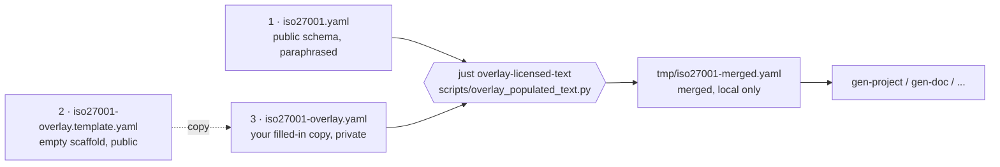

# ISO/IEC 27001:2022 verbatim-text overlay

This page is for a licence holder who wants the standard's own wording in their copy of the schema. The public schema, [iso27001.yaml](iso27001.yaml), holds only the project's own descriptions. The normative text of ISO/IEC 27001:2022 and Amd. 1:2024 is © ISO/IEC and appears nowhere in this repository. A licence holder can keep a **local, private overlay** that puts the standard's wording in place of those descriptions, without forking the schema.

## The three files

Two files are in the repository, and you create the third on your own machine and never publish it.

| # | File | In the repository? | Distributable? | Written by | What it holds |
| --- | --- | --- | --- | --- | --- |
| 1 | [`iso27001.yaml`](iso27001.yaml) | yes | yes (Apache-2.0) | maintainers | The public schema: classes, slots, enums and mappings, with the project's own descriptions. It is complete and usable on its own. |
| 2 | [`iso27001-overlay.template.yaml`](iso27001-overlay.template.yaml) | yes | yes (Apache-2.0) | `just create-empty-overlay` | An empty scaffold: every class with its attributes, every slot, and every enum with its permissible values, each with empty `description:` and `comments:` placeholders. It holds no copyrighted text. Never edit it by hand. |
| 3 | `iso27001-overlay.yaml` | **no**, git ignores it | **no**, local only | **you**, the licence holder | A copy of (2) with the placeholders filled from your licensed copy of the standard. It holds normative text: never commit or publish it. |

`just overlay-licensed-text` writes a fourth file, `tmp/iso27001-merged.yaml`: the merge of (1) and (3). Git ignores it too. It is input for your own generators: do not distribute it.



## Workflow

### Step 1: generate the scaffold

Run this the first time, and again whenever the public schema gains, renames or removes an element. It rewrites `iso27001-overlay.template.yaml`, which the repository keeps current so that a licence holder always has every placeholder to fill.

```bash
just create-empty-overlay
```

### Step 2: copy the scaffold to your private overlay

Do this once, on your own machine. [.gitignore](../../../.gitignore) ignores the new file, so it cannot be committed by accident.

```bash
cp src/iso27001/schema/iso27001-overlay.template.yaml \
   src/iso27001/schema/iso27001-overlay.yaml
```

### Step 3: fill the overlay from your licensed copy

The overlay holds entries like these:

```yaml
classes:
  IsmsObjective:
    description: ''
    comments: []
    attributes:
      objective_statement:
        description: ''
  IsmsPolicy:
    description: ''
    comments: []
```

For each element you want, replace the empty `description:` with the text of the matching clause from **your own licensed copy** of ISO/IEC 27001:2022. The element's `annotations` in [iso27001.yaml](iso27001.yaml) name the clause:

```yaml
classes:
  IsmsPolicy:
    annotations:
      iso27001_clause: "5.2" # the clause to copy text from
  IsmsTopicSpecificPolicy:
    annotations:
      annex_a_control: "5.1" # the Annex A control to copy text from
```

A filled entry looks like this, with placeholders in place of the standard's text so that this page stays distributable:

```yaml
classes:
  IsmsPolicy:
    description: |
      <Paste the verbatim text of ISO/IEC 27001:2022 Clause 5.2 here,
      preserving its lettered list and trailing bullets.>
    comments:
      - "source: ISO/IEC 27001:2022 Clause 5.2"
      - |
        <Optional: paste verbatim implementation guidance from
        ISO/IEC 27002:2022 Clause 5.1 here.>
```

- **`description:`** takes a block scalar (`|`), which keeps a clause's bullets and lettered lists as they are.
- **`comments:`** is a list. Put the clause citation in it, such as `'source: ISO/IEC 27001:2022 Clause 5.2'`, and any guidance from ISO/IEC 27002:2022 that adds to the clause. Leave it as `[]` if you have nothing to add.
- **Fill only what you need.** The merge ignores an empty `description: ''` or `comments: []`, and keeps the public description.
- **Other text keys.** You may also set `title:`, `aliases:`, `see_also:` or `notes:` on any element. These, with `description:` and `comments:`, are the only keys the merge takes.
- **Attributes, slots and enums.** The scaffold lists each class's attributes under the class, every slot under `slots:`, and every enum's permissible values under `enums:`. Fill them in the same way: the merge treats each entry on its own.

### Step 4: merge the overlay into a private schema

```bash
just overlay-licensed-text
```

This runs `scripts/overlay_populated_text.py`, which writes `tmp/iso27001-merged.yaml`: the public schema with your text in place. The script writes only under `tmp/` and refuses any other output path, because the merged file holds the standard's text. Use the merged file as the input to your own `gen-project`, `gen-doc` or validation, and do not redistribute it.

### Step 5: catch up with a changed schema

When the public `iso27001.yaml` changes, regenerate the scaffold and compare it with your overlay to find the new placeholders. Copy each new entry into your overlay and fill it.

```bash
just create-empty-overlay
diff -u src/iso27001/schema/iso27001-overlay.template.yaml \
        src/iso27001/schema/iso27001-overlay.yaml | less
```

## Merge semantics

`overlay_populated_text.py` merges `iso27001-overlay.yaml` into `iso27001.yaml`, key by key, and takes only these descriptive keys:

```text
description, comments, title, aliases, see_also, notes
```

- A non-empty value in the overlay **replaces** the value in the public schema.
- An empty value (`''`, `[]` or a missing key) is ignored, and the public description stays.
- **Structural fields are never overwritten.** `is_a`, `mixins`, `range`, `slots`, `slot_usage`, `annotations`, `*_mappings`, `in_subset` and the _keys_ of `permissible_values` all come from the public schema unchanged. Only a permissible value's inner `description:` can be merged.
- Each permissible value's description is merged on its own, by the same rules.

So the overlay can change only the text a person reads, never the schema's structure or meaning.

## Distribution guard

[`.gitignore`](../../../.gitignore) holds these lines:

```text
tmp/
/src/iso27001/schema/iso27001-overlay.yaml
```

`tests/test_overlay.py` checks that git ignores both, that the scaffold in the repository holds no text, and that it is the scaffold the script writes from the schema. `just apply-sssom-overlay` rewrites only `iso27001.yaml`, never the scaffold or your overlay beside it.

If you fork this repository, **do not remove those lines**. If a private fork needs the merged schema in CI, keep it in a private branch or artefact store. Never push `iso27001-overlay.yaml` or `tmp/iso27001-merged.yaml` to a public remote.
